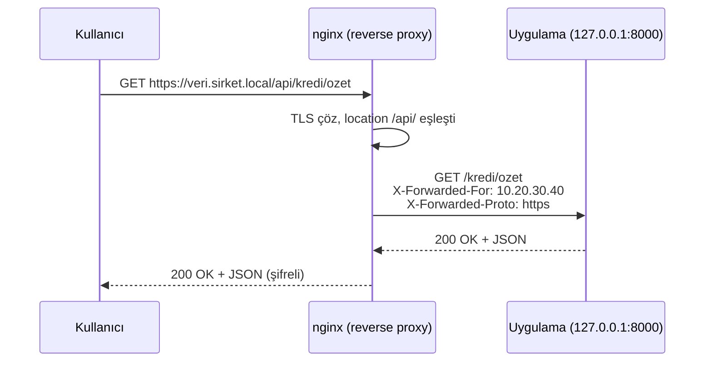

# 8.4 Reverse Proxy: Uygulamanın Önüne nginx Koymak

## Nedir?
**Reverse proxy (ters vekil)**, istemciden gelen istekleri karşılayan ve onları arkadaki bir veya daha fazla uygulama sunucusuna ileten aracı sunucudur. İstemci yalnızca proxy ile konuştuğunu bilir; arkadaki uygulamaları görmez.

**Forward proxy ile farkı:**
- **Forward proxy** istemcinin önündedir; istemciler adına internete çıkar (kurumsal internet proxy'si).
- **Reverse proxy** sunucunun önündedir; sunucular adına istekleri karşılar.

## Hangi problemi çözer?
- **Tek giriş kapısı:** Birçok uygulama tek alan adı ve port üzerinden yayınlanır (`/api`, `/dashboard`).
- **Güvenlik:** Uygulamalar sadece iç ağda/localhost'ta dinler; dışarı açık olan yalnızca proxy'dir.
- **TLS sonlandırma:** HTTPS şifrelemesi proxy'de yapılır; uygulama düz HTTP konuşur ([8.6](06-https-tls.md)).
- **Yük dengeleme, önbellek, rate limit** ([8.5](05-load-balancing.md), [8.7](07-cache-rate-limit.md)).
- **Yavaş istemci koruması:** Proxy yavaş istemcileri tamponlar; uygulama işçileri meşgul kalmaz.

## Nasıl çalışır?



**Header'lar neden önemli?** Uygulama artık isteği nginx'ten aldığı için kullanıcının gerçek IP'sini ve isteğin HTTPS olduğunu bilmez. Bu bilgiler header'larla iletilir:
- `X-Real-IP` / `X-Forwarded-For`: Gerçek istemci IP'si
- `X-Forwarded-Proto`: Orijinal şema (https)
- `Host`: Orijinal alan adı

**`proxy_pass` sonundaki `/` farkı**

| Konfigürasyon | `/api/kredi` isteği arka uca nasıl gider? |
|---|---|
| `location /api/ { proxy_pass http://app:8000; }` | `/api/kredi` (yol aynen) |
| `location /api/ { proxy_pass http://app:8000/; }` | `/kredi` (`/api/` kısmı atılır) |

## Mini örnek
FastAPI + Streamlit'i tek alan adı altında yayınlamak:
```nginx
upstream api      { server 127.0.0.1:8000; }
upstream dashboard { server 127.0.0.1:8501; }

server {
    listen 80;
    server_name veri.sirket.local;

    # Ortak proxy header'ları
    proxy_set_header Host              $host;
    proxy_set_header X-Real-IP         $remote_addr;
    proxy_set_header X-Forwarded-For   $proxy_add_x_forwarded_for;
    proxy_set_header X-Forwarded-Proto $scheme;

    # API
    location /api/ {
        proxy_pass http://api/;
        proxy_read_timeout 60s;
    }

    # Streamlit (WebSocket kullanır)
    location /dashboard/ {
        proxy_pass http://dashboard/dashboard/;
        proxy_http_version 1.1;
        proxy_set_header Upgrade    $http_upgrade;
        proxy_set_header Connection "upgrade";
        proxy_read_timeout 86400;
    }
}
```

Streamlit'in alt yolda çalışması için:
```bash
streamlit run app.py --server.port 8501 --server.baseUrlPath dashboard --server.address 127.0.0.1
```

FastAPI'nin proxy arkasında doğru URL üretmesi için:
```bash
uvicorn main:app --host 127.0.0.1 --port 8000 --proxy-headers --forwarded-allow-ips="127.0.0.1"
```

Docker Compose ile:
```yaml
services:
  api:
    build: ./api                 # dışarıya port açılmaz
  nginx:
    image: nginxinc/nginx-unprivileged
    ports: ["8080:8080"]
    volumes:
      - ./nginx.conf:/etc/nginx/conf.d/default.conf:ro
# nginx.conf içinde: proxy_pass http://api:8000/;
```

## Nerede kullanılır?
- Python API'leri, Streamlit/Dash dashboard'ları, Jupyter, Grafana, Airflow arayüzleri
- Birden çok iç aracı tek alan adı altında toplamak
- Kubernetes'te Ingress Controller'ın yaptığı iş tam olarak budur ([8.9](09-ingress-controller.md))

## Benzerleri ve farkları
- **Doğrudan yayın (uygulama 0.0.0.0'da dinler):** Basit ama TLS, rate limit, log ve güvenlik katmanları yoktur.
- **API Gateway:** Reverse proxy'nin üzerine kimlik doğrulama, kota, versiyon yönetimi ekleyen daha kapsamlı ürünler (Kong — kendisi de nginx tabanlıdır).
- **Service mesh (Istio/Envoy):** Servisler arası (doğu-batı) trafikte her pod'un yanında bir proxy çalışır; nginx genellikle dıştan içe (kuzey-güney) trafikte durur.

**Sık hatalar:**
- WebSocket header'ları (`Upgrade`, `Connection`) eksik → Streamlit "Connecting..." ekranında kalır.
- Uygulamanın loglarında herkesin IP'si `127.0.0.1` görünüyor → `X-Forwarded-For` iletilmiyor veya uygulama okumuyor.
- `502 Bad Gateway` → uygulama çalışmıyor veya yanlış port ([8.8](08-log-hatalar.md)).

## İlgili sayfalar
- [8.5 Load balancing](05-load-balancing.md)
- [8.6 HTTPS ve TLS](06-https-tls.md)
- [7.4 FastAPI](../07-api/04-fastapi.md)
- [1.9 Ağ temelleri](../01-linux/09-ag-temelleri.md)
