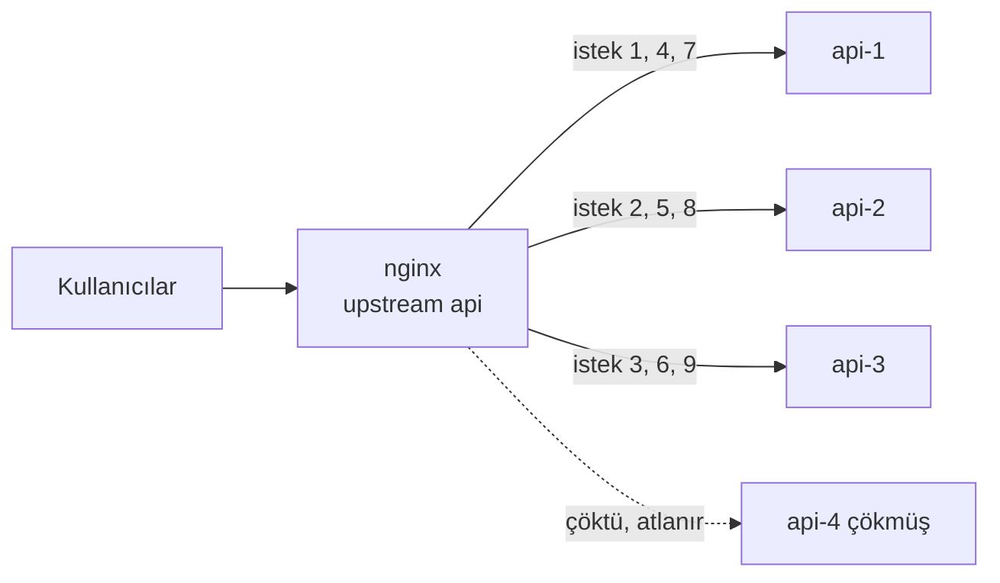

# 8.5 Load Balancing

## Nedir?
**Load balancing (yük dengeleme)**, gelen istekleri aynı uygulamanın birden fazla kopyası (sunucusu) arasında dağıtmaktır. nginx'te `upstream` bloğu ile yapılır.

## Hangi problemi çözer?
- **Kapasite:** Tek sunucunun kaldıramayacağı trafik birden fazla sunucuya yayılır.
- **Yüksek erişilebilirlik:** Bir sunucu çökerse trafik diğerlerine gider; kullanıcı kesinti yaşamaz.
- **Bakım kolaylığı:** Sunucular tek tek devreden çıkarılıp güncellenebilir.

## Nasıl çalışır?



**Dağıtım algoritmaları**

| Yöntem | Direktif | Nasıl? | Ne zaman? |
|---|---|---|---|
| **Round robin** | (varsayılan) | Sırayla | İstekler benzer maliyetteyse |
| **Ağırlıklı** | `server ... weight=3;` | Güçlü sunucuya daha çok | Farklı kapasiteli sunucular |
| **Least connections** | `least_conn;` | En az aktif bağlantısı olana | İstek süreleri farklıysa (uzun raporlar) |
| **IP hash** | `ip_hash;` | Aynı IP hep aynı sunucuya | Oturum bilgisi sunucuda tutuluyorsa |
| **Hash** | `hash $anahtar consistent;` | Belirlenen anahtara göre | Önbellek dağılımı |

**Sağlık kontrolü**
- **Pasif (açık kaynak nginx):** Bir sunucuya istek `max_fails` kez başarısız olursa `fail_timeout` süresince devre dışı bırakılır.
- **Aktif (NGINX Plus, HAProxy, Kubernetes):** Sunucular düzenli olarak yoklanır (`/health`).

**Sunucu parametreleri:** `weight`, `max_fails`, `fail_timeout`, `backup` (diğerleri çökünce devreye girer), `down` (elle devre dışı).

**Yapışkan oturum (sticky session):** Kullanıcının oturum bilgisi sunucunun belleğindeyse, her istekte aynı sunucuya gitmesi gerekir. Streamlit gibi durumlu uygulamalarda önemlidir. Kalıcı çözüm, oturumu paylaşılan bir yerde (Redis, veritabanı) tutmaktır.

## Mini örnek
```nginx
upstream skor_api {
    least_conn;
    server 10.0.0.11:8000 weight=2 max_fails=3 fail_timeout=30s;
    server 10.0.0.12:8000          max_fails=3 fail_timeout=30s;
    server 10.0.0.13:8000 backup;
    keepalive 32;                       # arka uca açık bağlantı havuzu
}

server {
    listen 80;
    server_name skor.sirket.local;

    location / {
        proxy_pass http://skor_api;
        proxy_http_version 1.1;
        proxy_set_header Connection "";  # keepalive için
        proxy_next_upstream error timeout http_502 http_503;   # hata alırsa sonrakini dene
    }
}
```

Hangi sunucunun cevap verdiğini görmek için:
```nginx
add_header X-Upstream $upstream_addr always;
```
```bash
for i in $(seq 1 6); do curl -s -o /dev/null -D - http://skor.sirket.local/health | grep X-Upstream; done
```

## Nerede kullanılır?
- Sanal makinelerde çalışan birden çok API kopyasının önünde
- Docker Compose'da `deploy.replicas` ile çoğaltılan servislerin önünde
- Kubernetes dışındaki eski (legacy) sunucu grupları

## Benzerleri ve farkları
- **Kubernetes Service:** Pod'lar arasında yük dengelemeyi zaten yapar ([5.7](../05-kubernetes/07-service.md)); Kubernetes içinde ayrı nginx upstream'ine genellikle gerek yoktur.
- **L4 ile L7 yük dengeleme:**
  - **L4 (TCP):** Paket içeriğine bakmaz; hızlıdır (HAProxy TCP modu, Kubernetes Service, donanım yük dengeleyiciler, nginx `stream` modülü).
  - **L7 (HTTP):** URL, header, cookie'ye göre karar verir (nginx `http`, Ingress).
- **Donanım / kurumsal yük dengeleyiciler:** F5 BIG-IP, Citrix ADC; bankalarda veri merkezi girişinde sık görülür. Arkalarında yine nginx veya OpenShift Router olabilir.
- **DNS round robin:** Bir alan adına birden çok IP vermek; sağlık kontrolü olmadığı için tek başına yetersizdir.

## İlgili sayfalar
- [8.4 Reverse proxy](04-reverse-proxy.md)
- [5.12 HPA](../05-kubernetes/12-hpa.md)
- [1.9 Ağ temelleri](../01-linux/09-ag-temelleri.md)
