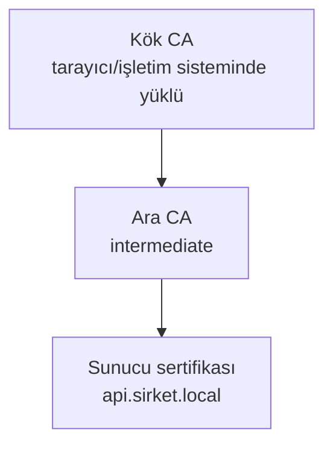

# 8.6 HTTPS ve TLS Sertifikaları

## Nedir?
- **TLS (Transport Layer Security):** İki taraf arasındaki trafiği şifreleyen ve sunucunun kimliğini doğrulayan protokol. Eski adı SSL'dir; "SSL sertifikası" ifadesi alışkanlıktan hâlâ kullanılır.
- **HTTPS:** HTTP'nin TLS üzerinden çalışan hâli. Varsayılan portu **443**.
- **Sertifika:** Bir alan adının (ör. `api.sirket.local`) belirli bir açık anahtara ait olduğunu, güvenilir bir **sertifika otoritesinin (CA)** imzasıyla doğrulayan dijital belge.

## Hangi problemi çözer?
- **Gizlilik:** Ağdaki biri trafiği dinlese bile şifreleri, token'ları ve müşteri verisini okuyamaz.
- **Bütünlük:** Veri yolda değiştirilemez.
- **Kimlik:** Kullanıcı gerçekten doğru sunucuyla konuştuğundan emin olur (sahte sunucu saldırılarına karşı).
- **Uyum:** Bankacılık düzenlemeleri ve iç güvenlik politikaları şifreli iletişimi zorunlu kılar.

## Nasıl çalışır?

**Güven zinciri**

İstemci, sunucu sertifikasından başlayıp güvendiği bir kök CA'ya kadar imzaları doğrular. Kurum içi sistemlerde genellikle **kurumun kendi CA'sı** kullanılır; bu CA şirket bilgisayarlarına önceden yüklenmiştir.

**TLS el sıkışması (sadeleştirilmiş)**
1. İstemci "merhaba" der; desteklediği TLS sürümlerini ve şifre takımlarını bildirir.
2. Sunucu sertifikasını gönderir.
3. İstemci sertifikayı doğrular (zincir, alan adı, son kullanma tarihi).
4. İki taraf ortak bir oturum anahtarı üretir; bundan sonra trafik bu anahtarla simetrik olarak şifrelenir.

**Dosyalar**

| Dosya | İçerik | Paylaşılır mı? |
|---|---|---|
| `sunucu.key` | Özel anahtar | **Asla** (izin: 600) |
| `sunucu.csr` | Sertifika imzalama talebi; CA'ya gönderilir | Evet |
| `sunucu.crt` / `.pem` | Sertifika (+ ara CA zinciri: `fullchain.pem`) | Evet |

**TLS sonlandırma (termination):** Şifre çözme işi nginx'te yapılır, arkadaki uygulamaya düz HTTP gider. Gerekirse nginx → uygulama arası da yeniden şifrelenir (re-encrypt), hatta istemci de sertifika sunar (**mTLS**).

## Mini örnek
**Kurumsal CA için anahtar ve CSR üretmek**
```bash
openssl req -new -newkey rsa:2048 -nodes \
  -keyout api.sirket.local.key \
  -out api.sirket.local.csr \
  -subj "/CN=api.sirket.local" \
  -addext "subjectAltName=DNS:api.sirket.local"
# CSR güvenlik ekibine/CA'ya gönderilir, imzalı .crt geri gelir
```

**Test için kendinden imzalı sertifika**
```bash
openssl req -x509 -newkey rsa:2048 -nodes -days 365 \
  -keyout test.key -out test.crt -subj "/CN=localhost"
```

**nginx HTTPS konfigürasyonu**
```nginx
server {
    listen 80;
    server_name api.sirket.local;
    return 301 https://$host$request_uri;          # HTTP'yi HTTPS'e yönlendir
}

server {
    listen 443 ssl;
    http2 on;                                      # nginx 1.25.1+; eski sürümlerde: listen 443 ssl http2;
    server_name api.sirket.local;

    ssl_certificate     /etc/nginx/tls/fullchain.pem;
    ssl_certificate_key /etc/nginx/tls/api.sirket.local.key;
    ssl_protocols       TLSv1.2 TLSv1.3;

    add_header Strict-Transport-Security "max-age=31536000" always;   # HSTS

    location / {
        proxy_pass http://127.0.0.1:8000;
        proxy_set_header X-Forwarded-Proto https;
    }
}
```

**Kontrol**
```bash
openssl x509 -in api.crt -noout -subject -issuer -dates      # sertifika bilgisi
openssl s_client -connect api.sirket.local:443 -servername api.sirket.local </dev/null
curl -v https://api.sirket.local/health
curl --cacert sirket-ca.pem https://api.sirket.local/health  # kurum CA'sıyla doğrula
```

## Nerede kullanılır?
- Dışa açılan her web uygulaması ve API
- Kubernetes'te Ingress `tls` bölümü ve TLS Secret'ları ([5.8](../05-kubernetes/08-ingress.md)); OpenShift Route TLS modları ([5.17](../05-kubernetes/17-openshift-kavramlari.md))
- Veritabanı bağlantıları (PostgreSQL `sslmode=require`)

## Benzerleri ve farkları
- **Let's Encrypt:** İnternete açık alan adları için ücretsiz, otomatik yenilenen sertifikalar (certbot). Kurum içi alan adlarında kullanılamaz.
- **cert-manager:** Kubernetes'te sertifikaları otomatik alan ve yenileyen araç (Let's Encrypt, kurum CA'sı, Vault ile).
- **TLS sürümleri:** TLS 1.0 ve 1.1 güvensiz kabul edilir; en az TLS 1.2, tercihen 1.3.

**Sık hatalar:**
- **Sertifikanın süresi dolması:** En sık kesinti sebeplerinden biri. Son kullanma tarihleri izlenmeli ve uyarı kurulmalı.
- **Ara sertifika eksik:** Tarayıcı çalışır ama `curl` veya Python "unable to get local issuer certificate" der → `fullchain` kullanın.
- **Alan adı uyuşmazlığı:** Sertifikadaki SAN listesinde olmayan bir adla erişim.
- **Python'da `verify=False`:** Doğrulamayı kapatmak yerine kurum CA'sını tanıtın: `requests.get(url, verify="/etc/ssl/certs/sirket-ca.pem")`.

## İlgili sayfalar
- [8.4 Reverse proxy](04-reverse-proxy.md)
- [7.5 API güvenliği](../07-api/05-api-guvenligi.md)
