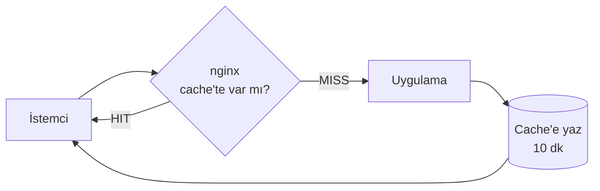

# 8.7 Cache, gzip ve Rate Limit

## Nedir?
nginx'in performans ve koruma için sunduğu üç yetenek:
- **Cache (önbellek):** Arka uçtan gelen cevabı saklayıp aynı istek tekrar geldiğinde uygulamaya gitmeden doğrudan döndürmek.
- **gzip sıkıştırma:** Metin tabanlı cevapları (JSON, HTML, CSS, JS) göndermeden önce sıkıştırmak.
- **Rate limit (hız sınırı):** Bir istemcinin belirli sürede yapabileceği istek sayısını sınırlamak.

## Hangi problemi çözer?
| Sorun | Çözüm |
|---|---|
| Aynı ağır rapor sorgusu dakikada yüzlerce kez çalışıyor | Cache |
| Büyük JSON cevapları yavaş iniyor | gzip (JSON genellikle %70–90 küçülür) |
| Hatalı bir script API'yi saniyede binlerce istekle boğuyor | Rate limit |
| Kaba kuvvet (brute force) giriş denemeleri | Rate limit |

## Nasıl çalışır?

**Proxy cache**

- Anahtar (cache key) varsayılan olarak şema + host + URL'dir.
- `proxy_cache_valid` ile cevap koduna göre saklama süresi verilir.
- Arka uç çökse bile eski cevabı sunmak mümkündür (`proxy_cache_use_stale`).
- `Cache-Control` header'larına uyulur.

**Rate limit: "sızdıran kova" (leaky bucket)**
- `limit_req_zone`: Kimin sayılacağını (ör. IP adresi) ve hızı tanımlar: `rate=10r/s`.
- `limit_req`: Bir location'a uygular. `burst` ani artışlar için tampon, `nodelay` tampondakileri bekletmeden işler.
- Sınırı aşan istek **429 Too Many Requests** alır (`limit_req_status 429;` ile; varsayılan 503'tür).
- `limit_conn`: Eşzamanlı bağlantı sayısını sınırlar.

## Mini örnek
```nginx
http {
    # ---- Cache alanı ----
    proxy_cache_path /var/cache/nginx/rapor levels=1:2 keys_zone=rapor_cache:10m
                     max_size=1g inactive=60m use_temp_path=off;

    # ---- Rate limit alanları ----
    limit_req_zone $binary_remote_addr zone=api_limit:10m rate=10r/s;
    limit_req_zone $binary_remote_addr zone=login_limit:10m rate=5r/m;

    # ---- gzip ----
    gzip on;
    gzip_types application/json text/css application/javascript text/csv image/svg+xml;
    gzip_min_length 1024;
    gzip_comp_level 5;

    server {
        listen 80;
        server_name veri.sirket.local;

        # Ağır ama sık değişmeyen rapor endpoint'i: 10 dk cache
        location /api/rapor/ {
            proxy_pass http://127.0.0.1:8000/rapor/;
            proxy_cache rapor_cache;
            proxy_cache_valid 200 10m;
            proxy_cache_valid 404 1m;
            proxy_cache_use_stale error timeout updating http_500 http_502;
            add_header X-Cache-Status $upstream_cache_status;   # HIT / MISS / STALE
        }

        # Genel API: IP başına 10 istek/sn, 20'lik tampon
        location /api/ {
            limit_req zone=api_limit burst=20 nodelay;
            limit_req_status 429;
            proxy_pass http://127.0.0.1:8000/;
        }

        # Giriş: dakikada 5 deneme
        location = /api/login {
            limit_req zone=login_limit burst=3;
            limit_req_status 429;
            proxy_pass http://127.0.0.1:8000/login;
        }

        # Statik dosyalar: tarayıcı 30 gün saklasın
        location /static/ {
            alias /srv/static/;
            expires 30d;
            add_header Cache-Control "public";
        }
    }
}
```

Kontrol:
```bash
curl -s -o /dev/null -D - http://veri.sirket.local/api/rapor/aylik | grep X-Cache-Status   # MISS, sonra HIT
curl -H "Accept-Encoding: gzip" -s -o /dev/null -w "%{size_download}\n" http://veri.sirket.local/api/rapor/aylik
for i in $(seq 1 50); do curl -s -o /dev/null -w "%{http_code} " http://veri.sirket.local/api/x; done   # 429'lar
```

## Nerede kullanılır?
- **Cache:** Aylık/haftalık değişen rapor ve metrik API'leri, statik dosyalar. **Kişiye özel veri dönen endpoint'ler cache'lenmemelidir** (başka kullanıcıya gösterilme riski).
- **gzip:** JSON API'ler, dashboard'ların JavaScript dosyaları.
- **Rate limit:** Giriş endpoint'leri, dışa açık API'ler, pahalı model skorlama endpoint'leri.

## Benzerleri ve farkları
- **Uygulama içi cache (Redis, `functools.lru_cache`, Streamlit `st.cache_data`):** Uygulamanın kendi mantığıyla cache'leme; daha esnek, kullanıcıya özel olabilir.
- **CDN:** Statik içeriği coğrafi olarak dağıtılmış sunuculardan sunar (internete açık sitelerde).
- **Ingress'te:** ingress-nginx annotation'larıyla aynı ayarlar yapılır: `nginx.ingress.kubernetes.io/limit-rps`, `.../proxy-body-size` ([8.9](09-ingress-controller.md)).
- **API Gateway:** Kullanıcı/API anahtarı bazında kota ve faturalama gibi daha gelişmiş sınırlar.
- **Brotli:** gzip'ten daha iyi sıkıştıran modern alternatif (ek modül gerekir).

**Dikkat:** Proxy arkasında `$binary_remote_addr` proxy'nin IP'si olabilir; gerçek IP için `real_ip` modülü (`set_real_ip_from`, `real_ip_header X-Forwarded-For`) ayarlanmalıdır, yoksa tüm kullanıcılar tek kişi sayılır.

## İlgili sayfalar
- [8.4 Reverse proxy](04-reverse-proxy.md)
- [7.5 API güvenliği](../07-api/05-api-guvenligi.md)
