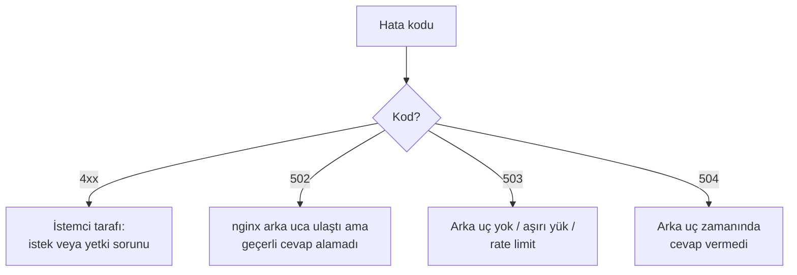

# 8.8 Loglar ve Sık Hatalar: 502, 504, 413

## Nedir?
nginx iki tür log tutar:
- **Access log (erişim kaydı):** Gelen her isteğin bir satırı: kim, ne zaman, hangi URL, hangi durum kodu, ne kadar sürede.
- **Error log (hata kaydı):** nginx'in yaşadığı sorunlar: arka uca bağlanamama, zaman aşımı, konfigürasyon hataları.

Bu sayfa, logları okumayı ve en sık görülen hata kodlarının nedenlerini anlatır.

## Hangi problemi çözer?
Kullanıcı "sayfa açılmıyor" dediğinde sorunun kullanıcıda mı, nginx'te mi, yoksa arkadaki uygulamada mı olduğunu hızla ayırt etmeyi sağlar.

## Nasıl çalışır?

**Access log satırı (varsayılan "combined" format)**
```
10.20.30.40 - - [13/Oct/2026:10:15:32 +0300] "GET /api/kredi/ozet HTTP/1.1" 200 512 "-" "python-requests/2.32"
└─ IP      ┘     └──────── zaman ─────────┘ └─────── istek ─────────────┘ kod boyut     └─ istemci yazılımı ─┘
```

Yanıt sürelerini görmek için özel format:
```nginx
log_format zamanli '$remote_addr [$time_local] "$request" $status '
                   'rt=$request_time urt=$upstream_response_time ua="$upstream_addr"';
access_log /var/log/nginx/access.log zamanli;
```
- `$request_time`: İsteğin toplam süresi (nginx gözünden)
- `$upstream_response_time`: Arka ucun cevap süresi; ikisi arasındaki fark ağ veya istemci yavaşlığıdır.

**Hata sınıflandırması**


**Sık hatalar ve çözümleri**

| Kod | error.log'da tipik mesaj | Olası neden | Çözüm |
|---|---|---|---|
| **502 Bad Gateway** | `connect() failed (111: Connection refused) while connecting to upstream` | Uygulama çalışmıyor, yanlış port, uygulama `127.0.0.1` yerine farklı adreste dinliyor | Uygulamanın ayakta olduğunu ve portu kontrol edin (`ss -tulpn`, `curl 127.0.0.1:8000`) |
| **502** | `upstream prematurely closed connection` | Uygulama istek sırasında çöktü (bellek, hata) | Uygulama loglarına bakın; OOM olup olmadığını kontrol edin |
| **502** | `connect() ... (13: Permission denied)` | SELinux nginx'in ağa bağlanmasını engelliyor (RHEL) | `setsebool -P httpd_can_network_connect 1` |
| **503 Service Unavailable** | `no live upstreams` | Tüm arka uçlar devre dışı | Arka uçların sağlığını kontrol edin |
| **504 Gateway Timeout** | `upstream timed out (110) while reading response header` | Uygulama çok yavaş (ağır sorgu, uzun rapor) | Sorguyu hızlandırın, işi asenkron yapın veya `proxy_read_timeout` artırın |
| **413 Request Entity Too Large** | `client intended to send too large body` | Yüklenen dosya `client_max_body_size` sınırını (varsayılan 1 MB) aşıyor | `client_max_body_size 50m;` |
| **404 Not Found** | `open() "/usr/share/nginx/html/x" failed (2: No such file)` | Yanlış `root`/`alias`, `proxy_pass` yolu hatalı | `location` ve `proxy_pass` sonundaki `/`'yi kontrol edin ([8.4](04-reverse-proxy.md)) |
| **403 Forbidden** | `directory index ... is forbidden` veya `Permission denied` | Klasörde index yok veya nginx kullanıcısının okuma izni yok | Dosya izinleri ([1.3](../01-linux/03-izinler.md)) |
| **400 Bad Request** | `client sent too large header` | Çok büyük cookie/token | `large_client_header_buffers` |
| **499** | (nginx'e özgü) | İstemci cevap gelmeden bağlantıyı kapattı | Genellikle istemci tarafındaki zaman aşımı; arka ucun yavaşlığına bakın |

## Mini örnek
```bash
# Canlı izleme
sudo tail -f /var/log/nginx/access.log /var/log/nginx/error.log

# Son 1000 isteğin durum kodu dağılımı
tail -n 1000 /var/log/nginx/access.log | awk '{print $9}' | sort | uniq -c | sort -rn

# 5xx hataları
grep -E '" 5[0-9]{2} ' /var/log/nginx/access.log | tail -20

# En çok istek yapan IP'ler
awk '{print $1}' /var/log/nginx/access.log | sort | uniq -c | sort -rn | head

# Arka ucu nginx'i atlayarak doğrudan test et
curl -v http://127.0.0.1:8000/health

# Container / Kubernetes'te loglar stdout'a yazılır
docker logs -f web
kubectl logs -n ingress-nginx deploy/ingress-nginx-controller | grep " 502 "
```

Uzun süren rapor endpoint'i için zaman aşımı ayarları:
```nginx
location /api/rapor/ {
    proxy_pass http://127.0.0.1:8000/rapor/;
    proxy_connect_timeout 5s;
    proxy_send_timeout    120s;
    proxy_read_timeout    120s;    # varsayılan 60s
}
```

## Nerede kullanılır?
- Kullanıcı şikâyetlerinde ilk bakılacak yer
- Performans analizi: yavaş endpoint'leri bulmak (`rt=` değerleri)
- Güvenlik: şüpheli IP'ler, tarama girişimleri
- Loglar genellikle merkezi bir sisteme gönderilir (ELK/OpenSearch, Loki) ve Grafana'da izlenir (Bölüm 14)

## Benzerleri ve farkları
- **Uygulama logu ile nginx logu:** nginx "ne oldu"yu (kod, süre), uygulama logu "neden oldu"yu (exception, stack trace) söyler. İkisini `X-Request-Id` header'ıyla eşleştirmek hata takibini çok kolaylaştırır.
- **Zaman aşımını artırmak kalıcı çözüm değildir:** 2 dakikalık rapor isteği yerine, raporu arka planda üretip hazır olunca indirme linki vermek (asenkron iş) daha sağlıklıdır.
- **OpenShift Router:** HAProxy tabanlıdır; benzer 502/503/504 hataları Route ve pod durumu üzerinden incelenir. Route için zaman aşımı annotation ile ayarlanır: `haproxy.router.openshift.io/timeout: 120s`.

## İlgili sayfalar
- [7.2 HTTP durum kodları](../07-api/02-http.md)
- [8.9 Ingress Controller](09-ingress-controller.md)
