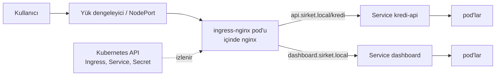

# 8.9 Kubernetes'te nginx: Ingress Controller

## Nedir?
**Ingress Controller**, Kubernetes'teki Ingress kurallarını ([5.8](../05-kubernetes/08-ingress.md)) okuyup gerçek bir reverse proxy konfigürasyonuna çeviren ve dış trafiği karşılayan bileşendir. En yaygın olanı **ingress-nginx**'tir: İçinde nginx çalışır ve Ingress nesneleri değiştikçe `nginx.conf`'u otomatik yeniden üretir.

Bu sayfa, bölümdeki nginx kavramlarının (reverse proxy, TLS, rate limit, zaman aşımı) Kubernetes'te nasıl karşılık bulduğunu gösterir.

## Hangi problemi çözer?
Kubernetes'te pod'lar sürekli değişir; elle nginx konfigürasyonu yazıp IP güncellemek mümkün değildir. Ingress Controller:
- Servisleri ve pod'ları otomatik takip eder,
- Geliştiricinin sadece kısa bir Ingress YAML'ı yazmasını yeter kılar,
- Tüm dış trafik için tek, merkezi yönetilen bir giriş noktası sağlar.

## Nasıl çalışır?



1. Controller, Kubernetes API'sini izler (Ingress, Service, Endpoints, TLS Secret'ları).
2. Değişiklik olunca nginx konfigürasyonunu üretir ve kesintisiz yeniden yükler.
3. Trafiği Service'in arkasındaki pod IP'lerine doğrudan iletir.

**nginx kavramı → Kubernetes karşılığı**

| nginx (sunucuda) | ingress-nginx (Kubernetes'te) |
|---|---|
| `server_name` | Ingress `rules[].host` |
| `location /api/` | Ingress `paths[].path` |
| `upstream` + `proxy_pass` | `backend.service` |
| `ssl_certificate` | `tls[].secretName` (TLS Secret) |
| `client_max_body_size` | annotation `nginx.ingress.kubernetes.io/proxy-body-size` |
| `proxy_read_timeout` | annotation `.../proxy-read-timeout` |
| `limit_req` | annotation `.../limit-rps` |
| `rewrite` | annotation `.../rewrite-target` |
| Sticky session | annotation `.../affinity: cookie` |
| WebSocket ayarları | Otomatik desteklenir |
| access/error log | Controller pod'unun logları (`kubectl logs`) |

## Mini örnek
Streamlit dashboard'u ve API'yi annotation'larla yayınlamak:
```yaml
apiVersion: networking.k8s.io/v1
kind: Ingress
metadata:
  name: veri-uygulamalari
  namespace: veri-prod
  annotations:
    nginx.ingress.kubernetes.io/proxy-body-size: "50m"
    nginx.ingress.kubernetes.io/proxy-read-timeout: "120"
    nginx.ingress.kubernetes.io/limit-rps: "20"
    nginx.ingress.kubernetes.io/affinity: "cookie"          # Streamlit oturumu için
spec:
  ingressClassName: nginx
  tls:
    - hosts: [veri.sirket.local]
      secretName: veri-tls
  rules:
    - host: veri.sirket.local
      http:
        paths:
          - path: /api
            pathType: Prefix
            backend:
              service: { name: kredi-api, port: { number: 80 } }
          - path: /
            pathType: Prefix
            backend:
              service: { name: dashboard, port: { number: 8501 } }
```

```bash
# TLS Secret'ı sertifikadan oluştur
kubectl create secret tls veri-tls --cert=fullchain.pem --key=veri.key -n veri-prod

kubectl apply -f ingress.yaml
kubectl get ingress -n veri-prod
kubectl describe ingress veri-uygulamalari -n veri-prod

# Controller tarafı
kubectl get pods -n ingress-nginx
kubectl logs -n ingress-nginx deploy/ingress-nginx-controller --tail=100
kubectl exec -n ingress-nginx deploy/ingress-nginx-controller -- cat /etc/nginx/nginx.conf | less   # üretilen konfigürasyon
```

**Kurulum (cluster yöneticisi için):**
```bash
helm upgrade --install ingress-nginx ingress-nginx \
  --repo https://kubernetes.github.io/ingress-nginx \
  --namespace ingress-nginx --create-namespace
```

## Nerede kullanılır?
- Standart Kubernetes cluster'larında (EKS, AKS, GKE, kurum içi vanilla Kubernetes) HTTP trafiğini içeri almak
- OpenShift'te varsayılan yol **Route + HAProxy tabanlı Router**'dır; standart Ingress nesneleri de kabul edilir ve Route'a çevrilir ([5.17](../05-kubernetes/17-openshift-kavramlari.md))

## Benzerleri ve farkları
| Controller | Not |
|---|---|
| **ingress-nginx** (Kubernetes topluluğu) | En yaygın; annotation'lar `nginx.ingress.kubernetes.io/` ile başlar |
| **NGINX Ingress Controller** (F5/NGINX Inc.) | Ayrı bir ürün; annotation'ları farklıdır (`nginx.org/`), karıştırılmamalı |
| **Traefik** | Otomatik keşif, kendi CRD'leri |
| **HAProxy Ingress / OpenShift Router** | HAProxy tabanlı |
| **Kong Ingress** | API gateway özellikleriyle |
| **Gateway API uygulamaları** | Ingress'in halefi olan yeni standart ([5.8](../05-kubernetes/08-ingress.md)) |

**Not:** Kubernetes topluluğunun ingress-nginx projesi bakım modu ve emeklilik planı açıklamıştır; yeni kurulumlarda Gateway API tabanlı çözümler değerlendirilmelidir. Mevcut kurumunuzda hangi controller'ın kullanıldığını platform ekibine danışın; kavramlar (host, path, TLS, zaman aşımı, body size) hepsinde aynıdır.

## İlgili sayfalar
- [5.8 Ingress](../05-kubernetes/08-ingress.md)
- [8.4 Reverse proxy](04-reverse-proxy.md)
- [8.8 Loglar ve hatalar](08-log-hatalar.md)
