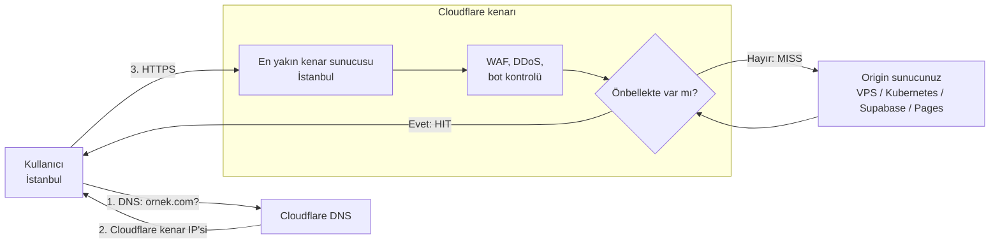

# 8.10 CDN ve Kenar Ağı: Cloudflare Nedir?

## Nedir?
**CDN (Content Delivery Network, içerik dağıtım ağı)**, dünyanın birçok şehrine yayılmış sunuculardan oluşan bir ağdır. Kullanıcı, sitenizin sunucusuna (**origin**) doğrudan değil, kendisine en yakın CDN sunucusuna bağlanır. Bu sunuculara **kenar (edge)** denir.

**Cloudflare**, CDN ile başlayıp bugün DNS, TLS sertifikası, WAF (web uygulama güvenlik duvarı), DDoS koruması, bot yönetimi, tünel ve sıfır güven (Zero Trust) erişimi gibi hizmetleri tek bir kenar ağında sunan şirkettir. Sitenizin önünde duran, internet ölçeğinde bir **reverse proxy** olarak düşünülebilir ([8.4](04-reverse-proxy.md)).

## Hangi problemi çözer?
- **Hız:** Statik dosyalar (resim, JS, CSS) kullanıcıya yakın kenardan sunulur; origin'e giden istek azalır.
- **Güvenlik:** Saldırılar origin'e ulaşmadan kenarda durdurulur (DDoS, SQL injection denemeleri, kötü botlar). Origin'in gerçek IP adresi gizlenir.
- **HTTPS kolaylığı:** Ücretsiz ve otomatik yenilenen sertifika.
- **Kolay yayına alma:** Ev bilgisayarındaki veya kapalı ağdaki bir uygulamayı, port açmadan internete güvenli şekilde açmak (Tunnel).
- **Tek panel:** Alan adı, DNS, sertifika, güvenlik kuralları ve önbellek aynı yerden yönetilir.

## Nasıl çalışır?

**İsteğin yolu**


**Anycast:** Cloudflare'in yüzlerce şehirdeki sunucuları **aynı IP adreslerini** duyurur. İnternet yönlendirmesi kullanıcıyı otomatik olarak en yakın noktaya götürür. Bu, hem hızı hem de saldırı trafiğinin dünyaya dağılarak sönümlenmesini sağlar.

**Proxied (turuncu bulut) ve DNS only (gri bulut)**
| | Proxied (turuncu) | DNS only (gri) |
|---|---|---|
| DNS cevabı | Cloudflare'in IP'leri | Origin'in gerçek IP'si |
| Trafik Cloudflare'den geçer mi? | Evet | Hayır, sadece isim çözümleme |
| CDN, WAF, DDoS, SSL | Çalışır | Çalışmaz |
| Hangi trafik? | HTTP/HTTPS (belirli portlar: 80, 443, 8080, 8443 vb.) | Her şey (SSH, veritabanı, e-posta) |
| Kullanım | Web siteleri, API'ler | SSH sunucusu, mail sunucusu, doğrulama kayıtları |

**Önbellek (cache) temelleri**
- Varsayılan olarak **statik dosya uzantıları** (resim, CSS, JS, font, PDF...) önbelleğe alınır; HTML ve API cevapları alınmaz.
- Origin'in gönderdiği `Cache-Control` başlıkları ve Cloudflare'deki **Cache Rules** davranışı belirler.
- Cevaptaki `cf-cache-status` başlığı: `HIT` (önbellekten), `MISS` (origin'den alındı), `DYNAMIC` (önbelleğe uygun değil), `BYPASS`, `EXPIRED`.
- Yeni sürüm yayınlandığında **purge** (önbellek temizleme) gerekebilir.

**Cloudflare'in Cloudflare'e özel hata kodları**
| Kod | Anlamı | Tipik neden |
|---|---|---|
| **520** | Origin boş veya anlaşılmayan cevap verdi | Uygulama çöktü, başlıklar çok büyük |
| **521** | Origin bağlantıyı reddetti | Web sunucusu kapalı, firewall Cloudflare IP'lerini engelliyor |
| **522** | Origin'e bağlantı zaman aşımı | Sunucu erişilemez, yanlış IP, port kapalı |
| **523** | Origin'e ulaşılamıyor | DNS kaydı yanlış, ağ yönlendirmesi yok |
| **524** | Origin bağlantıyı kabul etti ama zamanında cevap vermedi | Uzun süren sorgu/rapor; varsayılan sınır 100 saniye ([9.26](../09-veri-depolama/26-query-timeout.md)) |
| **525** | Origin ile SSL el sıkışması başarısız | Origin'de HTTPS yok veya yanlış yapılandırılmış ([8.12](12-cloudflare-ssl-tls.md)) |
| **526** | Origin sertifikası geçersiz | Full (strict) modunda süresi dolmuş/self-signed sertifika |

**Gerçek istemci IP'si:** Proxied trafikte origin, bağlantıyı Cloudflare IP'lerinden görür. Gerçek kullanıcı IP'si `CF-Connecting-IP` ve `X-Forwarded-For` başlıklarında gelir. Loglarda ve rate limit'te doğru IP'yi görmek için nginx'in `real_ip` modülü kullanılır.

**Diğer Cloudflare hizmetleri (kavramsal harita)**
| Hizmet | Ne işe yarar? | Kitapta karşılığı |
|---|---|---|
| **DNS** | Alan adının yetkili DNS sunucusu | [8.11](11-cloudflare-dns.md) |
| **SSL/TLS** | Kenar ve origin sertifikaları | [8.12](12-cloudflare-ssl-tls.md) |
| **WAF, DDoS, Bot Management, Turnstile** | Uygulama güvenliği | [8.13](13-waf-ddos-bot.md) |
| **Tunnel, Access, WARP (Zero Trust)** | Port açmadan yayın, kimlik tabanlı erişim | [8.14](14-tunnel-zero-trust.md) |
| **Pages** | Statik site / frontend barındırma (Git'e bağlı otomatik dağıtım) | [6.1 CI/CD](../06-ci-cd/01-ci-cd-nedir.md) |
| **Workers** | Kenarda çalışan küçük sunucusuz (serverless) kodlar | — |
| **R2** | S3 uyumlu nesne depolama, çıkış (egress) ücreti yok | [9.15](../09-veri-depolama/15-nesne-depolama.md) |
| **D1, KV** | Kenarda SQLite tabanlı veritabanı, anahtar–değer deposu | — |
| **Registrar** | Alan adı satın alma/yenileme (maliyet fiyatına) | — |

## Mini örnek
**Bir sitenin Cloudflare'den geçip geçmediğini görmek**
```bash
dig +short ornek.com                         # Cloudflare IP'leri (104.x, 172.67.x...) dönüyorsa proxied
curl -sI https://ornek.com | grep -i -E "server|cf-ray|cf-cache-status"
# server: cloudflare
# cf-ray: 8d2f...-IST                        # isteği karşılayan kenar (IST = İstanbul)
# cf-cache-status: HIT
```

**nginx'te gerçek istemci IP'si**
```nginx
# Cloudflare IP aralıkları: https://www.cloudflare.com/ips/ (listeyi düzenli güncelleyin)
set_real_ip_from 173.245.48.0/20;
set_real_ip_from 103.21.244.0/22;
# ... diğer aralıklar ...
real_ip_header CF-Connecting-IP;
```

**Origin'i sadece Cloudflare'e açmak (ufw)**
```bash
for ip in $(curl -s https://www.cloudflare.com/ips-v4); do
  sudo ufw allow from "$ip" to any port 443 proto tcp
done
sudo ufw deny 443/tcp        # geri kalan herkes doğrudan origin'e gelemesin
```
Daha da iyisi: Tunnel ile origin'de hiç port açmamak ([8.14](14-tunnel-zero-trust.md)).

**Önbellek temizleme (API)**
```bash
curl -X POST "https://api.cloudflare.com/client/v4/zones/$ZONE_ID/purge_cache" \
  -H "Authorization: Bearer $CF_API_TOKEN" -H "Content-Type: application/json" \
  --data '{"files":["https://ornek.com/assets/app.js"]}'
```

## Nerede kullanılır?
- Kişisel ve kurumsal web siteleri, veri portalları, dashboard'lar
- Supabase, Vercel, VPS gibi farklı yerlerde çalışan servislerin önünde tek bir alan adı ve güvenlik katmanı
- Kurum içi bir uygulamayı VPN'siz, SSO ile sınırlı kişilere açmak
- Bankalarda: internete açık kurumsal siteler, kampanya sayfaları ve API'ler önünde (Cloudflare veya muadilleri)

## Benzerleri ve farkları
| Ürün | Not |
|---|---|
| **Akamai** | En eski ve büyük CDN'lerden; bankacılık ve büyük kurumsal müşterilerde yaygın |
| **Imperva, F5 (Distributed Cloud), Radware** | WAF ve DDoS odaklı kurumsal çözümler |
| **AWS CloudFront + AWS WAF + Shield** | AWS içi eşdeğer |
| **Azure Front Door, Google Cloud CDN / Armor** | Bulut sağlayıcı eşdeğerleri |
| **Fastly** | Geliştirici odaklı, programlanabilir kenar |
| **nginx** | Tek sunucu/cluster seviyesinde reverse proxy; Cloudflare internet ölçeğinde onun önünde durur, birbirinin yerine değil birlikte kullanılır |

## İlgili sayfalar
- [8.4 Reverse proxy](04-reverse-proxy.md)
- [8.7 Cache ve rate limit](07-cache-rate-limit.md)
- [1.9 Ağ temelleri](../01-linux/09-ag-temelleri.md)
- [8.11 Cloudflare DNS](11-cloudflare-dns.md)
