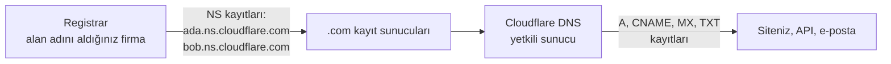

# 8.11 Cloudflare DNS: Alan Adı, Kayıtlar ve E-posta Doğrulama

## Nedir?
DNS'in genel çalışması [1.9](../01-linux/09-ag-temelleri.md)'da anlatıldı. Bu sayfa, **internete açık bir alan adını** (ör. `ornek.com`) Cloudflare'de yönetirken karşılaşılan kavramları anlatır: alan adını Cloudflare'e taşımak, kayıt türleri, proxied/DNS only seçimi, TTL ve e-posta güvenliği kayıtları (SPF, DKIM, DMARC).

Cloudflare bu durumda alan adınızın **yetkili (authoritative) DNS sunucusu** olur: "`ornek.com` nerede?" sorusuna son cevabı o verir.

## Hangi problemi çözer?
- Alan adını sitenize, API'nize, e-posta sağlayıcınıza bağlamak
- Kayıt değişikliklerinin hızlı yayılması (birkaç dakika)
- CDN, WAF ve SSL'in devreye girmesi (proxied kayıtlarla)
- Sahte e-postaların sizin alan adınızdan gönderilmesini zorlaştırmak (SPF, DKIM, DMARC)
- Servis doğrulamaları (Google Search Console, Microsoft 365, sertifika sağlayıcıları) için TXT kayıtları

## Nasıl çalışır?

**Alan adının Cloudflare'e bağlanması**

1. Cloudflare'de site (zone) eklenir; mevcut kayıtlar taranır.
2. Alan adını satın aldığınız yerde (registrar) **nameserver**'lar Cloudflare'in verdikleriyle değiştirilir.
3. Değişiklik birkaç dakika ile 24–48 saat arasında yayılır; sonrasında tüm kayıtlar Cloudflare'den yönetilir.

**Kayıt türleri**
| Kayıt | Anlamı | Örnek |
|---|---|---|
| `A` | Ad → IPv4 | `ornek.com → 203.0.113.10` |
| `AAAA` | Ad → IPv6 | |
| `CNAME` | Ad → başka ad | `www → ornek.com`, `app → ornek.pages.dev` |
| `MX` | E-postanın teslim edileceği sunucu ve öncelik | `10 mx1.mail-saglayici.com` |
| `TXT` | Serbest metin: doğrulama, SPF, DKIM, DMARC | `google-site-verification=...` |
| `CAA` | Bu alan adı için hangi sertifika otoritelerinin sertifika verebileceği | `0 issue "letsencrypt.org"` |
| `NS` | Alt alan adını başka DNS sunucusuna devretmek | `lab.ornek.com → başka sağlayıcı` |
| `SRV` | Servis, port ve öncelik bilgisi | Bazı iletişim protokolleri |

**Kök alan adında CNAME (CNAME flattening):** DNS standardı kök alan adında (`ornek.com`) CNAME kaydına izin vermez. Cloudflare, kök kayıttaki CNAME'i arka planda çözüp A/AAAA olarak döndürür; böylece `ornek.com`'u doğrudan `ornek.pages.dev` gibi bir hedefe yönlendirebilirsiniz.

**TTL (Time To Live):** Bir DNS cevabının ne kadar süre önbellekte tutulacağı. Proxied kayıtlarda "Auto" (Cloudflare yönetir) kullanılır; DNS only kayıtlarda göç öncesi TTL'i düşürmek (ör. 300 saniye) değişikliğin hızlı yayılmasını sağlar.

**Proxied kayıt tuzakları**
- **Origin IP sızıntısı:** Web kaydı proxied olsa bile aynı IP'yi gösteren DNS only bir kayıt (`mail`, `ftp`, `direct`), geçmiş DNS kayıtları veya sunucunun gönderdiği e-postaların başlıkları origin IP'yi ortaya çıkarabilir. Saldırgan Cloudflare'i atlayıp doğrudan origin'e gider. Çözüm: origin'i sadece Cloudflare IP'lerine açmak veya Tunnel.
- **HTTP dışı trafik:** SSH, PostgreSQL, Redis gibi servisler proxied kayıt üzerinden çalışmaz; ya DNS only (ve güçlü firewall) ya da Tunnel/Access kullanılır.
- **Doğrulama kayıtları:** Bazı sağlayıcıların istediği CNAME kayıtları DNS only olmalıdır.

**E-posta güvenliği kayıtları**
| Kayıt | Ne yapar? | Örnek |
|---|---|---|
| **SPF** (TXT) | Alan adınız adına hangi sunucuların e-posta gönderebileceği | `v=spf1 include:_spf.google.com ~all` |
| **DKIM** (TXT) | Giden e-postaların dijital imzasını doğrulamak için açık anahtar | `selector1._domainkey` → `v=DKIM1; k=rsa; p=MIIB...` |
| **DMARC** (TXT) | SPF/DKIM başarısız olursa alıcı ne yapsın, raporlar nereye gitsin | `_dmarc` → `v=DMARC1; p=quarantine; rua=mailto:dmarc@ornek.com` |

DMARC politikası genellikle `p=none` (sadece izle) ile başlar, raporlar incelendikten sonra `quarantine` ve `reject`'e yükseltilir. E-posta hiç göndermeyen alan adları için `v=spf1 -all` ve `p=reject` sahteciliği engeller.

**DNSSEC:** DNS cevaplarını kriptografik olarak imzalar; araya girip sahte cevap verilmesini (DNS spoofing) engeller. Cloudflare'de tek tıkla açılır, ardından registrar'a bir **DS kaydı** eklenir.

## Mini örnek
**Tipik bir veri sitesi için kayıtlar**
```
Tür    Ad        Hedef                          Proxy
A      @         203.0.113.10                   Proxied     # ana site (VPS)
CNAME  www       ornek.com                      Proxied
CNAME  app       ornek-app.pages.dev            Proxied     # Cloudflare Pages
CNAME  api       tunnel-uuid.cfargotunnel.com   Proxied     # Tunnel ile yayınlanan API
A      ssh       203.0.113.10                   DNS only    # dikkat: origin IP görünür
MX     @         10 mx1.mail-saglayici.com      —
TXT    @         "v=spf1 include:_spf.mail-saglayici.com -all"
TXT    _dmarc    "v=DMARC1; p=quarantine; rua=mailto:dmarc@ornek.com"
CAA    @         0 issue "letsencrypt.org"
```

**Kontrol komutları**
```bash
dig ornek.com NS +short                    # Cloudflare nameserver'ları görünmeli
dig app.ornek.com +short                   # proxied → Cloudflare IP'leri
dig _dmarc.ornek.com TXT +short
dig @1.1.1.1 ornek.com A                   # belirli bir çözümleyiciye sor
nslookup -type=mx ornek.com                # Windows'ta da çalışır
```

**API ile kayıt eklemek (otomasyon)**
```bash
curl -X POST "https://api.cloudflare.com/client/v4/zones/$ZONE_ID/dns_records" \
  -H "Authorization: Bearer $CF_API_TOKEN" -H "Content-Type: application/json" \
  --data '{"type":"CNAME","name":"rapor","content":"ornek-rapor.pages.dev","proxied":true}'
```
API token'ı sadece ilgili zone ve "DNS:Edit" yetkisiyle oluşturun; global API anahtarını kullanmayın ([15.7](../15-guvenlik/07-secret-yonetimi.md)). Terraform'un Cloudflare sağlayıcısı ile DNS kayıtları kod olarak da yönetilebilir.

## Nerede kullanılır?
- Kişisel/kurumsal alan adlarının yönetimi
- Siteyi bir barındırma ortamından diğerine taşırken (VPS → Pages, sunucu değişimi) kesintisiz geçiş
- E-posta sağlayıcısı kurulumu ve sahte e-posta koruması
- Alt alan adlarıyla servisleri ayırmak (`api.`, `app.`, `docs.`, `status.`)

## Benzerleri ve farkları
- **Kurum içi DNS (Active Directory DNS, BIND, Infoblox):** `*.sirket.local` gibi iç adlar; internetten görünmez ([15.3](../15-guvenlik/03-active-directory.md)).
- **Split-horizon DNS:** Aynı adın içeriden ve dışarıdan farklı IP'ye çözülmesi; kurumlarda yaygındır.
- **Diğer yetkili DNS hizmetleri:** AWS Route 53, Azure DNS, Google Cloud DNS, registrar'ın kendi DNS'i.
- **1.1.1.1 / 8.8.8.8:** Bunlar **çözümleyici (resolver)** hizmetleridir; sizin adınıza başka alan adlarını sorarlar. Yetkili DNS ile karıştırılmamalıdır.

## İlgili sayfalar
- [1.9 Ağ temelleri](../01-linux/09-ag-temelleri.md)
- [8.10 CDN ve Cloudflare](10-cdn-edge-cloudflare.md)
- [8.12 Cloudflare SSL/TLS](12-cloudflare-ssl-tls.md)
