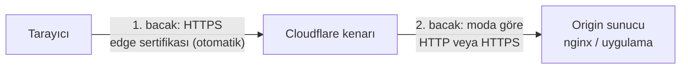
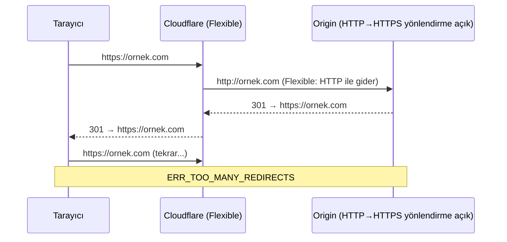

# 8.12 Cloudflare'de SSL/TLS: Şifreleme Modları ve Sertifikalar

## Nedir?
TLS'in genel çalışması, sertifika ve HTTPS kavramları [8.6](06-https-tls.md)'da anlatıldı. Cloudflare devreye girdiğinde bağlantı **iki parçaya** bölünür:
1. **Kullanıcı ↔ Cloudflare kenarı:** Cloudflare'in **edge certificate** (kenar sertifikası) ile şifrelenir.
2. **Cloudflare kenarı ↔ origin sunucunuz:** Sizin sunucunuzdaki sertifikayla şifrelenir (veya şifrelenmez!).

**SSL/TLS şifreleme modu**, bu ikinci parçanın nasıl kurulacağını belirleyen ayardır ve Cloudflare kurulumunun en kritik ayarlarından biridir.

## Hangi problemi çözer?
- Sitenin tarayıcıda "güvenli" görünmesi için ücretsiz, otomatik yenilenen sertifika
- Origin'e giden trafiğin de şifrelenmesi ve araya girilememesi
- Yanlış yapılandırmadan kaynaklanan yaygın hataları anlamak: **sonsuz yönlendirme döngüsü (ERR_TOO_MANY_REDIRECTS)**, **525**, **526**
- Eski ve zayıf TLS sürümlerini kapatmak, HTTPS'i zorunlu kılmak

## Nasıl çalışır?

**İki bacaklı bağlantı**


**Şifreleme modları**
| Mod | Cloudflare → origin | Sertifika doğrulanır mı? | Değerlendirme |
|---|---|---|---|
| **Off** | HTTP | — | HTTPS yok; kullanmayın |
| **Flexible** | **HTTP** (şifresiz) | — | Kullanıcı kilit simgesi görür ama 2. bacak açıktır. Sadece origin'de HTTPS kurmak mümkün değilse, geçici olarak |
| **Full** | HTTPS | **Hayır** (self-signed veya süresi dolmuş sertifika kabul edilir) | Şifreli ama araya girmeye karşı tam koruma yok |
| **Full (strict)** | HTTPS | **Evet** (geçerli, süresi dolmamış, alan adıyla eşleşen; güvenilir CA veya Cloudflare Origin CA) | **Önerilen** |
| **Strict (SSL-Only Origin Pull)** | Her zaman HTTPS, sıkı doğrulama | Evet | Kurumsal (Enterprise) seçenek |

Yeni hesaplarda Cloudflare'in origin'i tarayıp uygun modu kendisi seçen **otomatik** bir seçeneği de bulunur; yine de hangi modun etkin olduğunu panelden kontrol edin.

**Sonsuz yönlendirme döngüsü (Flexible tuzağı)**

Çözüm: Origin'e sertifika kurup modu **Full (strict)** yapmak; HTTP→HTTPS yönlendirmesini Cloudflare'in **Always Use HTTPS** ayarına bırakmak.

**Origin'de hangi sertifika?**
| Seçenek | Not |
|---|---|
| **Cloudflare Origin CA sertifikası** | Cloudflare panelinden üretilir, 15 yıla kadar geçerli olabilir; **sadece Cloudflare tarafından güvenilir** (tarayıcılar güvenmez). Origin sadece Cloudflare arkasındaysa en kolay yol |
| **Let's Encrypt (certbot)** | Herkesin güvendiği ücretsiz sertifika; 90 günde bir otomatik yenilenir. DNS doğrulaması için Cloudflare API eklentisi kullanılabilir |
| **Kurumsal / ticari CA** | Kurumlarda sertifika yönetimi ekibi üzerinden |
| **Tunnel** | Cloudflare Tunnel kullanılıyorsa origin'e gelen bağlantı tünel içinde şifrelidir; origin'de yerel HTTP yeterli olabilir ([8.14](14-tunnel-zero-trust.md)) |

**Diğer önemli ayarlar**
| Ayar | Ne yapar? |
|---|---|
| **Always Use HTTPS** | Tüm HTTP isteklerini kenarda HTTPS'e yönlendirir |
| **HSTS** | Tarayıcıya "bu siteye bir süre sadece HTTPS ile gel" der. Geri alınması zordur (tarayıcılar `max-age` boyunca hatırlar); HTTPS'in her alt alan adında çalıştığından emin olduktan sonra açın |
| **Minimum TLS Version** | TLS 1.0/1.1'i kapatmak için 1.2 (veya daha yüksek) |
| **TLS 1.3** | Daha hızlı ve güvenli el sıkışma; açık tutun |
| **Automatic HTTPS Rewrites** | Sayfadaki `http://` bağlantılarını mümkünse `https://` yapar (karışık içerik uyarılarını azaltır) |
| **Authenticated Origin Pulls (mTLS)** | Cloudflare origin'e bağlanırken **istemci sertifikası** sunar; origin sadece bu sertifikayı gösteren bağlantıları kabul eder. Saldırganın Cloudflare'i atlamasını engeller |
| **Edge Certificates / Advanced Certificate** | Varsayılan Universal SSL birinci seviye alt alan adlarını kapsar (`*.ornek.com`); `a.b.ornek.com` gibi derin alt alan adları için ek sertifika gerekir |

## Mini örnek
**Origin'de nginx + Cloudflare Origin CA sertifikası (Full strict)**
```nginx
server {
    listen 443 ssl;
    http2 on;
    server_name ornek.com www.ornek.com;

    ssl_certificate     /etc/ssl/cloudflare/ornek.com.pem;      # Origin CA sertifikası
    ssl_certificate_key /etc/ssl/cloudflare/ornek.com.key;      # özel anahtar (chmod 600)

    # İsteğe bağlı: Authenticated Origin Pulls
    ssl_client_certificate /etc/ssl/cloudflare/origin-pull-ca.pem;
    ssl_verify_client on;

    location / {
        proxy_pass http://127.0.0.1:8501;
        proxy_set_header Host $host;
        proxy_set_header X-Forwarded-Proto https;
    }
}
```
`http2 on;` söz dizimi nginx 1.25.1 ve sonrası içindir; eski sürümlerde `listen 443 ssl http2;` yazılır.

**Let's Encrypt sertifikasını DNS doğrulamasıyla almak**
```bash
sudo apt install certbot python3-certbot-dns-cloudflare
# /root/.secrets/cloudflare.ini  (chmod 600):  dns_cloudflare_api_token = <Zone:DNS:Edit yetkili token>
sudo certbot certonly --dns-cloudflare \
  --dns-cloudflare-credentials /root/.secrets/cloudflare.ini \
  -d ornek.com -d '*.ornek.com'
```

**Kontrol**
```bash
# Kullanıcının gördüğü (edge) sertifika
echo | openssl s_client -connect ornek.com:443 -servername ornek.com 2>/dev/null \
  | openssl x509 -noout -issuer -subject -dates

# Origin'in sertifikası (Cloudflare'i atlayarak, sadece yetkili kişiler/test için)
curl -vk --resolve ornek.com:443:203.0.113.10 https://ornek.com 2>&1 | grep -E "subject|issuer|expire"
```

**Hata → neden tablosu**
| Belirti | Olası neden | Çözüm |
|---|---|---|
| ERR_TOO_MANY_REDIRECTS | Flexible mod + origin HTTPS'e yönlendiriyor | Full (strict) + origin sertifikası |
| 525 SSL handshake failed | Full/strict modda origin 443'te HTTPS sunmuyor | Origin'de TLS'i yapılandırın |
| 526 Invalid SSL certificate | Strict modda origin sertifikası geçersiz/süresi dolmuş/ad uyuşmuyor | Origin CA veya geçerli sertifika |
| Karışık içerik (mixed content) uyarısı | Sayfa `http://` kaynak yüklüyor | Kaynakları `https://` yapın, Automatic HTTPS Rewrites |
| Uygulama kendini `http` sanıyor, yanlış link üretiyor | Proxy başlıkları iletilmiyor | `X-Forwarded-Proto` başlığını iletin, uygulamada "proxy arkasında" ayarını açın |

## Nerede kullanılır?
- Cloudflare arkasındaki her web sitesi ve API
- Kişisel projelerde VPS veya ev sunucusu üzerinde barınan uygulamalar
- Kurumsal sitelerde sertifika yönetiminin kenar ve origin olarak ayrılması

## Benzerleri ve farkları
- **Doğrudan nginx + Let's Encrypt:** Cloudflare olmadan tek bacaklı TLS; sertifika sunucuda ([8.6](06-https-tls.md)).
- **Kurumsal TLS sonlandırma:** Bankalarda TLS genellikle F5 gibi bir load balancer'da veya WAF cihazında sonlandırılır ve içeride yeniden şifrelenir; Cloudflare'in Full (strict) modu bunun internet ölçeğindeki karşılığıdır.
- **mTLS:** Normal TLS'te sadece sunucu kimliğini kanıtlar; mTLS'te istemci de sertifika gösterir (Authenticated Origin Pulls, servisler arası güvenlik, [15.8](../15-guvenlik/08-sifreleme.md)).

## İlgili sayfalar
- [8.6 HTTPS ve TLS sertifikaları](06-https-tls.md)
- [8.10 CDN ve Cloudflare](10-cdn-edge-cloudflare.md)
- [8.13 WAF, DDoS ve bot koruması](13-waf-ddos-bot.md)
- [15.8 Şifreleme](../15-guvenlik/08-sifreleme.md)
