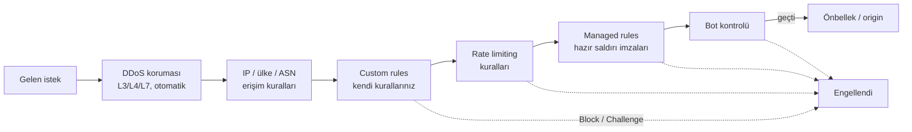

# 8.13 WAF, DDoS ve Bot Koruması

## Nedir?
İnternete açık bir uygulamayı kenarda (origin'e ulaşmadan önce) koruyan üç katman:
- **WAF (Web Application Firewall, web uygulama güvenlik duvarı):** HTTP isteklerinin **içeriğine** bakar; SQL injection, XSS, yol gezinme (`../`), bilinen açık istismarları gibi saldırı kalıplarını engeller. Klasik firewall IP ve porta bakarken WAF isteğin kendisini okur.
- **DDoS (Distributed Denial of Service) koruması:** Binlerce kaynaktan gelen ve sistemi trafik hacmiyle çökertmeye çalışan saldırıları emer ve filtreler.
- **Bot yönetimi:** İnsan ziyaretçiyi, iyi botları (Google arama botu) ve kötü botları (kazıyıcılar, parola deneyenler, sahte hesap açanlar) ayırt eder.

Bunlara ek olarak **rate limiting** (belirli sürede belirli sayıda istek) ve **erişim kuralları** (IP, ülke, ASN) aynı kural motoru içinde yönetilir.

## Hangi problemi çözer?
- Uygulamada henüz kapatılmamış bir açığın istismar edilmesini **zaman kazandıracak şekilde** kenarda engellemek (virtual patching)
- Giriş sayfasına parola deneme (credential stuffing, brute force) saldırıları
- Veri sitelerinin ve API'lerin botlarca toplu kazınması (scraping), maliyetli API uçlarının kötüye kullanılması
- Hacim saldırıları: sitenin/bağlantının kapasitesini aşan trafik
- Yönetim panellerinin (`/admin`, `/wp-login.php`, Grafana girişi) internete gereksiz açık olması

## Nasıl çalışır?

**İsteğin kenarda geçtiği kontroller (sadeleştirilmiş)**

Gerçek sıra ürün sürümüne göre değişebilir; önemli olan her kuralın bir **ifade (expression)** ve bir **aksiyon** içermesidir.

**Kural aksiyonları**
| Aksiyon | Ne olur? |
|---|---|
| **Block** | İstek reddedilir (403) |
| **Managed Challenge** | Cloudflare ziyaretçinin şüphe düzeyine göre görünmez kontrol veya etkileşimli doğrulama gösterir (önerilen "şüpheli" aksiyonu) |
| **JS Challenge** | Tarayıcının JavaScript çalıştırabildiğini doğrular |
| **Skip** | Bu istek için diğer bazı kuralları atla (ör. kendi izleme sisteminizin IP'si) |
| **Log** | Engellemeden kaydet (yeni kuralı denerken; bazı planlarda) |

**Kural ifadeleri:** Wireshark benzeri bir dil kullanılır. Alanlar: `ip.src`, `ip.src.country`, `http.host`, `http.request.uri.path`, `http.request.method`, `http.user_agent`, `cf.client.bot` (doğrulanmış iyi bot), `cf.threat_score` vb.

**Managed rules (hazır kurallar)**
- **Cloudflare Managed Ruleset:** Cloudflare'in güncel tuttuğu, yaygın yazılımlar ve yeni açıklar için kurallar.
- **OWASP Core Ruleset:** Genel saldırı kalıplarına puan veren kural seti; eşik değeri ve hassasiyet ayarlanır. Yanlış pozitif (meşru isteği engelleme) üretebilir; önce izleyip sonra açmak gerekir.
- Plan seviyesine göre hangi setlerin kullanılabildiği değişir; ücretsiz planda daha sınırlı bir set bulunur.

**DDoS katmanları**
| Katman | Saldırı örneği | Koruma |
|---|---|---|
| L3/L4 (ağ/taşıma) | SYN flood, UDP amplification | Anycast ağı ve otomatik filtreler; proxied trafikte origin'e ulaşmaz |
| L7 (uygulama) | Saniyede binlerce meşru görünen HTTP isteği | Otomatik HTTP DDoS kuralları, rate limiting, challenge, **Under Attack Mode** |

**Under Attack Mode:** Aktif saldırı sırasında tüm ziyaretçilere kısa bir tarayıcı doğrulaması uygular. Geçici bir acil durum düğmesidir; API istemcilerini de engelleyebileceği için API alt alan adlarında dikkatli kullanılmalıdır.

**Bot koruması**
| Özellik | Not |
|---|---|
| **Bot Fight Mode / Super Bot Fight Mode** | Bilinen otomasyon trafiğine challenge uygular; plan seviyesine göre ayarlanabilirlik değişir |
| **Bot Management (kurumsal)** | Her isteğe 1–99 arası **bot skoru** verir; kurallarda `cf.bot_management.score` kullanılır |
| **Verified bots** | Arama motorları ve bilinen iyi botlar ayrıca tanınır; yanlışlıkla engellenmemeli |
| **Turnstile** | CAPTCHA alternatifi; formlarda (kayıt, iletişim, giriş) kullanıcıyı yormadan bot doğrulaması. Sunucu tarafında token doğrulaması şarttır |

**Rate limiting**
- Örnek: "Aynı IP'den `/api/` yoluna 1 dakikada 100'den fazla istek → 10 dakika engelle."
- Anahtar (sayılan şey) IP olabileceği gibi, plana göre başlık, çerez veya API anahtarı da olabilir. Kurumsal ağlarda yüzlerce kullanıcı tek bir çıkış IP'sinden (NAT) geldiği için IP bazlı eşikler çok düşük tutulmamalıdır.
- Uygulama içi rate limit (nginx, API gateway) ile birlikte katmanlı düşünülmelidir ([8.7](07-cache-rate-limit.md)).

## Mini örnek
**Custom rule ifadeleri**
```
# 1) Yönetim paneline sadece belirli IP'lerden erişim
(http.request.uri.path contains "/admin" and not ip.src in {198.51.100.10 198.51.100.11})
→ Block

# 2) Türkiye dışından giriş sayfasına gelenlere challenge
(http.request.uri.path eq "/login" and ip.src.country ne "TR")
→ Managed Challenge

# 3) Boş User-Agent ile API çağrıları
(starts_with(http.request.uri.path, "/api/") and http.user_agent eq "")
→ Block

# 4) Doğrulanmış arama botlarını engelleme kurallarından muaf tut
(cf.client.bot)
→ Skip (seçili kurallar)
```

**Rate limiting kuralı (kavramsal)**
```
Eşleşme:   (starts_with(http.request.uri.path, "/api/v1/veri"))
Sayaç:     ip.src başına
Eşik:      60 istek / 1 dakika
Aksiyon:   Block, 10 dakika
```

**Turnstile sunucu tarafı doğrulama (Python)**
```python
import requests

def turnstile_dogrula(token: str, istemci_ip: str) -> bool:
    r = requests.post(
        "https://challenges.cloudflare.com/turnstile/v0/siteverify",
        data={"secret": TURNSTILE_SECRET, "response": token, "remoteip": istemci_ip},
        timeout=5,
    )
    return r.json().get("success", False)
```

**Güvenlik olaylarını incelemek:** Panelde **Security → Events** bölümü hangi kuralın hangi isteği neden engellediğini gösterir. Yeni bir kural açıldıktan sonra yanlış pozitifler (meşru kullanıcıların engellenmesi) burada takip edilir.

## Nerede kullanılır?
- Halka açık veri portalları ve API'ler: kazıma ve kötüye kullanım koruması
- Giriş, kayıt ve iletişim formları (Turnstile, rate limit)
- Yönetim panellerini kısıtlamak (daha iyisi: Access ile SSO arkasına almak, [8.14](14-tunnel-zero-trust.md))
- Bankacılık: internet bankacılığı, kampanya ve başvuru sayfaları önünde WAF ve DDoS koruması (Cloudflare veya Akamai, Imperva, F5 gibi muadilleri), ek olarak kurum içi IPS ve SIEM entegrasyonu

## Benzerleri ve farkları
- **Ağ firewall'u:** IP ve port seviyesinde izin/engel; WAF ise HTTP içeriğini inceler ([1.9](../01-linux/09-ag-temelleri.md)).
- **ModSecurity / Coraza + OWASP CRS:** nginx veya Apache içinde çalışan açık kaynak WAF; kendi sunucunuzda aynı mantık.
- **Bulut WAF'ları:** AWS WAF, Azure WAF (Front Door/Application Gateway), Google Cloud Armor.
- **Uygulama güvenliği:** WAF, güvenli kodun yerini tutmaz: parametreli sorgu, girdi doğrulama, kimlik doğrulama ve yetkilendirme uygulamanın görevidir ([7.5](../07-api/05-api-guvenligi.md)).

## İlgili sayfalar
- [8.10 CDN ve Cloudflare](10-cdn-edge-cloudflare.md)
- [8.7 Cache, gzip ve rate limit](07-cache-rate-limit.md)
- [7.5 API güvenliği](../07-api/05-api-guvenligi.md)
- [14.4 Alarm](../14-gozlemlenebilirlik/04-alarm.md)
