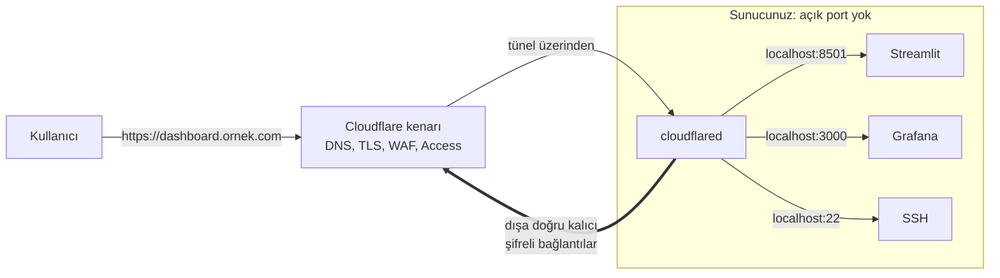
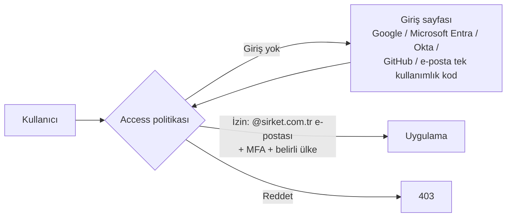

# 8.14 Cloudflare Tunnel ve Zero Trust Erişim

## Nedir?
- **Cloudflare Tunnel**, sunucunuzda çalışan küçük bir programın (`cloudflared`) Cloudflare'e **dışarıya doğru** bağlantı açması ve internetten gelen istekleri bu bağlantı üzerinden uygulamanıza taşımasıdır. Sunucunun herkese açık bir IP'si veya açık bir portu olması gerekmez.
- **Zero Trust (sıfır güven)**, "ağın içindeysen güvenilirsin" varsayımını bırakıp **her isteği kimlik, cihaz ve bağlama göre** doğrulayan güvenlik yaklaşımıdır.
- **Cloudflare Access**, bir uygulamanın önüne kimlik doğrulama (SSO, e-posta kodu, MFA) koyan Zero Trust bileşenidir. **WARP** ise kullanıcı cihazına kurulan ve trafiği Cloudflare üzerinden güvenli şekilde geçiren istemcidir.

## Hangi problemi çözer?
- **Port açmadan yayın:** Ev bilgisayarı, şirket içi VM veya NAT arkasındaki bir sunucudaki Streamlit/Grafana/API'yi internete açmak için router'da port yönlendirmesi, sabit IP veya firewall kuralı gerekmez.
- **Saldırı yüzeyini küçültmek:** Origin'in internete açık portu olmadığı için Cloudflare'i atlayıp doğrudan sunucuya saldırmak mümkün olmaz.
- **VPN'siz güvenli erişim:** İç araçlara (dashboard, Jupyter, yönetim paneli, SSH) sadece belirli kişilerin, kurumsal kimlikle ve MFA ile erişmesi.
- **Uygulamaya giriş eklemeden koruma:** Kendi giriş ekranı olmayan bir prototipi bile SSO arkasına almak.

## Nasıl çalışır?

**Tunnel**

1. `cloudflared` sunucuda çalışır ve Cloudflare'e birden çok yedekli bağlantı açar (sadece **giden** trafik).
2. Bir alan adı (`dashboard.ornek.com`) tünele bağlanır; DNS'te `<tunnel-id>.cfargotunnel.com` hedefli proxied bir CNAME oluşur.
3. İstek kenara gelir, güvenlik kontrollerinden geçer, tünel üzerinden `cloudflared`'a, oradan yerel servise (`http://localhost:8501`) iletilir.

**Access ile kimlik kontrolü**

- Politika örnekleri: belirli e-posta adresleri veya alan adı, kimlik sağlayıcıdaki grup, cihaz durumu (WARP kurulu, disk şifreli), ülke.
- Başarılı girişten sonra tarayıcıya imzalı bir JWT çerezi (`CF_Authorization`) verilir; uygulama isterse bu token'ı doğrulayıp kullanıcının kimliğini öğrenebilir (`Cf-Access-Authenticated-User-Email` başlığı da gönderilir).
- Makineler (scriptler, CI/CD) için **service token**: `CF-Access-Client-Id` ve `CF-Access-Client-Secret` başlıkları ([15.5](../15-guvenlik/05-sso-oauth-oidc.md)).

**Zero Trust bileşenlerinin haritası**
| Bileşen | Ne işe yarar? | Klasik karşılığı |
|---|---|---|
| **Tunnel** | Origin'i port açmadan Cloudflare'e bağlar | Reverse proxy + açık port / DMZ |
| **Access** | Uygulama önünde kimlik ve politika kontrolü | VPN + uygulama içi giriş |
| **WARP istemcisi** | Kullanıcı cihazını Cloudflare'e bağlar; özel ağlara (`10.x.x.x`) erişim | VPN istemcisi |
| **Gateway** | Kullanıcıların internet trafiğini DNS/HTTP düzeyinde filtreler | Kurumsal web proxy ([1.9](../01-linux/09-ag-temelleri.md)) |

## Mini örnek
**Hızlı deneme (geçici adres, hesap gerekmez)**
```bash
streamlit run app.py --server.address 127.0.0.1 --server.port 8501
cloudflared tunnel --url http://localhost:8501
# → https://rastgele-kelimeler.trycloudflare.com  (sadece test için; kalıcı değil, korumasız)
```

**Kalıcı (adlandırılmış) tünel**
```bash
cloudflared tunnel login                              # tarayıcıda alan adını seçip yetki ver
cloudflared tunnel create veri-sunucu                 # tünel ve kimlik dosyası oluşur
cloudflared tunnel route dns veri-sunucu dashboard.ornek.com
cloudflared tunnel route dns veri-sunucu grafana.ornek.com
cloudflared tunnel run veri-sunucu                    # deneme
sudo cloudflared service install                      # systemd servisi olarak kalıcı çalıştır
```

`~/.cloudflared/config.yml`
```yaml
tunnel: TUNNEL_ID                      # create komutunun verdiği UUID
credentials-file: /home/kullanici/.cloudflared/TUNNEL_ID.json
ingress:
  - hostname: dashboard.ornek.com
    service: http://localhost:8501
  - hostname: grafana.ornek.com
    service: http://localhost:3000
  - hostname: ssh.ornek.com
    service: ssh://localhost:22
  - service: http_status:404          # eşleşmeyen her şey için zorunlu son kural
```
Panelden yönetilen (remotely-managed) tünellerde bu yapılandırma Cloudflare panelinde tutulur ve sunucuda sadece bir token ile `cloudflared` çalıştırılır.

**Docker Compose ile**
```yaml
services:
  app:
    image: registry.ornek.com/veri-dashboard:1.2.0
  tunnel:
    image: cloudflare/cloudflared:latest
    command: tunnel --no-autoupdate run
    environment:
      TUNNEL_TOKEN: ${TUNNEL_TOKEN}   # .env dosyasından; Git'e girmemeli
    depends_on: [app]
```
Bu durumda panelde servis adresi `http://app:8501` olarak tanımlanır (container adı, [4.6](../04-docker/06-network.md)). Canlı kullanımda `latest` yerine sabit sürüm etiketi tercih edin.

**Access arkasındaki uygulamayı script'ten çağırmak**
```bash
curl -H "CF-Access-Client-Id: $CF_CLIENT_ID" \
     -H "CF-Access-Client-Secret: $CF_CLIENT_SECRET" \
     https://api-ic.ornek.com/v1/rapor
```

**SSH'ı tünel ve Access üzerinden kullanmak**
```
# ~/.ssh/config (istemci)
Host ssh.ornek.com
    ProxyCommand cloudflared access ssh --hostname %h
```

## Nerede kullanılır?
- Kişisel projeler ve ev laboratuvarı: Raspberry Pi/VM/bilgisayardaki uygulamayı alan adıyla yayınlamak
- Küçük ekipler: Grafana, Jupyter, Airflow arayüzü gibi iç araçlara VPN'siz, SSO'lu erişim
- Müşteriye veya iş birimine geçici demo açmak (Access ile sadece belirli e-postalara)
- Kurumlarda: VPN'in yerini veya tamamlayıcısını oluşturan Zero Trust ağ erişimi (ZTNA) projeleri

**Kurum içi uyarı:** Şirket ağındaki bir makineden, BT ve güvenlik ekibinin onayı olmadan tünel açmak, kurumsal güvenlik kontrollerini (firewall, DLP, proxy) atlamak anlamına gelir ve politika ihlalidir. Tunnel'ı kişisel ortamlarda veya kurumun onayladığı mimaride kullanın.

## Benzerleri ve farkları
| Araç | Not |
|---|---|
| **ngrok** | Geliştirme için popüler tünel; hızlı demo |
| **Tailscale / ZeroTier** | Cihazlar arası özel sanal ağ (mesh VPN); internete açmak yerine "sadece benim cihazlarım" ağı |
| **SSH port forwarding** | `ssh -L` / `ssh -R` ile tek seferlik tünel ([1.6](../01-linux/06-ssh.md)) |
| **Klasik VPN** | Kullanıcıyı ağın tamamına bağlar; Zero Trust ise sadece izin verilen uygulamalara erişim verir |
| **Zscaler, Netskope, Palo Alto Prisma Access** | Kurumsal Zero Trust / SASE platformları |
| **OAuth2 Proxy, Pomerium** | Kendi altyapınızda uygulama önüne SSO koyan açık kaynak araçlar |

## İlgili sayfalar
- [8.10 CDN ve Cloudflare](10-cdn-edge-cloudflare.md)
- [1.10 localhost ve port dinleme](../01-linux/10-localhost.md)
- [15.5 SSO, OAuth ve OIDC](../15-guvenlik/05-sso-oauth-oidc.md)
- [12.5 Streamlit](../12-bi/05-streamlit.md)
