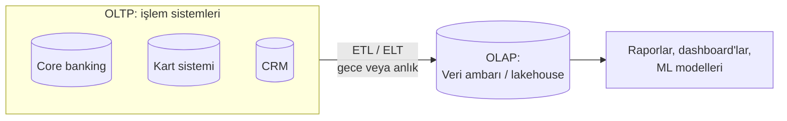
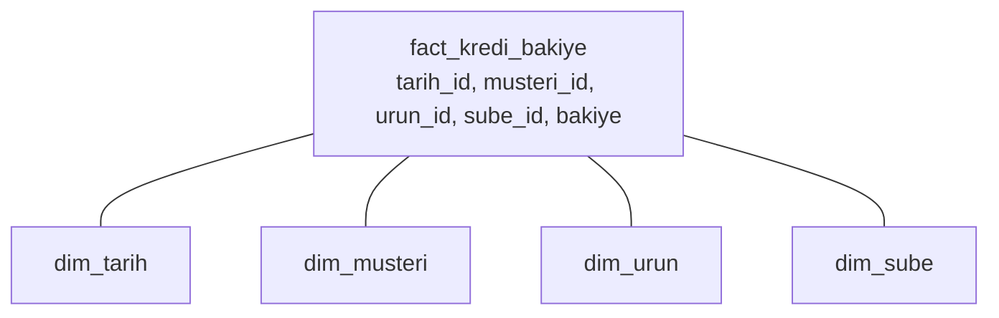

# 9.1 OLTP ve OLAP Farkı

## Nedir?
Veri sistemleri iki ana iş yüküne göre tasarlanır:
- **OLTP (Online Transaction Processing — çevrimiçi işlem işleme):** Günlük operasyonel işlemleri kaydeden sistemler. Bir para transferi, bir kredi kullandırımı, bir kart harcaması.
- **OLAP (Online Analytical Processing — çevrimiçi analitik işleme):** Geçmiş veriyi toplu olarak analiz eden sistemler. "Son 3 yılda segment bazında aylık kredi büyümesi nedir?"

## Hangi problemi çözer?
Tek bir sistem iki işi birden iyi yapamaz:
- OLTP sistemine ağır analiz sorgusu atmak, müşteri işlemlerini yavaşlatır (core banking'i rapor sorgusuyla kilitlemek).
- OLAP sistemi saniyede binlerce küçük yazma işlemi için tasarlanmamıştır.

Bu ayrımı bilmek, "rapor neden doğrudan kaynak sistemden alınmıyor?" ve "neden ayrı bir veri ambarı var?" sorularının cevabıdır.

## Nasıl çalışır?



| Özellik | OLTP | OLAP |
|---|---|---|
| Amaç | İşlemi kaydetmek | Veriyi analiz etmek |
| Tipik sorgu | Tek kayıt oku/yaz: `WHERE hesap_no = 123` | Milyonlarca kaydı topla: `GROUP BY ay, segment` |
| İşlem sayısı | Çok fazla, küçük | Az, büyük |
| Veri güncelliği | Anlık | Gecikmeli (saatlik/günlük) |
| Veri hacmi | Güncel veri (GB–TB) | Yıllarca geçmiş (TB–PB) |
| Şema | Normalize (tekrar yok) | Denormalize (yıldız/kar tanesi şeması) |
| Saklama | Satır bazlı (row-oriented) | Sütun bazlı (columnar) |
| Kullanıcı | Uygulamalar, gişe, müşteri | Analist, yönetim, veri bilimci |
| Örnek | Oracle, PostgreSQL, SQL Server, DB2 | Teradata, Exadata, Snowflake, BigQuery, ClickHouse, lakehouse |

**Satır bazlı ve sütun bazlı saklama**
```
Tablo:   id | musteri | segment | bakiye
         1  | Ali     | KOBİ    | 100
         2  | Ayşe    | Bireysel| 250

Satır bazlı:  [1,Ali,KOBİ,100] [2,Ayşe,Bireysel,250]       → tek müşteriyi okumak hızlı
Sütun bazlı:  [1,2] [Ali,Ayşe] [KOBİ,Bireysel] [100,250]   → "toplam bakiye" için sadece 1 sütun okunur
```
Sütun bazlı saklama, analiz sorgusunda sadece gereken sütunları okur ve aynı tipteki değerleri çok iyi sıkıştırır.

**Yıldız şeması (star schema)**
OLAP'ta yaygın modelleme:
- **Fact (olgu) tablosu:** Ölçülen olaylar ve sayılar (kredi bakiyeleri, işlem tutarları).
- **Dimension (boyut) tabloları:** Olayları açıklayan nitelikler (müşteri, ürün, şube, tarih).



## Mini örnek
Aynı veriye iki farklı soru:
```sql
-- OLTP sorgusu: tek kayıt, milisaniyeler
SELECT bakiye FROM hesap WHERE hesap_no = '1234567';

-- OLAP sorgusu: milyonlarca satır, toplama
SELECT d.yil, d.ay, m.segment, SUM(f.bakiye) AS toplam_bakiye
FROM fact_kredi_bakiye f
JOIN dim_tarih   d ON f.tarih_id = d.tarih_id
JOIN dim_musteri m ON f.musteri_id = m.musteri_id
WHERE d.yil >= 2024
GROUP BY d.yil, d.ay, m.segment
ORDER BY d.yil, d.ay;
```

## Nerede kullanılır?
- **OLTP:** Core banking, kart, ödeme, kredi başvuru sistemleri
- **OLAP:** Yönetim raporları, BDDK raporlamaları, risk analizleri, ML eğitim verisi

## Benzerleri ve farkları
- **HTAP (Hybrid Transactional/Analytical Processing):** İki iş yükünü aynı sistemde birleştirmeye çalışan yaklaşımlar (ör. Oracle In-Memory, SingleStore, TiDB).
- **Okuma kopyası (read replica):** OLTP veritabanının kopyası; raporlar ana sisteme değil kopyaya gönderilir. Ara çözümdür, gerçek OLAP'ın yerini tutmaz.
- **Operasyonel veri deposu (ODS):** Kaynak sistemlerin entegre, güncel kopyası; OLTP ile veri ambarı arasında durur.

## İlgili sayfalar
- [9.2 İlişkisel veritabanları ve ACID](02-iliskisel-sql-acid.md)
- [9.12 Warehouse, lake, lakehouse](12-warehouse-lake-lakehouse.md)
- [0.2 Veriden rapora](../00-buyuk-resim/02-veriden-rapora.md)
