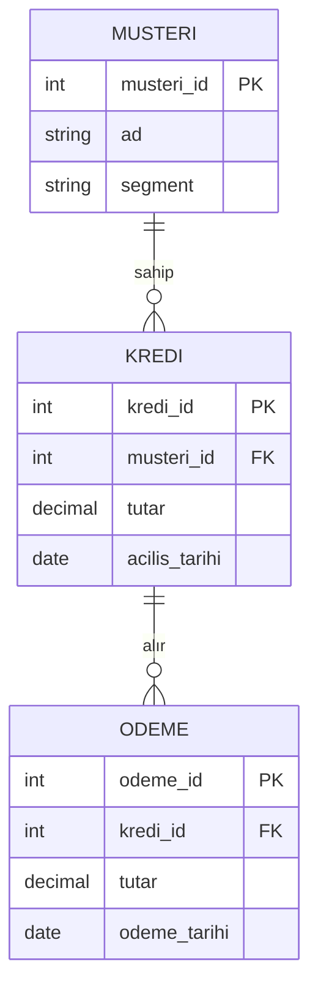

# 9.2 İlişkisel Veritabanları, SQL ve ACID

## Nedir?
- **İlişkisel veritabanı (RDBMS — Relational Database Management System):** Veriyi satır ve sütunlardan oluşan **tablolarda** tutan ve tabloları **anahtarlarla** birbirine bağlayan veritabanı türü.
- **SQL (Structured Query Language):** İlişkisel veritabanlarıyla konuşmak için kullanılan standart dil.
- **ACID:** Bir veritabanı işleminin (transaction) güvenilir olmasını sağlayan dört özelliğin baş harfleri.

## Hangi problemi çözer?
- **Tutarlılık:** Para transferinde bir hesaptan düşüp diğerine eklenmeme gibi yarım kalmış işlemler olmaz.
- **Tekrarsız veri:** Müşteri adresi tek yerde tutulur, her işlemde tekrar yazılmaz.
- **Esnek sorgulama:** Veri önceden bilinmeyen sorulara göre birleştirilip analiz edilebilir.
- **Eşzamanlılık:** Aynı anda binlerce kullanıcı veriyi bozmadan okuyup yazabilir.

## Nasıl çalışır?

**Temel kavramlar**

| Kavram | Anlamı |
|---|---|
| **Tablo** | Aynı türdeki kayıtlar (müşteriler, krediler) |
| **Satır (row / record)** | Bir kayıt |
| **Sütun (column)** | Bir nitelik, belirli bir veri tipiyle (`INTEGER`, `NUMERIC`, `DATE`, `VARCHAR`) |
| **Primary key (birincil anahtar)** | Her satırı benzersiz tanımlayan sütun |
| **Foreign key (yabancı anahtar)** | Başka tablonun birincil anahtarına bağlantı |
| **Index** | Aramayı hızlandıran yapı ([9.4](04-performans.md)) |
| **Constraint (kısıt)** | Veri kuralları: `NOT NULL`, `UNIQUE`, `CHECK (tutar > 0)` |
| **View** | Kayıtlı sorgu; sanal tablo |
| **Schema** | Tabloları gruplayan isim alanı |



**Normalizasyon:** Veriyi tekrarları önleyecek şekilde tablolara bölmek. OLTP'de tercih edilir. Analiz tarafında ise sorgu kolaylığı için bilinçli olarak **denormalize** edilir ([9.1](01-oltp-olap.md)).

**SQL'in alt dilleri**

| Grup | Komutlar | Amaç |
|---|---|---|
| **DDL** (Data Definition) | `CREATE`, `ALTER`, `DROP` | Yapıyı tanımla |
| **DML** (Data Manipulation) | `INSERT`, `UPDATE`, `DELETE`, `MERGE` | Veriyi değiştir |
| **DQL** (Data Query) | `SELECT` | Veriyi sorgula |
| **DCL** (Data Control) | `GRANT`, `REVOKE` | Yetki ver/al |
| **TCL** (Transaction Control) | `BEGIN`, `COMMIT`, `ROLLBACK` | İşlemi yönet |

**ACID**

| Harf | Özellik | Anlamı | Bankacılık örneği |
|---|---|---|---|
| **A** | Atomicity (bölünmezlik) | İşlemin tamamı ya olur ya hiç olmaz | Transferde borç ve alacak kaydı birlikte |
| **C** | Consistency (tutarlılık) | İşlem veritabanını kurallara uygun bir durumdan yine kurallara uygun bir duruma taşır | Bakiye negatif olamaz kısıtı ihlal edilmez |
| **I** | Isolation (yalıtım) | Eşzamanlı işlemler birbirinin yarım hâlini görmez | İki şube aynı hesaptan aynı anda para çekemez |
| **D** | Durability (kalıcılık) | Onaylanan (commit) işlem elektrik kesilse bile kaybolmaz | Onaylanan EFT kaydı kalıcıdır |

**Yalıtım seviyeleri (isolation levels):** Read Uncommitted < Read Committed (çoğu veritabanında varsayılan) < Repeatable Read < Serializable. Seviye yükseldikçe tutarlılık artar, eşzamanlılık performansı düşer.

## Mini örnek
```sql
-- DDL
CREATE TABLE musteri (
    musteri_id  SERIAL PRIMARY KEY,
    ad          VARCHAR(100) NOT NULL,
    segment     VARCHAR(20)  CHECK (segment IN ('Bireysel', 'KOBİ', 'Ticari'))
);

CREATE TABLE kredi (
    kredi_id      SERIAL PRIMARY KEY,
    musteri_id    INT NOT NULL REFERENCES musteri(musteri_id),
    tutar         NUMERIC(18,2) NOT NULL CHECK (tutar > 0),
    acilis_tarihi DATE NOT NULL DEFAULT CURRENT_DATE
);

-- DML
INSERT INTO musteri (ad, segment) VALUES ('Örnek A.Ş.', 'KOBİ');
INSERT INTO kredi (musteri_id, tutar) VALUES (1, 250000);

-- Sorgu: segment bazında toplam kredi
SELECT m.segment, COUNT(*) AS adet, SUM(k.tutar) AS toplam
FROM kredi k
JOIN musteri m ON m.musteri_id = k.musteri_id
GROUP BY m.segment
HAVING SUM(k.tutar) > 100000
ORDER BY toplam DESC;

-- Transaction: transfer (ya ikisi ya hiçbiri)
BEGIN;
UPDATE hesap SET bakiye = bakiye - 1000 WHERE hesap_no = 'A';
UPDATE hesap SET bakiye = bakiye + 1000 WHERE hesap_no = 'B';
COMMIT;      -- hata olursa: ROLLBACK;
```

## Nerede kullanılır?
- Neredeyse tüm işlem sistemleri (core banking, ERP, CRM)
- Veri ambarları ve raporlama veritabanları
- ETL'lerin hedef tabloları (BDDK, TÜİK verilerinin yüklendiği PostgreSQL)

## Benzerleri ve farkları
- **NoSQL veritabanları:** Esnek şema, yatay ölçekleme, belirli erişim desenleri için optimize; çoğu ACID garantilerini gevşetir veya sınırlar ([9.5](05-nosql-turleri.md)).
- **BASE:** Birçok dağıtık NoSQL sistemin benimsediği yaklaşım (Basically Available, Soft state, Eventually consistent): anlık tutarlılık yerine "sonunda tutarlı" olma ([9.10](10-cap-teoremi.md)).
- **SQL lehçeleri:** Standart SQL'in üzerine her veritabanının kendi eklentileri vardır (Oracle PL/SQL, PostgreSQL PL/pgSQL, SQL Server T-SQL). Temel `SELECT`/`JOIN`/`GROUP BY` her yerde aynıdır.

## İlgili sayfalar
- [9.3 PostgreSQL ve Oracle](03-postgres-oracle.md)
- [9.4 Performans](04-performans.md)
- [10.1 SQL ile veri işleme](../10-veri-isleme/01-sql.md)
