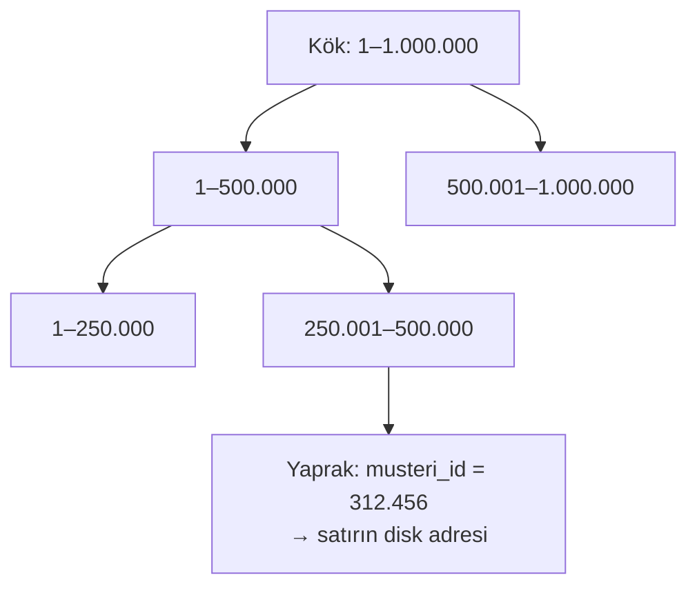
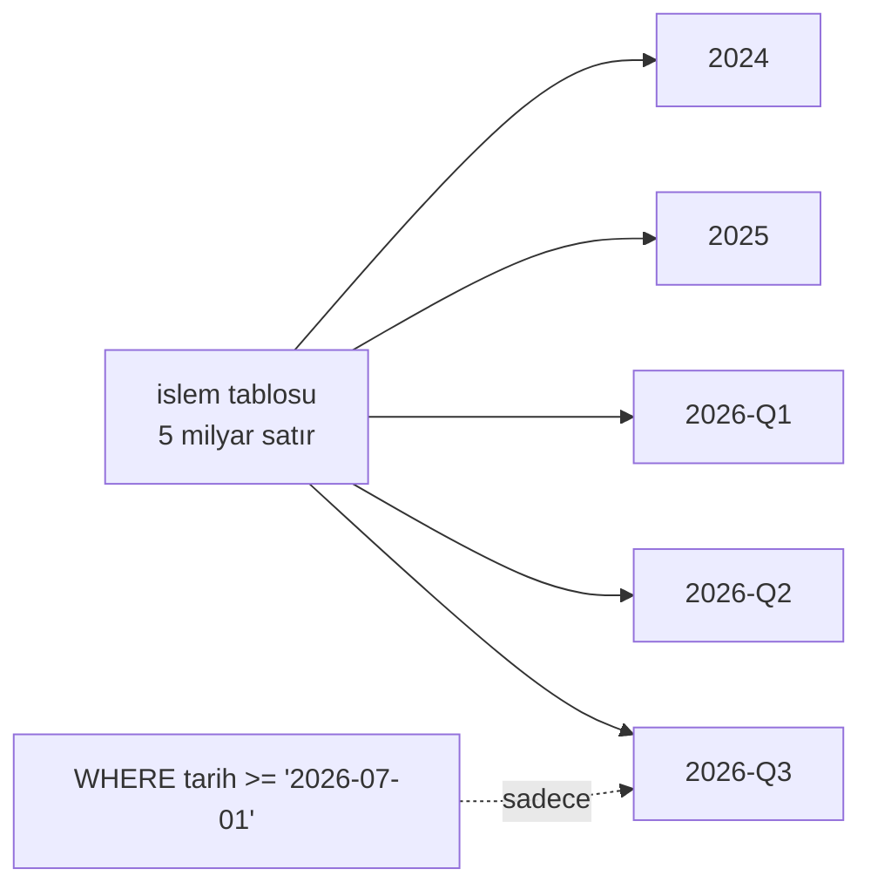

# 9.4 Veritabanı Performansı: Index, Partitioning, EXPLAIN

## Nedir?
Veritabanı sorgularını hızlandırmanın üç temel aracı:
- **Index (dizin):** Bir tablonun belirli sütunlarına göre oluşturulmuş, aramayı hızlandıran yardımcı yapı. Kitabın arkasındaki dizin gibi.
- **Partitioning (bölümleme):** Büyük bir tabloyu (ör. tarih bazında) mantıksal parçalara bölmek.
- **EXPLAIN (sorgu planı):** Veritabanının bir sorguyu nasıl çalıştıracağını gösteren komut.

## Hangi problemi çözer?
Tablolar büyüdükçe (milyonlarca–milyarlarca satır) aynı sorgu saniyelerden dakikalara çıkar. Dashboard yavaşlar, ETL zamanında bitmez, veritabanı diğer kullanıcılar için de yavaşlar. Doğru index ve bölümleme çoğu zaman donanım eklemekten çok daha etkilidir.

## Nasıl çalışır?

### Index
- Index olmadan veritabanı aranan kaydı bulmak için tüm tabloyu okur (**full table scan / sequential scan**).
- Index ile doğrudan ilgili satırlara gider (**index scan**).
- En yaygın tür **B-tree**: Sıralı ağaç yapısı; eşitlik (`=`), aralık (`BETWEEN`, `>`), sıralama (`ORDER BY`) için uygundur.



| Index türü | Ne için? |
|---|---|
| **B-tree** | Varsayılan; eşitlik, aralık, sıralama |
| **Bileşik (composite)** | Birden çok sütun: `(donem, segment)`. Sütun sırası önemlidir: soldaki sütun filtrelenmeden sağdaki tek başına kullanılamaz |
| **Unique** | Benzersizliği garanti eder |
| **Hash** | Sadece eşitlik |
| **GIN** (PostgreSQL) | JSONB, dizi, tam metin arama |
| **BRIN** (PostgreSQL) | Çok büyük, doğal sıralı tablolar (tarih) için çok küçük index |
| **Bitmap** (Oracle) | Az farklı değerli sütunlar; veri ambarlarında |

**Index'in bedeli:** Her `INSERT`/`UPDATE`/`DELETE` index'leri de güncellemek zorundadır; yazma yavaşlar ve disk alanı harcanır. Bu yüzden "her sütuna index" yanlıştır; sık filtrelenen ve birleştirilen sütunlar seçilir.

### Partitioning
Büyük tablo, bir anahtara göre fiziksel parçalara bölünür. Sorgu sadece ilgili parçaları okur (**partition pruning**).



| Tür | Örnek |
|---|---|
| **Range** (aralık) | Tarihe göre: aylık/yıllık parçalar (en yaygın) |
| **List** (liste) | Bölgeye veya segmente göre |
| **Hash** | Müşteri ID'sine göre eşit dağıtım |

Ek faydası: Eski veriyi silmek, satır satır `DELETE` yerine bir parçayı düşürmek (`DROP PARTITION`) kadar hızlıdır.

### EXPLAIN
Sorgu iyileştirici (optimizer) bir sorgu için birçok yol arasından en ucuzunu seçer. `EXPLAIN` bu planı, `EXPLAIN ANALYZE` (PostgreSQL) ise planı **çalıştırarak** gerçek süreleri gösterir.

Plan okurken bakılacaklar:
- `Seq Scan` / `TABLE ACCESS FULL` büyük bir tabloda → index eksik olabilir.
- Tahmini satır sayısı (`rows`) ile gerçek sayı çok farklı → istatistikler güncel değil (`ANALYZE`).
- `Nested Loop` büyük tablolarda → join stratejisi uygunsuz olabilir.
- En çok zaman harcanan adım.

## Mini örnek
```sql
-- Yavaş sorgu
EXPLAIN ANALYZE
SELECT donem, SUM(tutar)
FROM islem
WHERE musteri_id = 312456 AND islem_tarihi >= '2026-01-01'
GROUP BY donem;
-- Seq Scan on islem  (actual time=0.02..8421.3 rows=1200 ...)   ← tüm tablo okundu

-- Bileşik index ekle (eşitlik sütunu önce, aralık sütunu sonra)
CREATE INDEX idx_islem_musteri_tarih ON islem (musteri_id, islem_tarihi);
ANALYZE islem;

EXPLAIN ANALYZE ... ;
-- Index Scan using idx_islem_musteri_tarih (actual time=0.03..2.1 rows=1200 ...)
```

PostgreSQL'de tarihe göre bölümleme:
```sql
CREATE TABLE islem (
    islem_id     BIGINT,
    musteri_id   INT,
    islem_tarihi DATE NOT NULL,
    tutar        NUMERIC(18,2)
) PARTITION BY RANGE (islem_tarihi);

CREATE TABLE islem_2026_q3 PARTITION OF islem
    FOR VALUES FROM ('2026-07-01') TO ('2026-10-01');
CREATE TABLE islem_2026_q4 PARTITION OF islem
    FOR VALUES FROM ('2026-10-01') TO ('2027-01-01');
```

Oracle'da plan:
```sql
EXPLAIN PLAN FOR SELECT ... ;
SELECT * FROM TABLE(DBMS_XPLAN.DISPLAY);
```

**Sorguyu yavaşlatan yaygın hatalar**
```sql
-- Index'li sütuna fonksiyon uygulamak index'i devre dışı bırakır
WHERE TO_CHAR(islem_tarihi, 'YYYY') = '2026'          -- kötü
WHERE islem_tarihi >= '2026-01-01' AND islem_tarihi < '2027-01-01'   -- iyi

-- Gereksiz sütun çekmek
SELECT * FROM islem ...                               -- kötü
SELECT musteri_id, tutar FROM islem ...               -- iyi

-- Baştaki joker karakter index kullanamaz
WHERE unvan LIKE '%BANK%'
```

## Nerede kullanılır?
- Yavaşlayan dashboard ve rapor sorguları
- ETL'lerde büyük tablolara yükleme ve birleştirme
- Geçmişi yıllarca tutulan işlem ve log tabloları (bölümleme)

## Benzerleri ve farkları
- **Sütun bazlı saklama ve veri ambarları:** Analitik sorgularda index yerine sütun okuma, sıkıştırma ve bölümleme ön plandadır ([9.1](01-oltp-olap.md)).
- **Materialized view:** Ağır sorgunun sonucunu tablo gibi saklamak ve periyodik yenilemek; dashboard'lar için çok etkili.
- **Lakehouse'ta karşılığı:** Parquet dosyalarında bölümleme (`/donem=2026-09/`), dosya istatistikleri ve Z-ordering ([9.14](14-delta-iceberg.md)).
- **Önbellek:** Sık okunan sonuçları Redis'te tutmak ([9.7](07-redis-cache.md)).

## İlgili sayfalar
- [9.3 PostgreSQL ve Oracle](03-postgres-oracle.md)
- [10.1 SQL ile veri işleme](../10-veri-isleme/01-sql.md)
