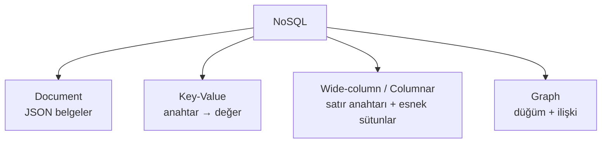
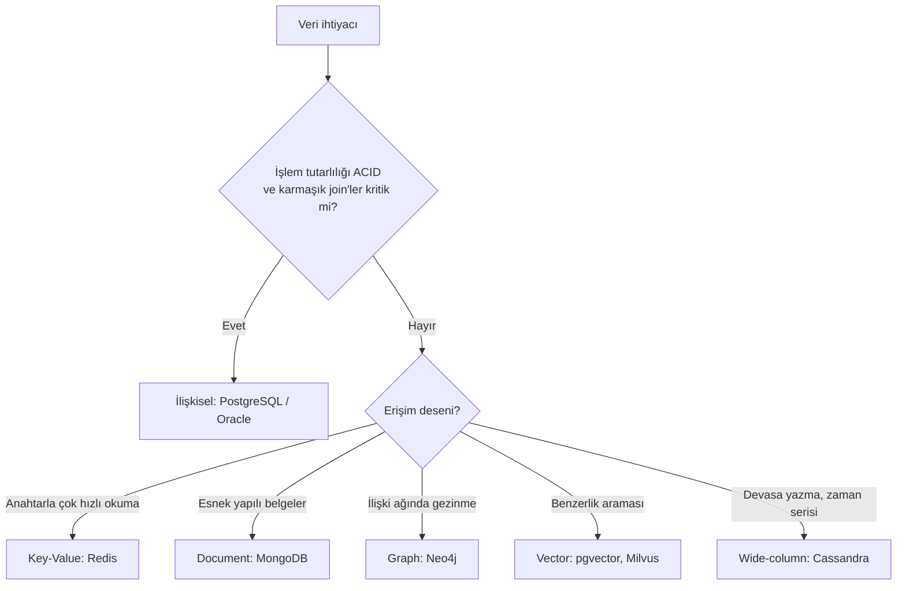

# 9.5 NoSQL Türleri: Document, Key-Value, Columnar, Graph

## Nedir?
**NoSQL ("Not only SQL")**, ilişkisel tablo modeli dışındaki veri modellerini kullanan veritabanlarının genel adıdır. Tek bir teknoloji değil, farklı ihtiyaçlar için tasarlanmış dört ana ailedir.

## Hangi problemi çözer?
İlişkisel veritabanları çok güçlüdür ama bazı durumlarda zorlanır:
- **Değişken yapılı veri:** Her kaydın farklı alanları olduğu durumlar (ürün katalogları, olay logları, API cevapları).
- **Çok yüksek ölçek:** Saniyede yüz binlerce yazma, birden çok sunucuya yatay yayılma.
- **Özel erişim desenleri:** Milisaniye altı anahtar okuma (cache), ilişki ağında derin gezinme (fraud ağları), benzerlik araması (vektörler).

## Nasıl çalışır?



| Tür | Veri modeli | Güçlü yanı | Zayıf yanı | Örnekler | Bankacılıkta |
|---|---|---|---|---|---|
| **Document** | JSON/BSON belgeleri | Esnek şema, iç içe veri, geliştirici dostu | Çok tablolu join'ler zayıf | MongoDB, Couchbase | Müşteri 360 profili, başvuru formları, log |
| **Key-Value** | Anahtar → değer | Çok hızlı, basit | Sadece anahtarla erişim | Redis, Memcached, DynamoDB | Oturum, cache, rate limit sayaçları |
| **Wide-column** | Satır anahtarı + dinamik sütun aileleri | Devasa yazma hacmi, yatay ölçek | Sorgu esnekliği düşük | Cassandra, HBase, ScyllaDB | Zaman serisi, işlem geçmişi, IoT |
| **Graph** | Düğüm (node) + kenar (edge) | İlişkilerde derin gezinme | Toplu analitikte sınırlı | Neo4j, Amazon Neptune, TigerGraph | Fraud ağları, grup firma ilişkileri |

Ek olarak sık anılan iki kategori:
- **Vector veritabanları:** Embedding vektörlerinde benzerlik araması (GenAI/RAG) ([9.9](09-vector-db.md)).
- **Zaman serisi veritabanları:** InfluxDB, TimescaleDB, Prometheus; zaman damgalı metrikler.
- **Arama motorları:** Elasticsearch/OpenSearch; tam metin arama ve log analizi.

**Aynı veri, farklı modeller**

İlişkisel:
```
musteri(id, ad)        adres(id, musteri_id, il)        kredi(id, musteri_id, tutar)
```

Document:
```json
{
  "_id": 123,
  "ad": "Örnek A.Ş.",
  "adresler": [{"il": "İstanbul"}],
  "krediler": [{"tutar": 250000, "tur": "işletme"}]
}
```

Key-Value:
```
"musteri:123:skor"  →  "0.12"
```

Graph:
```
(Örnek A.Ş.)-[:ORTAK %60]->(Örnek Holding)-[:ORTAK %40]->(Başka Ltd.)
```

## Mini örnek
Ne zaman hangisi? Basit bir karar akışı:


## Nerede kullanılır?
Gerçek sistemler genellikle **çok dilli kalıcılık (polyglot persistence)** kullanır: İşlemler Oracle'da, oturumlar Redis'te, müşteri profili MongoDB'de, ilişki ağı Neo4j'de, analiz lakehouse'ta.

## Benzerleri ve farkları
- **"NoSQL ilişkisel veritabanının yerini alır" yanılgısı:** Değildir. Finansal işlemler, muhasebe ve düzenleyici raporlamada ilişkisel veritabanları standart olmaya devam eder.
- **Sınırlar bulanıklaşıyor:** PostgreSQL `jsonb` ile belge, `pgvector` ile vektör, eklentilerle zaman serisi işlerini yapabiliyor; MongoDB çok belgeli ACID işlemleri destekliyor.
- **Tutarlılık modeli:** Birçok dağıtık NoSQL sistem "sonunda tutarlılık" (eventual consistency) sunar ([9.10 CAP](10-cap-teoremi.md)).

## İlgili sayfalar
- [9.6 MongoDB](06-mongodb.md)
- [9.7 Redis](07-redis-cache.md)
- [9.8 Graph veritabanları](08-graph-db.md)
- [9.9 Vector veritabanları](09-vector-db.md)
