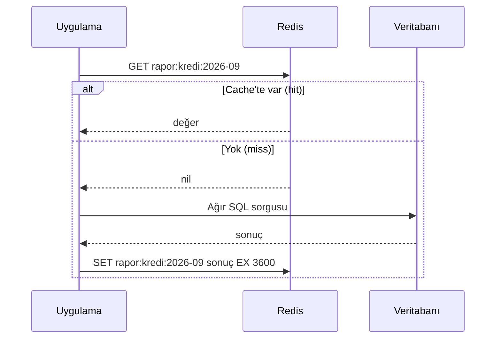

# 9.7 Redis ve Cache Kavramı

## Nedir?
- **Cache (önbellek):** Sık erişilen veya üretmesi pahalı veriyi, daha hızlı bir yerde geçici olarak saklamak.
- **Redis:** Veriyi **bellekte (RAM)** tutan, milisaniye altı hızda çalışan **key-value** veri deposu. Cache'in yanında kuyruk, sayaç, oturum deposu ve mesajlaşma için de kullanılır.

## Hangi problemi çözer?
- Dashboard her açılışta aynı ağır SQL sorgusunu (10 saniye) çalıştırıyor → sonuç Redis'te tutulur, sonraki açılışlar milisaniyeler sürer.
- Veritabanı tekrar eden okumalarla yoruluyor → yük azalır.
- Kubernetes'te birden çok pod oturum bilgisini paylaşmalı → oturum Redis'te tutulur, pod'lar durumsuz kalır.
- Rate limit sayaçları, dağıtık kilitler gibi hızlı ve paylaşılan sayaçlar gerekir.

## Nasıl çalışır?

**Cache-aside (en yaygın desen)**


**Önemli kavramlar**
| Kavram | Anlamı |
|---|---|
| **TTL (time to live)** | Anahtarın otomatik silineceği süre; bayat veriyi sınırlar |
| **Hit ratio** | İsteklerin yüzde kaçının cache'ten karşılandığı |
| **Invalidation (geçersiz kılma)** | Kaynak veri değişince cache'teki kopyayı silmek. "Bilgisayar bilimindeki iki zor problemden biri" diye anılır |
| **Eviction (tahliye)** | Bellek dolunca hangi anahtarların atılacağı (`allkeys-lru`: en uzun süredir kullanılmayan) |
| **Kalıcılık** | RDB (anlık görüntü) ve AOF (işlem günlüğü) ile diske yazılabilir; yine de birincil veri deposu olarak değil, cache olarak düşünülmelidir |

**Redis veri tipleri**
| Tip | Örnek kullanım |
|---|---|
| String | Cache değeri, sayaç (`INCR`) |
| Hash | Nesne alanları: `musteri:123 → {ad, segment}` |
| List | Basit kuyruk |
| Set | Benzersiz elemanlar (günün aktif kullanıcıları) |
| Sorted set | Sıralı liste (en çok işlem yapan müşteriler) |
| Stream | Olay akışı, tüketici grupları |

## Mini örnek
`redis-cli` ile:
```bash
redis-cli -h redis.sirket.local
SET kur:USDTRY "34.25" EX 300          # 5 dakika geçerli
GET kur:USDTRY
TTL kur:USDTRY                         # kalan süre
INCR api:istek:10.20.30.40             # sayaç
HSET musteri:123 ad "Örnek A.Ş." segment "KOBİ"
HGETALL musteri:123
DEL rapor:kredi:2026-09                # cache'i geçersiz kıl
INFO stats                             # keyspace_hits / keyspace_misses
```

Python'da cache-aside:
```python
import json, redis, pandas as pd
from sqlalchemy import create_engine

r = redis.Redis(host="redis.sirket.local", port=6379, decode_responses=True)
db = create_engine("postgresql+psycopg2://...")

def kredi_ozet(donem: str) -> pd.DataFrame:
    anahtar = f"rapor:kredi:{donem}"
    if (onbellek := r.get(anahtar)):
        return pd.read_json(onbellek)
    df = pd.read_sql("SELECT ... WHERE donem = %(d)s", db, params={"d": donem})
    r.set(anahtar, df.to_json(), ex=3600)
    return df
```

Streamlit'in kendi cache'i (tek uygulama içinde yeterli olabilir):
```python
import streamlit as st

@st.cache_data(ttl=3600)
def kredi_ozet(donem: str):
    return pd.read_sql(...)
```

## Nerede kullanılır?
- Dashboard ve API cevaplarının önbelleği
- Kullanıcı oturumları, token kara listeleri
- Rate limit ve sayaçlar
- Basit iş kuyrukları (Celery, RQ arka ucu)
- Feature store'larda **online store** olarak düşük gecikmeli feature okuma (MLOps, Bölüm 13)

## Benzerleri ve farkları
| | Uygulama içi cache (`lru_cache`, `st.cache_data`) | Redis | nginx cache |
|---|---|---|---|
| Nerede? | Uygulama süreci belleği | Ayrı servis | Proxy katmanı |
| Pod'lar arası paylaşım | Yok | Var | Proxy başına |
| Kontrol | Fonksiyon bazında | Anahtar bazında, esnek | HTTP cevabı bazında ([8.7](../08-nginx/07-cache-rate-limit.md)) |

- **Memcached:** Daha basit, sadece string cache.
- **Valkey:** Redis'in lisans değişikliği sonrası Linux Foundation altında devam eden açık kaynak çatalı; Redis ile uyumludur. Kurumunuzda hangisinin kullanıldığını kontrol edin.

**Dikkat:** Kişiye özel ve hassas veri cache'leniyorsa anahtar tasarımı ve erişim yetkisi dikkatle kurulmalı; Redis'e şifreli bağlantı (TLS) ve parola (ACL) şarttır.

## İlgili sayfalar
- [9.5 NoSQL türleri](05-nosql-turleri.md)
- [8.7 nginx cache](../08-nginx/07-cache-rate-limit.md)
