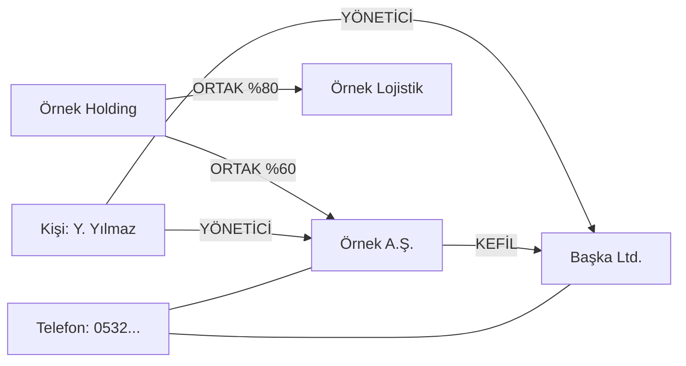

# 9.8 Graph Veritabanları ve Neo4j

## Nedir?
**Graph (çizge) veritabanı**, veriyi **düğümler (node)** ve bu düğümleri bağlayan **ilişkiler (edge / relationship)** olarak saklar. İlişkiler, ilişkisel veritabanlarındaki gibi sorgu anında hesaplanmaz; verinin kendisinde **birinci sınıf vatandaş** olarak durur.

En yaygın ürün **Neo4j**'dir; sorgu dili **Cypher**'dır.

## Hangi problemi çözer?
"Bu firmanın doğrudan ve dolaylı ortakları kimler?", "Bu müşteriyle aynı telefonu, adresi veya cihazı paylaşan hesaplar hangileri ve onlar kimlerle bağlantılı?" gibi sorular ilişkisel veritabanında **çok sayıda kendi kendine join** (self-join) gerektirir. Derinlik arttıkça sorgu hem yazılması zor hem de üstel olarak yavaş hâle gelir. Graph veritabanında aynı soru, ilişkiler boyunca **gezinme** (traversal) ile hızlı ve okunaklı biçimde cevaplanır.

## Nasıl çalışır?

**Property graph modeli**
- **Düğüm:** Bir varlık. Etiketi (label) ve özellikleri (property) vardır: `(:Firma {vkn: "123", unvan: "Örnek A.Ş."})`
- **İlişki:** Yönü, tipi ve özellikleri olan bağlantı: `-[:ORTAK {pay: 0.6}]->`



Bu yapıda "Örnek A.Ş. ile Başka Ltd. aynı risk grubunda mı?" sorusu, ortak yönetici, kefalet ve paylaşılan telefon üzerinden birkaç adımlık bir gezinmedir.

**İlişkisel ile karşılaştırma**
| Soru | İlişkisel | Graph |
|---|---|---|
| Firmanın doğrudan ortakları | 1 join, kolay | Kolay |
| 4 seviye dolaylı ortaklar | 4 self-join veya özyinelemeli CTE, yavaş | `[:ORTAK*1..4]`, hızlı |
| İki firma arasındaki en kısa bağlantı | Çok zor | Hazır fonksiyon |
| Toplu analitik (aylık toplamlar) | Çok güçlü | Zayıf |

**Graph algoritmaları** (Neo4j Graph Data Science, NetworkX vb.)
| Algoritma | Kullanım |
|---|---|
| Bağlı bileşenler (connected components) | Grup firmaları / risk grubu tespiti |
| Topluluk tespiti (Louvain, Leiden) | Fraud halkaları, yakın ilişkili kümeler |
| Merkezilik (PageRank, betweenness) | Ağın kilit aktörleri |
| En kısa yol | İki varlık arasındaki bağlantı zinciri |
| Benzerlik / node embedding | ML modellerine graph özelliği üretmek |

## Mini örnek
Cypher ile:
```cypher
// Veri oluştur
CREATE (h:Firma {vkn: "100", unvan: "Örnek Holding"})
CREATE (a:Firma {vkn: "200", unvan: "Örnek A.Ş."})
CREATE (c:Firma {vkn: "300", unvan: "Başka Ltd."})
CREATE (k:Kisi  {ad: "Y. Yılmaz"})
CREATE (h)-[:ORTAK {pay: 0.6}]->(a)
CREATE (k)-[:YONETICI]->(a), (k)-[:YONETICI]->(c)
CREATE (a)-[:KEFIL]->(c);

// Örnek A.Ş.'ye 1–4 adımda bağlı tüm firmalar
MATCH (f:Firma {vkn: "200"})-[*1..4]-(diger:Firma)
RETURN DISTINCT diger.unvan;

// İki firma arasındaki en kısa bağlantı
MATCH p = shortestPath((a:Firma {vkn: "200"})-[*..6]-(b:Firma {vkn: "300"}))
RETURN p;

// Ortak yöneticisi olan firma çiftleri
MATCH (f1:Firma)<-[:YONETICI]-(k:Kisi)-[:YONETICI]->(f2:Firma)
WHERE f1.vkn < f2.vkn
RETURN f1.unvan, f2.unvan, k.ad;
```

Python'da graph veritabanı olmadan da başlanabilir (NetworkX):
```python
import networkx as nx
import pandas as pd

iliskiler = pd.DataFrame({
    "kaynak": ["Örnek Holding", "Y. Yılmaz", "Y. Yılmaz", "Örnek A.Ş."],
    "hedef":  ["Örnek A.Ş.",    "Örnek A.Ş.", "Başka Ltd.", "Başka Ltd."],
    "tip":    ["ORTAK",         "YONETICI",  "YONETICI",   "KEFIL"],
})
G = nx.from_pandas_edgelist(iliskiler, "kaynak", "hedef", edge_attr="tip")
gruplar = list(nx.connected_components(G))          # risk grupları
yol = nx.shortest_path(G, "Örnek Holding", "Başka Ltd.")
```

## Nerede kullanılır?
- **Grup firma / risk grubu tespiti:** Ortaklık, yönetici ve kefalet ilişkilerinden "örümcek ağı" kurmak (kredi tahsis ve limit yönetimi)
- **Fraud tespiti:** Ortak cihaz, IP, telefon, adres paylaşan hesap halkaları; para akış zincirleri
- **AML (kara para aklamayla mücadele):** İşlem ağlarında katmanlama desenleri
- **Müşteri 360 ve öneri sistemleri**
- **Bilgi grafları (knowledge graph)** ve GraphRAG uygulamaları

## Benzerleri ve farkları
| Araç | Not |
|---|---|
| **Neo4j** | En yaygın; Cypher; Graph Data Science kütüphanesi; Community ve Enterprise sürümleri |
| **Amazon Neptune, Azure Cosmos DB (Gremlin)** | Bulut graph hizmetleri |
| **TigerGraph** | Büyük ölçekli analitik graph |
| **PostgreSQL + Apache AGE** | PostgreSQL içinde Cypher desteği |
| **NetworkX / igraph** | Python'da bellek içi graph analizi; prototip ve orta ölçek için ideal |
| **Spark GraphFrames** | Dağıtık graph işleme |

- **Sorgu dilleri:** Cypher (Neo4j ve openCypher), Gremlin (Apache TinkerPop), ve ISO standardı **GQL**.
- **RDF / triple store:** Anlamsal web (semantic web) dünyasının graph modeli (SPARQL); kurumsal ontolojilerde kullanılır.
- **Pratik yaklaşım:** Veri ilişkisel sistemde kalır, ilişki tabloları düzenli olarak graph veritabanına veya NetworkX'e aktarılıp analiz edilir; sonuçlar (grup ID'si, merkezilik skoru) tekrar veri ambarına yazılır.

## İlgili sayfalar
- [9.5 NoSQL türleri](05-nosql-turleri.md)
- [9.9 Vector veritabanları](09-vector-db.md)
