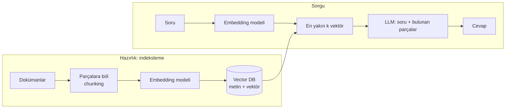

# 9.9 Vector Veritabanları ve pgvector

## Nedir?
- **Embedding (gömme vektörü):** Bir metnin, görselin veya kaydın anlamını temsil eden sayı dizisi. Örneğin bir cümle 768 veya 1536 boyutlu bir vektöre dönüştürülür. Anlamca benzer içerikler, vektör uzayında birbirine yakın düşer.
- **Vector veritabanı:** Bu vektörleri saklayan ve "bu vektöre en benzer N kaydı bul" sorusunu milyonlarca kayıt arasında hızla cevaplayan veritabanı.
- **pgvector:** PostgreSQL'e vektör tipi ve benzerlik araması ekleyen eklenti.

## Hangi problemi çözer?
Klasik arama **kelime eşleşmesine** dayanır: "kredi kartı aidatı" araması, "kart yıllık ücreti" yazan dokümanı bulamayabilir. Vektör araması **anlam benzerliğine** dayanır.

Bu, özellikle **RAG (Retrieval-Augmented Generation)** için gereklidir: Bir dil modeline (LLM) soru sorulmadan önce, kurum içi dokümanlardan (yönetmelikler, prosedürler, ürün dokümanları) en ilgili parçalar bulunup modele bağlam olarak verilir (Bölüm 13).

## Nasıl çalışır?



**Benzerlik ölçüleri**
| Ölçü | Anlamı | pgvector operatörü |
|---|---|---|
| Kosinüs benzerliği/uzaklığı | Vektörler arası açı; metinde en yaygın | `<=>` |
| Öklid (L2) uzaklığı | Düz çizgi mesafesi | `<->` |
| İç çarpım (inner product) | Normalize vektörlerde kosinüse denk | `<#>` |

**Yaklaşık en yakın komşu (ANN) index'leri:** Milyonlarca vektörle tek tek karşılaştırmak yavaştır. Index'ler, çok küçük bir doğruluk kaybıyla aramayı çok hızlandırır:
- **HNSW:** Katmanlı graph tabanlı; hızlı ve isabetli, bellek kullanımı daha yüksek.
- **IVFFlat:** Vektörleri kümelere ayırır; daha az bellek, index oluşturmadan önce veri gerekir.

**Hibrit arama:** Vektör benzerliği + anahtar kelime araması (BM25) + metadata filtresi (`belge_turu = 'yönetmelik'`, `tarih > ...`). Pratikte en iyi sonuçlar genellikle hibrit aramayla alınır.

## Mini örnek
pgvector ile:
```sql
CREATE EXTENSION IF NOT EXISTS vector;

CREATE TABLE dokuman_parca (
    id         BIGSERIAL PRIMARY KEY,
    belge      TEXT,
    bolum      TEXT,
    icerik     TEXT,
    embedding  vector(1536)
);

CREATE INDEX ON dokuman_parca USING hnsw (embedding vector_cosine_ops);

-- Sorgu vektörüne en yakın 5 parça (sorgu vektörü uygulamadan parametre olarak gelir)
SELECT belge, bolum, icerik, 1 - (embedding <=> $1) AS benzerlik
FROM dokuman_parca
WHERE belge LIKE 'Kredi Yönetmeliği%'          -- metadata filtresi
ORDER BY embedding <=> $1
LIMIT 5;
```

Python tarafı (kavramsal; embedding modeli kurumun onayladığı bir model olmalıdır):
```python
import psycopg
from pgvector.psycopg import register_vector

def embed(metin: str) -> list[float]:
    ...  # kurum içi embedding modeli / API çağrısı

with psycopg.connect("postgresql://...") as conn:
    register_vector(conn)
    soru_vektoru = embed("Kredi kartı yıllık ücreti hangi durumlarda iade edilir?")
    rows = conn.execute(
        "SELECT icerik FROM dokuman_parca ORDER BY embedding <=> %s LIMIT 5",
        (soru_vektoru,),
    ).fetchall()
```

## Nerede kullanılır?
- Kurum içi doküman asistanları (RAG): prosedür, mevzuat, ürün bilgisi
- Müşteri şikâyetlerinde benzer vakaları bulma
- Benzer işlem / benzer müşteri araması
- Yinelenen kayıt tespiti (farklı yazılmış aynı firma unvanları)

## Benzerleri ve farkları
| Araç | Not |
|---|---|
| **pgvector** | Mevcut PostgreSQL'e eklenir; ilişkisel veri ve vektör aynı yerde, ACID, SQL ile filtre. Orta ölçek için çoğu zaman yeterli |
| **Milvus, Qdrant, Weaviate** | Özel vektör veritabanları; çok büyük ölçek ve gelişmiş özellikler |
| **Elasticsearch / OpenSearch** | Tam metin + vektör (hibrit) arama |
| **FAISS** | Meta'nın kütüphanesi; veritabanı değil, bellek içi vektör index'i |
| **Chroma** | Prototip için hafif, gömülü vektör deposu |

**Dikkat:**
- Embedding modelini değiştirirseniz tüm vektörlerin yeniden hesaplanması gerekir; model adı ve sürümü kayıtla birlikte saklanmalıdır.
- Hassas dokümanlar için erişim yetkisi arama sonuçlarına da uygulanmalıdır (kullanıcının göremeyeceği dokümanın parçası cevaba girmemeli).
- Müşteri verisi içeren metinler dış embedding servislerine gönderilmeden önce KVKK ve kurum politikaları kontrol edilmelidir.

## İlgili sayfalar
- [9.5 NoSQL türleri](05-nosql-turleri.md)
- [9.3 PostgreSQL](03-postgres-oracle.md)
