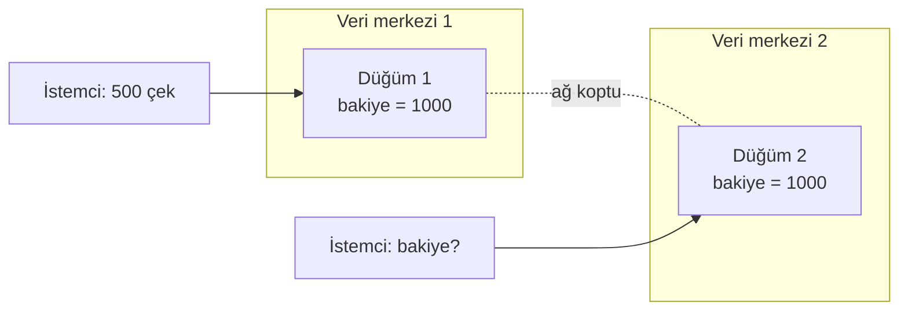

# 9.10 CAP Teoremi

## Nedir?
**CAP teoremi**, birden çok sunucuya dağıtılmış bir veri sisteminin, **ağ bölünmesi (network partition)** yaşandığında şu üç özellikten aynı anda en fazla ikisini garanti edebileceğini söyler:

| Harf | Özellik | Anlamı |
|---|---|---|
| **C** | Consistency (tutarlılık) | Her okuma en son yazılan değeri görür; tüm düğümler aynı veriyi gösterir |
| **A** | Availability (erişilebilirlik) | Çalışan her düğüm her isteğe (hata değil) cevap verir |
| **P** | Partition tolerance (bölünme toleransı) | Düğümler arası iletişim kopsa da sistem çalışmaya devam eder |

2000'de Eric Brewer tarafından ortaya atılmış, 2002'de ispatlanmıştır.

## Hangi problemi çözer?
Dağıtık bir veritabanı seçerken veya tasarlarken, "her şey her zaman tutarlı ve her zaman erişilebilir" beklentisinin neden gerçekçi olmadığını açıklar. Bir sistemin hata anında **hangi garantiden vazgeçtiğini** sorgulamayı öğretir.

## Nasıl çalışır?
Dağıtık sistemlerde ağ kopmaları kaçınılmazdır; bu yüzden **P pratikte zorunludur**. Gerçek seçim, bölünme anında **C ile A arasındadır**:



Düğüm 1'de 500 TL çekildi ama düğüm 2 bunu bilmiyor. Düğüm 2'ye bakiye sorulursa:
- **CP seçimi:** "Şu an güncel olduğumdan emin değilim" → hata döner veya bekler. **Tutarlılık korunur, erişilebilirlik kaybedilir.**
- **AP seçimi:** "Bildiğim değer 1000" → cevap verir. **Erişilebilirlik korunur, tutarlılık geçici olarak kaybedilir**; ağ düzelince düğümler uzlaşır (**eventual consistency — sonunda tutarlılık**).

| Sistem | Bölünmede tipik tercih | Not |
|---|---|---|
| Tek sunuculu PostgreSQL/Oracle | Dağıtık değil; CAP doğrudan uygulanmaz | Replikasyon ayarına göre davranış değişir |
| MongoDB (varsayılan ayarlar) | CP'ye yakın | Birincil seçilene kadar yazma durur |
| Cassandra | AP'ye yakın | Tutarlılık seviyesi sorgu bazında ayarlanabilir |
| etcd, ZooKeeper | CP | Kubernetes'in durumu etcd'de; tutarlılık kritik |
| DNS | AP | Değişiklikler zamanla yayılır |

**PACELC genişlemesi:** CAP sadece bölünme anını anlatır. PACELC şunu ekler: **Bölünme yoksa (Else)** bile **gecikme (Latency)** ile **tutarlılık (Consistency)** arasında seçim vardır. Her yazmayı tüm kopyalara onaylatmak tutarlılığı artırır ama yavaşlatır.

## Mini örnek
Tutarlılık seviyesinin ayarlanabildiği örnekler:

```javascript
// MongoDB: yazma çoğunluk kopyaya ulaşınca onaylansın (daha tutarlı, biraz daha yavaş)
db.islemler.insertOne({ tutar: 500 }, { writeConcern: { w: "majority" } })
```

```sql
-- Cassandra (CQL): okuma ve yazmada çoğunluk iste
CONSISTENCY QUORUM;
SELECT bakiye FROM hesap WHERE hesap_no = 'A';
```

```sql
-- PostgreSQL replikasyonu: commit'in eşzamanlı yedeğe yazılmasını bekle
-- postgresql.conf
-- synchronous_commit = on
-- synchronous_standby_names = 'yedek1'
```

## Nerede kullanılır?
- **Bankacılık çekirdek işlemleri:** Bakiye ve para transferinde tutarlılık önceliklidir (CP yaklaşımı, ACID veritabanları).
- **Sosyal akış, öneri, sayaç, cache:** Kısa süreli tutarsızlık kabul edilebilir; erişilebilirlik ve hız önceliklidir (AP).
- **Çok bölgeli (multi-region) mimariler:** Veri merkezleri arası kopukluk senaryolarında hangi davranışın isteneceğinin tasarımı.

## Benzerleri ve farkları
- **ACID'deki C ile CAP'teki C aynı şey değildir:** ACID'deki tutarlılık "veritabanı kurallarına uygunluk"; CAP'teki tutarlılık "tüm kopyaların aynı ve en güncel veriyi göstermesi"dir.
- **BASE:** AP sistemlerin felsefesi: Basically Available, Soft state, Eventually consistent ([9.2](02-iliskisel-sql-acid.md)).
- **Pratik not:** CAP bir ikili seçim gibi anlatılsa da modern sistemler çoğu zaman tutarlılık seviyesini işlem bazında ayarlamaya izin verir.

## İlgili sayfalar
- [9.2 ACID](02-iliskisel-sql-acid.md)
- [9.5 NoSQL türleri](05-nosql-turleri.md)
