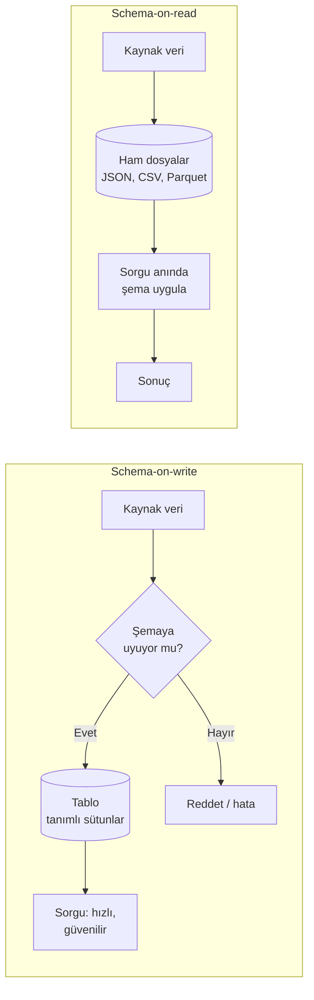
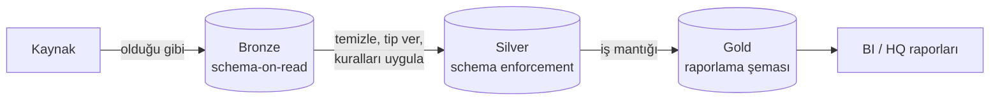

# 9.11 Schema-on-Write ve Schema-on-Read

## Nedir?
Verinin yapısının (şemasının: sütun adları, tipleri, kuralları) **ne zaman** uygulandığına dair iki yaklaşım:

- **Schema-on-write (yazarken şema):** Şema önceden tanımlanır. Veri **yazılırken** bu şemaya uyması zorunludur; uymayan kayıt reddedilir. Klasik ilişkisel veritabanları ve veri ambarları böyle çalışır.
- **Schema-on-read (okurken şema):** Veri **ham hâliyle** saklanır. Şema, veri **okunurken** (sorgu veya işleme sırasında) uygulanır. Data lake'ler ve belge veritabanları böyle çalışır.

## Hangi problemi çözer?
İki yaklaşım farklı riskleri yönetir:
- Schema-on-write, **kirli veri girişini** engeller; raporlanan rakamların güvenilirliğini sağlar.
- Schema-on-read, **esneklik ve hız** sağlar; kaynak yeni bir alan eklediğinde ya da yapısı değiştiğinde veri kaybolmaz, yükleme durmaz.

## Nasıl çalışır?



| Özellik | Schema-on-write | Schema-on-read |
|---|---|---|
| Şema ne zaman? | Yüklemeden önce | Okurken |
| Yükleme hızı | Yavaş (dönüştür + doğrula) | Hızlı (olduğu gibi yaz) |
| Sorgu hızı | Hızlı | Daha yavaş (her okumada yorumlama) |
| Veri kalitesi | Giriş noktasında garanti | Okuyan kişiye/koda kalır |
| Esneklik | Düşük; şema değişikliği maliyetli | Yüksek |
| Ham veri | Genelde kaybolur (sadece dönüştürülmüş hâli kalır) | Korunur; geçmişe dönük yeniden işlenebilir |
| Risk | Yeni alanlar kaçırılır, yükleme kırılır | **Data swamp** (bataklık): kimsenin anlamadığı, güvenilmeyen veri yığını |
| Tipik sistem | Oracle DWH, PostgreSQL, Snowflake tabloları | Data lake (S3/HDFS), MongoDB, bronze katman |
| Tipik akış | ETL | ELT |

## Mini örnek

**Schema-on-write:** PostgreSQL tablosu
```sql
CREATE TABLE bddk_kredi (
    donem   CHAR(7)       NOT NULL,          -- '2026-09'
    kalem   VARCHAR(100)  NOT NULL,
    tutar   NUMERIC(20,2) NOT NULL CHECK (tutar >= 0),
    PRIMARY KEY (donem, kalem)
);

INSERT INTO bddk_kredi VALUES ('2026-09', 'tuketici', 'bin yüz');
-- ERROR: invalid input syntax for type numeric   ← kirli veri giremez
```

**Schema-on-read:** Ham JSON dosyalarını okurken şema uygulamak
```python
import duckdb

# Dosyalar olduğu gibi duruyor; şema sorgu anında belirleniyor
duckdb.sql("""
    SELECT
        CAST(json_extract_string(j, '$.donem') AS VARCHAR)  AS donem,
        CAST(json_extract(j, '$.tutar') AS DECIMAL(20,2))   AS tutar
    FROM read_json_objects('ham/bddk/*.json') AS t(j)
""").show()
```

```python
# PySpark: aynı ham dosyaya iki farklı ekip iki farklı şemayla bakabilir
from pyspark.sql.types import StructType, StructField, StringType, DecimalType
sema = StructType([
    StructField("donem", StringType()),
    StructField("tutar", DecimalType(20, 2)),
])
df = spark.read.schema(sema).json("s3a://lake/bronze/bddk/")
```

**İkisinin birlikte kullanımı (modern yaklaşım)**

Ham veri bronze katmanda esnek biçimde saklanır; silver ve gold katmanlarda şema zorlanır (Delta Lake / Iceberg **schema enforcement**) ([9.13](13-medallion.md)).

## Nerede kullanılır?
- **Schema-on-write:** Düzenleyici raporlar, finansal tablolar, yönetim KPI'ları; yani "bu rakam doğru olmalı" denen her yer.
- **Schema-on-read:** Yapısı sık değişen dış kaynaklar (API cevapları, web'den toplanan Excel'ler), loglar, keşif amaçlı veri bilimi, ham verinin denetim için saklanması.

## Benzerleri ve farkları
- **Schema evolution (şema evrimi):** Delta Lake ve Iceberg gibi tablo formatları, kontrollü biçimde yeni sütun eklemeye izin verir; iki yaklaşımın arasında bir orta yoldur ([9.14](14-delta-iceberg.md)).
- **Veri sözleşmesi (data contract):** Kaynak sistem ile veri ekibi arasında şemanın ve kalite kurallarının yazılı olarak tanımlanması; schema-on-write disiplinini kaynağa taşır.
- **Veri akışındaki yeri:** ETL ve ELT bağlamında ayrıntılı anlatım için [11.2](../11-veri-akisi/02-akista-schema.md).

## İlgili sayfalar
- [9.12 Warehouse, lake, lakehouse](12-warehouse-lake-lakehouse.md)
- [11.1 ETL ve ELT](../11-veri-akisi/01-etl-elt.md)
- [11.2 Akışta şema](../11-veri-akisi/02-akista-schema.md)
