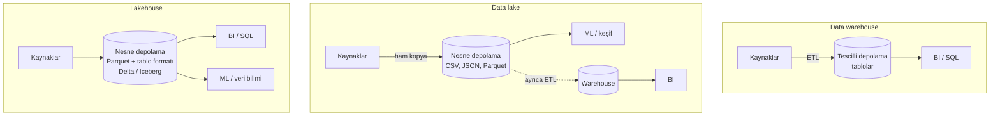

# 9.12 Data Warehouse, Data Lake ve Lakehouse

## Nedir?
Analitik veriyi saklamanın üç mimarisi:
- **Data warehouse (veri ambarı):** Temizlenmiş, yapılandırılmış ve iş için modellenmiş verinin tutulduğu, SQL ile sorgulanan analitik veritabanı.
- **Data lake (veri gölü):** Her türlü verinin (yapılı, yarı yapılı, yapısız) **ham hâliyle** ve ucuza saklandığı dosya deposu.
- **Lakehouse (göl evi):** Data lake'in ucuz ve açık dosya depolamasını, veri ambarının güvenilirlik özellikleriyle (ACID, şema, performans) birleştiren mimari.

## Hangi problemi çözer?
| Mimari | Çözdüğü sorun | Yarattığı sorun |
|---|---|---|
| Warehouse | Güvenilir, hızlı, standart raporlama | Pahalı, esnek değil, yapısız veri ve ML için zayıf |
| Data lake | Ucuz, her veri tipi, ML ve keşif | Güvenilirlik zayıf, "data swamp" riski, güncelleme/silme zor |
| Lakehouse | İkisinin avantajlarını tek kopyada | Görece yeni; yetkinlik ve araç seçimi gerektirir |

Eskiden kurumlar iki sistem birden işletiyordu: ML için lake, BI için warehouse. Veri iki kez kopyalanıyor, iki sistem arasında tutarsızlık oluşuyordu. Lakehouse bu ikiliği azaltmayı hedefler.

## Nasıl çalışır?



**Katmanlar (lakehouse)**
| Katman | Bileşen | Örnek |
|---|---|---|
| Depolama | Nesne depolama (object storage) | S3, Azure Data Lake Storage, Google Cloud Storage, kurum içinde MinIO/Ceph, HDFS |
| Dosya formatı | Sütun bazlı, sıkıştırılmış | **Parquet**, ORC |
| Tablo formatı | ACID, şema, zaman yolculuğu, versiyon | **Delta Lake**, **Apache Iceberg**, Apache Hudi ([9.14](14-delta-iceberg.md)) |
| Katalog | Tabloların ve yetkilerin kaydı | Unity Catalog, Hive Metastore, AWS Glue, Polaris, Nessie |
| Sorgu motoru | SQL ve işleme | Spark, Trino/Presto, Databricks SQL, Dremio, DuckDB, Snowflake (Iceberg) |

| Özellik | Warehouse | Data lake | Lakehouse |
|---|---|---|---|
| Veri tipi | Yapılı | Hepsi | Hepsi |
| Şema | Yazarken | Okurken | Katmana göre ikisi |
| ACID | Var | Yok | Var (tablo formatıyla) |
| Maliyet | Yüksek | Düşük | Düşük–orta |
| Depolama ve hesaplama | Çoğu zaman bağlı | Ayrık | Ayrık |
| Açık format | Genelde tescilli | Açık | Açık |
| BI performansı | Çok iyi | Zayıf | İyi |
| ML erişimi | Dolaylı | Doğrudan | Doğrudan |
| Örnek | Oracle Exadata, Teradata, Snowflake, BigQuery, Redshift | Hadoop/HDFS, S3 klasörleri | Databricks, Iceberg + Trino/Spark, Microsoft Fabric |

## Mini örnek
Aynı aylık kredi raporu üç dünyada:

```sql
-- Warehouse (Oracle DWH)
SELECT donem, SUM(bakiye) FROM dwh.fact_kredi GROUP BY donem;
```

```python
# Data lake: ham Parquet klasörleri (tutarlılık garantisi yok, yarım yazılmış dosyalar okunabilir)
import pandas as pd
df = pd.read_parquet("s3://lake/kredi/donem=2026-09/")
```

```sql
-- Lakehouse: Parquet üzerinde ACID tablo (Spark SQL / Trino)
SELECT donem, SUM(bakiye) FROM lakehouse.gold.kredi_aylik GROUP BY donem;
-- geçen ayki rapor hangi veriyle üretildi? (zaman yolculuğu)
SELECT * FROM lakehouse.gold.kredi_aylik VERSION AS OF 42;
```

## Nerede kullanılır?
- **Warehouse:** Kurumsal raporlama, yasal raporlar, finans ve yönetim KPI'ları. Bankalarda uzun yıllardır merkezi sistemdir.
- **Data lake:** Ham verinin uzun süreli ve ucuz saklanması, log ve yapısız veri (doküman, ses kaydı), veri bilimi keşfi.
- **Lakehouse:** BI ve ML'in aynı veriden beslendiği yeni nesil platformlar; geçmiş verinin denetlenebilir saklanması.

## Benzerleri ve farkları
- **Data mart:** Veri ambarının belirli bir departmana (risk, pazarlama) yönelik küçük alt kümesi.
- **Data mesh:** Teknoloji değil organizasyon yaklaşımı: Veri, merkezi bir ekip yerine alan ekiplerinin sahip olduğu "veri ürünleri" olarak sunulur.
- **Bulut veri ambarları (Snowflake, BigQuery):** Depolama ve hesaplamayı ayırarak lake özelliklerine yaklaştılar; Iceberg tablolarını da okuyabiliyorlar. Sınırlar giderek bulanıklaşıyor.

## İlgili sayfalar
- [9.13 Medallion mimarisi](13-medallion.md)
- [9.14 Delta Lake ve Iceberg](14-delta-iceberg.md)
- [9.11 Schema-on-write ve read](11-schema-on-write-read.md)
- [17.5 Parquet](../17-formatlar/05-parquet.md)
- [9.15 Nesne depolama: S3 ve MinIO](15-nesne-depolama.md)
