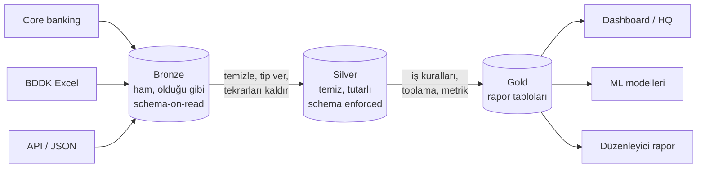

# 9.13 Medallion Mimarisi: Bronze, Silver, Gold

## Nedir?
**Medallion (madalya) mimarisi**, bir lakehouse veya veri platformunda verinin kalitesine göre üç katmanda düzenlenmesidir. İsimler olimpiyat madalyalarından gelir: veri katmandan katmana geçtikçe "değerlenir".

| Katman | Diğer adları | İçerik |
|---|---|---|
| **Bronze** | Raw, landing, ham | Kaynaktan geldiği gibi veri |
| **Silver** | Cleansed, conformed, temiz | Temizlenmiş, tipleri düzeltilmiş, birleştirilmiş veri |
| **Gold** | Curated, business, sunum | İş kurallarıyla hesaplanmış, rapora hazır veri |

## Hangi problemi çözer?
- **İzlenebilirlik:** Raporda bir rakam yanlış görünürse, gold → silver → bronze yolunda geriye gidilerek hatanın nerede oluştuğu bulunur.
- **Yeniden işleme:** İş kuralı değişince (ör. segment tanımı) kaynaktan tekrar veri çekmeden, bronze'dan yeniden hesaplanır.
- **Sorumluluk ayrımı:** Veri mühendisliği bronze/silver'ı, analitik ekipleri gold'u sahiplenir.
- **Tekrar kullanım:** Aynı silver tablo birçok gold tabloyu (dashboard, model, düzenleyici rapor) besler.

## Nasıl çalışır?



| | Bronze | Silver | Gold |
|---|---|---|---|
| Amaç | Kaybetme, denetim kaydı | Güvenilir ortak veri | İş sorusuna cevap |
| Dönüşüm | Yok veya çok az (yükleme zamanı, kaynak dosya adı eklenir) | Tip dönüşümü, boş değer, tekrar, standartlaştırma, birleştirme | Toplama, KPI, iş kuralı, denormalize |
| Şema | Esnek | Zorunlu | Zorunlu, iş diline uygun |
| Ayrıntı seviyesi | Kaynakla aynı | Kayıt seviyesi | Genellikle özet |
| Kim kullanır? | Veri mühendisi | Veri mühendisi, veri bilimci | Analist, BI, yönetim, modeller |
| Saklama | Uzun (denetim) | Uzun | İhtiyaca göre |

## Mini örnek
BDDK aylık kredi verisi için üç katman:

```text
bronze.bddk_kredi_ham        ← Excel'den okunan satırlar olduğu gibi + _kaynak_dosya, _yukleme_zamani
silver.bddk_kredi            ← donem (DATE), kalem (standart kod), tutar (DECIMAL), tekrarsız
gold.bddk_kredi_metrik       ← donem, kalem, tutar, mom_degisim, yoy_degisim, ytd_degisim
```

PySpark ile (Delta Lake):
```python
from pyspark.sql import functions as F, Window

# BRONZE: olduğu gibi + izleme alanları
ham = (spark.read.option("header", True).csv("s3a://lake/landing/bddk/2026-09/*.csv")
       .withColumn("_kaynak_dosya", F.input_file_name())
       .withColumn("_yukleme_zamani", F.current_timestamp()))
ham.write.format("delta").mode("append").saveAsTable("bronze.bddk_kredi_ham")

# SILVER: temizle ve tip ver
silver = (spark.table("bronze.bddk_kredi_ham")
          .withColumn("donem", F.to_date(F.concat(F.col("Donem"), F.lit("-01"))))
          .withColumn("kalem", F.lower(F.trim(F.col("Kalem"))))
          # "1.250.000,50" -> 1250000.50 (Türkçe sayı biçimi)
          .withColumn("tutar", F.regexp_replace(F.regexp_replace("Tutar", r"\.", ""), ",", ".")
                                .cast("decimal(20,2)"))
          .filter(F.col("tutar").isNotNull())
          .dropDuplicates(["donem", "kalem"])
          .select("donem", "kalem", "tutar"))
silver.write.format("delta").mode("overwrite").saveAsTable("silver.bddk_kredi")

# GOLD: metrikler
w = Window.partitionBy("kalem").orderBy("donem")
gold = (spark.table("silver.bddk_kredi")
        .withColumn("mom_degisim", F.col("tutar") / F.lag("tutar", 1).over(w) - 1)
        .withColumn("yoy_degisim", F.col("tutar") / F.lag("tutar", 12).over(w) - 1))
gold.write.format("delta").mode("overwrite").saveAsTable("gold.bddk_kredi_metrik")
```

Aynı mantık PostgreSQL'de şema (schema) ayrımıyla da kurulabilir: `bronze.*`, `silver.*`, `gold.*`.

## Nerede kullanılır?
- Lakehouse platformları (Databricks, Fabric, Iceberg tabanlı yapılar)
- Klasik veri ambarlarında da benzer katmanlar vardır: **staging → ODS/core → data mart**
- Küçük ölçekte tek bir PostgreSQL içinde şemalarla

## Benzerleri ve farkları
| Medallion | Klasik veri ambarı | dbt geleneği |
|---|---|---|
| Bronze | Staging / landing | `sources` + `staging` modelleri |
| Silver | ODS / core / integration | `intermediate` modelleri |
| Gold | Data mart / presentation | `marts` modelleri |

- **Katman sayısı kural değildir:** Bazı ekipler "platinum" (çok özel kullanım) veya ayrı "feature" katmanı ekler.
- **Schema-on-write/read ilişkisi:** Bronze esnektir (read), silver ve gold zorunlu şemalıdır (write) ([9.11](11-schema-on-write-read.md)).

**Dikkat:** Bronze'daki ham veri kişisel veri içerebilir; maskeleme ve erişim yetkileri bu katmandan itibaren planlanmalıdır (Bölüm 15).

## İlgili sayfalar
- [9.12 Warehouse, lake, lakehouse](12-warehouse-lake-lakehouse.md)
- [9.14 Delta Lake ve Iceberg](14-delta-iceberg.md)
- [11.4 dbt](../11-veri-akisi/04-dbt.md)
