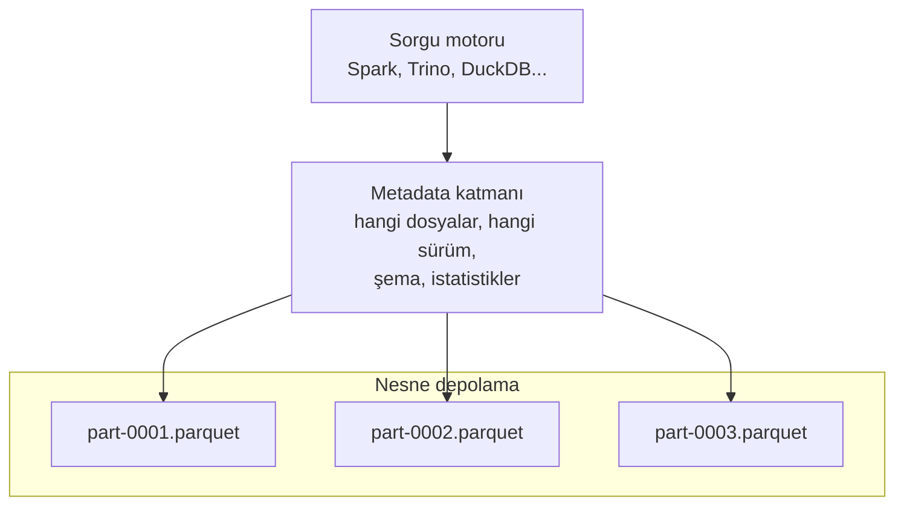

# 9.14 Delta Lake ve Apache Iceberg

## Nedir?
**Açık tablo formatlarıdır (open table formats).** Nesne depolamadaki Parquet dosyalarının üzerine bir **metadata (üst veri) katmanı** ekleyerek, bir dosya klasörünü gerçek bir veritabanı tablosu gibi davranır hâle getirirler.

- **Delta Lake:** Databricks tarafından geliştirilip açık kaynak yapıldı (Linux Foundation).
- **Apache Iceberg:** Netflix'te geliştirildi, Apache projesi oldu. Motor bağımsızlığıyla öne çıkar.
- **Apache Hudi:** Uber'de geliştirilen, artımlı (incremental) işlemeye odaklı üçüncü seçenek.

Lakehouse mimarisinin temel yapı taşıdırlar ([9.12](12-warehouse-lake-lakehouse.md)).

## Hangi problemi çözer?
Düz Parquet klasörlerinin sorunları:

| Sorun (düz dosyalar) | Tablo formatının çözümü |
|---|---|
| Yazma yarıda kalırsa okuyucu yarım veri görür | **ACID işlemler**: yazma ya tamamen görünür ya hiç |
| Tek satırı güncellemek/silmek için tüm dosyayı yeniden yazmak | `UPDATE`, `DELETE`, `MERGE` desteği |
| Yanlış tipte veri yazılabilir | **Şema zorlama (schema enforcement)** |
| Yeni sütun eklemek zor | **Şema evrimi (schema evolution)** |
| "Geçen ayki rapor hangi veriyle üretildi?" bilinmez | **Zaman yolculuğu (time travel)**: eski sürümleri sorgulama |
| Milyonlarca dosyayı listelemek yavaş | Metadata'da dosya listesi ve istatistikler; ilgisiz dosyaları atlama |
| Eşzamanlı yazanlar birbirini bozar | İyimser eşzamanlılık kontrolü |

## Nasıl çalışır?



**Delta Lake:** Tablo klasöründe bir `_delta_log/` dizini vardır. Her işlem sıralı bir JSON kaydıdır (`00000.json`, `00001.json`...): "şu dosyalar eklendi, şunlar silindi". Belirli aralıklarla checkpoint dosyası oluşturulur.

**Iceberg:** Hiyerarşik metadata: tablo metadata dosyası → **snapshot** → manifest listesi → manifest dosyaları → veri dosyaları. Tablonun "güncel" metadata konumu bir **katalogda** tutulur (REST catalog, Hive Metastore, Glue, Nessie, Polaris).

```
kredi_aylik/
├── _delta_log/                 # Delta
│   ├── 00000000000000000000.json
│   └── 00000000000000000001.json
└── donem=2026-09/
    └── part-0001.snappy.parquet
```

**Önemli özellikler**
| Özellik | Açıklama |
|---|---|
| Time travel | `VERSION AS OF 12` / `TIMESTAMP AS OF '2026-10-01'` |
| MERGE (upsert) | CDC ve artımlı yüklemelerin temeli ([11.3](../11-veri-akisi/03-yukleme-turleri.md)) |
| Partitioning | Delta: klasör bazlı; Iceberg: **gizli bölümleme** (hidden partitioning), sorgu yazan kişinin bölümü bilmesine gerek yok |
| Partition evolution | Iceberg'de bölümleme şeması tabloyu yeniden yazmadan değiştirilebilir |
| Compaction / OPTIMIZE | Çok sayıda küçük dosyayı birleştirmek |
| Z-order / clustering | İlgili satırları aynı dosyalarda toplayarak filtreli sorguları hızlandırmak |
| VACUUM / expire snapshots | Eski sürümlere ait gereksiz dosyaları temizlemek (zaman yolculuğu süresini belirler) |

## Mini örnek
Delta Lake (Spark SQL):
```sql
CREATE TABLE silver.bddk_kredi (donem DATE, kalem STRING, tutar DECIMAL(20,2))
USING DELTA PARTITIONED BY (donem);

-- Upsert: yeni ay geldi, düzeltilmiş eski ay da var
MERGE INTO silver.bddk_kredi t
USING staging.bddk_kredi_yeni s
ON t.donem = s.donem AND t.kalem = s.kalem
WHEN MATCHED THEN UPDATE SET t.tutar = s.tutar
WHEN NOT MATCHED THEN INSERT *;

DESCRIBE HISTORY silver.bddk_kredi;                       -- sürüm geçmişi
SELECT * FROM silver.bddk_kredi VERSION AS OF 3;          -- zaman yolculuğu
RESTORE TABLE silver.bddk_kredi TO VERSION AS OF 3;       -- hatalı yüklemeyi geri al
OPTIMIZE silver.bddk_kredi ZORDER BY (kalem);
```

Iceberg (Spark SQL):
```sql
CREATE TABLE lake.silver.islem (islem_id BIGINT, musteri_id INT, ts TIMESTAMP, tutar DECIMAL(18,2))
USING iceberg
PARTITIONED BY (months(ts));                 -- gizli bölümleme: sorguda sadece ts filtrelenir

SELECT * FROM lake.silver.islem.snapshots;   -- snapshot'lar
SELECT * FROM lake.silver.islem TIMESTAMP AS OF '2026-10-01 00:00:00';
```

Python'dan Spark olmadan okumak:
```python
import duckdb
duckdb.sql("INSTALL delta; LOAD delta;")
duckdb.sql("SELECT donem, SUM(tutar) FROM delta_scan('s3://lake/silver/bddk_kredi') GROUP BY 1").show()

from deltalake import DeltaTable          # pip install deltalake
df = DeltaTable("s3://lake/silver/bddk_kredi").to_pandas()

from pyiceberg.catalog import load_catalog  # pip install pyiceberg
tablo = load_catalog("kurum").load_table("silver.islem")
df = tablo.scan(row_filter="musteri_id = 123").to_pandas()
```

## Nerede kullanılır?
- Lakehouse'ların bronze/silver/gold tabloları ([9.13](13-medallion.md))
- CDC ile kaynak sistemlerin güncel kopyasını tutmak
- Denetim gereksinimi: geçmiş rapor sürümlerinin yeniden üretilebilmesi
- Birden çok motorun (Spark ile işleme, Trino ile BI sorgusu, DuckDB ile analiz) aynı veriyi kopyalamadan kullanması

## Benzerleri ve farkları
| | Delta Lake | Apache Iceberg | Apache Hudi |
|---|---|---|---|
| Köken | Databricks | Netflix → Apache | Uber → Apache |
| Güçlü yanı | Spark/Databricks entegrasyonu, olgunluk | Motor bağımsızlığı, gizli bölümleme, geniş ekosistem (Snowflake, Trino, Flink, BigQuery) | Akış (streaming) upsert'leri |
| Metadata | `_delta_log` işlem günlüğü | Snapshot + manifest + katalog | Timeline |

- **Yakınsama:** Delta UniForm, Delta tablolarını Iceberg istemcilerinin de okuyabileceği metadata ile yazabilir; formatlar arası uyumluluk artıyor.
- **Düz Parquet:** Tek seferlik dışa aktarım ve basit arşiv için hâlâ yeterlidir; güncellenen ve paylaşılan tablolar için tablo formatı önerilir.

## İlgili sayfalar
- [9.12 Warehouse, lake, lakehouse](12-warehouse-lake-lakehouse.md)
- [9.13 Medallion](13-medallion.md)
- [10.3 Spark](../10-veri-isleme/03-spark.md)
- [17.5 Parquet](../17-formatlar/05-parquet.md)
- [9.15 Nesne depolama: S3 ve MinIO](15-nesne-depolama.md)
