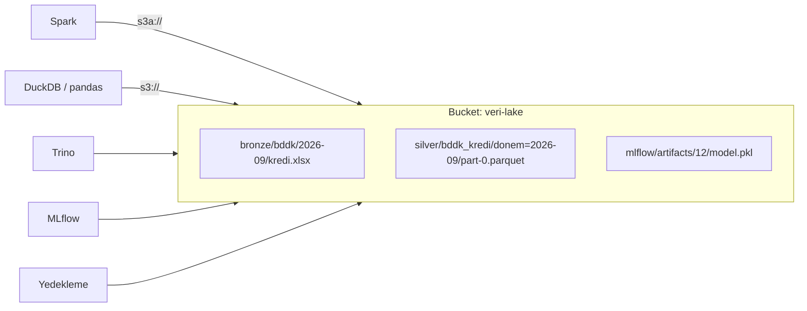

# 9.15 Nesne Depolama: S3 ve MinIO

## Nedir?
**Nesne depolama (object storage)**, veriyi klasör ağacındaki dosyalar ya da diskteki bloklar olarak değil, **nesneler (object)** olarak saklayan depolama türüdür. Her nesne üç parçadan oluşur:
- **Veri:** Dosyanın içeriği (Parquet, CSV, resim, model dosyası, yedek...)
- **Anahtar (key):** Nesnenin benzersiz adı: `bronze/bddk/2026-09/kredi.parquet`
- **Metadata:** İçerik tipi, oluşturulma zamanı, özel etiketler

Nesneler **bucket** (kova) adı verilen kaplarda durur ve **HTTP tabanlı bir API** ile okunup yazılır. Bu API'nin fiilî standardı Amazon'un **S3 (Simple Storage Service)** API'sidir; birçok ürün "S3 uyumlu" çalışır.

| Ürün | Ortam |
|---|---|
| **Amazon S3** | AWS |
| **Azure Blob Storage / ADLS Gen2** | Azure (kendi API'si; S3 uyumlu değil) |
| **Google Cloud Storage** | GCP (S3 uyumlu erişim de sunar) |
| **MinIO** | Kurum içi (on-prem), Kubernetes/OpenShift üzerinde; S3 uyumlu |
| **Ceph (RADOS Gateway)**, OpenShift Data Foundation (NooBaa) | Kurum içi, S3 uyumlu |
| NetApp StorageGRID, Dell ECS vb. | Kurumsal donanım çözümleri, S3 uyumlu |

## Hangi problemi çözer?
- **Ölçek ve maliyet:** Petabaytlarca veriyi ucuz ve neredeyse sınırsız büyüyerek saklar. Disk eklemek, bölüm büyütmek gerekmez.
- **Depolama ve hesaplamanın ayrılması:** Veri tek bir yerde durur; Spark, Trino, DuckDB, pandas, Snowflake aynı veriyi kopyalamadan okur. Lakehouse mimarisinin temeli budur ([9.12](12-warehouse-lake-lakehouse.md)).
- **Paylaşılan erişim:** Birden çok sunucu ve pod aynı veriye ağ üzerinden erişir; bir sunucunun diskine bağlı kalınmaz.
- **Dayanıklılık:** Veri arka planda birden çok diske/sunucuya/veri merkezine kopyalanır.
- **Yaşam döngüsü:** Eski veriyi otomatik olarak ucuz katmana taşımak veya silmek.

## Nasıl çalışır?

**Üç depolama türü**
| | Blok depolama | Dosya depolama | Nesne depolama |
|---|---|---|---|
| Birim | Disk bloğu | Dosya, klasör ağacı | Nesne (veri + anahtar + metadata) |
| Erişim | İşletim sistemi diski olarak | NFS / SMB paylaşımı, POSIX | HTTP API (S3) |
| Tipik kullanım | Veritabanı diski, VM diski | Ortak klasörler, ev dizinleri | Veri gölü, yedek, arşiv, model dosyaları |
| Ölçek | Tek sunucuya bağlı | Orta | Çok büyük |
| Dosyanın ortasını değiştirmek | Evet | Evet | **Hayır**, nesne bütün olarak yeniden yazılır |
| Kubernetes karşılığı | PVC (RWO) | PVC (RWX) | Uygulama doğrudan S3 API'siyle konuşur |



**Önemli kavramlar**
| Kavram | Açıklama |
|---|---|
| **Bucket** | Nesnelerin kabı; adı genellikle küresel veya sistem çapında benzersiz olmalı |
| **Key / prefix** | `silver/bddk/` gibi önekler klasör **gibi görünür** ama gerçek klasör yoktur; anahtarın parçasıdır |
| **Endpoint** | API adresi: AWS'de bölgesel, MinIO'da `https://minio.sirket.local` |
| **Access key / secret key** | Kimlik bilgileri; Vault'ta saklanmalı ([15.7](../15-guvenlik/07-secret-yonetimi.md)) |
| **Bucket politikası / IAM** | Hangi kimliğin hangi bucket/önek üzerinde hangi işlemi yapabileceği |
| **Versioning** | Nesnenin eski sürümlerini saklamak; yanlış silme ve üzerine yazmaya karşı koruma |
| **Lifecycle kuralları** | "90 günden eski bronze verisini soğuk katmana taşı, 7 yıl sonra sil" |
| **Object lock (WORM)** | Belirli süre silinemez/değiştirilemez nesneler; denetim kayıtları ve yasal saklama için |
| **Presigned URL** | Kimlik bilgisi paylaşmadan, süreli indirme/yükleme bağlantısı |
| **Multipart upload** | Büyük dosyaların parçalar hâlinde paralel yüklenmesi |
| **Sunucu tarafı şifreleme (SSE)** | Nesnelerin diskte şifreli tutulması ([15.8](../15-guvenlik/08-sifreleme.md)) |
| **Depolama sınıfları** | Standart, seyrek erişim, arşiv (Glacier vb.); erişim sıklığına göre maliyet |

**Nesne depolamanın sınırları**
- **Değiştirilemezlik:** Bir nesneye satır eklenemez; dosya yeniden yazılır. Bu yüzden tablolar için Parquet + **Delta/Iceberg** kullanılır; güncelleme ve ACID'i tablo formatı sağlar ([9.14](14-delta-iceberg.md)).
- **"Klasör taşıma" pahalıdır:** Önek değiştirmek her nesneyi kopyalayıp silmek demektir.
- **Gecikme:** Her istek bir HTTP çağrısıdır; çok sayıda küçük dosya yavaştır ("small files problem"). Az sayıda büyük dosya (yüzlerce MB) tercih edilir.
- **Listeleme maliyeti:** Milyonlarca nesneyi listelemek yavaştır; tablo formatlarının metadata'sı bu sorunu çözer.

## Mini örnek
**MinIO'yu yerelde denemek**
```bash
docker run -d --name minio -p 9000:9000 -p 9001:9001 \
  -e MINIO_ROOT_USER=admin -e MINIO_ROOT_PASSWORD=degistir123 \
  -v miniodata:/data quay.io/minio/minio server /data --console-address ":9001"
# Web konsolu: http://localhost:9001
```

**Komut satırı (MinIO istemcisi `mc` ve AWS CLI)**
```bash
mc alias set yerel http://localhost:9000 admin degistir123
mc mb yerel/veri-lake                                  # bucket oluştur
mc cp kredi.parquet yerel/veri-lake/silver/bddk/       # yükle
mc ls --recursive yerel/veri-lake/silver/
mc share download --expire 1h yerel/veri-lake/silver/bddk/kredi.parquet   # süreli link

aws s3 ls s3://veri-lake/silver/ --endpoint-url https://minio.sirket.local
aws s3 cp kredi.parquet s3://veri-lake/silver/bddk/ --endpoint-url https://minio.sirket.local
aws s3 sync ./cikti s3://veri-lake/gold/rapor/ --endpoint-url https://minio.sirket.local
```

**Python: boto3**
```python
import boto3

s3 = boto3.client(
    "s3",
    endpoint_url="https://minio.sirket.local",       # AWS S3'te bu satır olmaz
    aws_access_key_id=ERISIM_ANAHTARI,               # Vault / ortam değişkeninden
    aws_secret_access_key=GIZLI_ANAHTAR,
)
s3.upload_file("kredi.parquet", "veri-lake", "silver/bddk/donem=2026-09/kredi.parquet")

for nesne in s3.list_objects_v2(Bucket="veri-lake", Prefix="silver/bddk/").get("Contents", []):
    print(nesne["Key"], nesne["Size"])

link = s3.generate_presigned_url("get_object",
                                 Params={"Bucket": "veri-lake", "Key": "gold/rapor/ozet.xlsx"},
                                 ExpiresIn=3600)
```

**pandas / DuckDB / Polars ile doğrudan okuma**
```python
import pandas as pd

ayar = {"key": ERISIM_ANAHTARI, "secret": GIZLI_ANAHTAR,
        "client_kwargs": {"endpoint_url": "https://minio.sirket.local"}}
df = pd.read_parquet("s3://veri-lake/silver/bddk/", storage_options=ayar)      # s3fs gerekir
df.to_parquet("s3://veri-lake/gold/bddk_ozet.parquet", storage_options=ayar)
```
```sql
-- DuckDB
INSTALL httpfs; LOAD httpfs;
CREATE SECRET minio (TYPE s3, KEY_ID '...', SECRET '...', ENDPOINT 'minio.sirket.local', URL_STYLE 'path');
SELECT donem, SUM(tutar) FROM 's3://veri-lake/silver/bddk/**/*.parquet' GROUP BY donem;
```

**Spark**
```python
spark = (SparkSession.builder
    .config("spark.hadoop.fs.s3a.endpoint", "https://minio.sirket.local")
    .config("spark.hadoop.fs.s3a.path.style.access", "true")
    .getOrCreate())
df = spark.read.parquet("s3a://veri-lake/silver/bddk/")
```

**Lifecycle kuralı örneği (S3 JSON)**
```json
{
  "Rules": [
    {
      "ID": "bronze-temizlik",
      "Filter": {"Prefix": "bronze/"},
      "Status": "Enabled",
      "Expiration": {"Days": 365}
    }
  ]
}
```

**Bucket düzeni önerisi**
```
veri-lake/
├── bronze/<kaynak>/<donem>/...        # ham, değiştirilmez
├── silver/<tablo>/...                 # Delta/Iceberg tabloları
├── gold/<tablo>/...
├── _checkpoints/                      # akış işleme durumu
└── tmp/                               # lifecycle ile 7 günde silinir
mlflow-artifacts/                      # ayrı bucket: modeller ve deney dosyaları
yedekler/                              # versioning + object lock açık
```

## Nerede kullanılır?
- Lakehouse ve data lake'lerin depolama katmanı (bronze/silver/gold)
- MLflow artifact deposu, model dosyaları, eğitim veri setleri
- Veritabanı ve uygulama yedekleri, log arşivleri
- Raporların (PDF/Excel) üretilip süreli linkle paylaşılması
- Container registry'lerin (Harbor, Quay) ve Loki gibi log sistemlerinin arka uç deposu

## Benzerleri ve farkları
- **NFS / dosya paylaşımı:** Uygulamalar dosyayı yerel dosya gibi açar ve kısmen değiştirebilir; ama ölçek ve eşzamanlı analitik erişimde nesne depolama daha uygundur.
- **HDFS:** Hadoop'un dağıtık dosya sistemi; birçok kurumda yerini nesne depolamaya bırakmaktadır (depolama ve hesaplamanın ayrılması).
- **Veritabanı (BLOB sütunu):** Büyük dosyaları veritabanında tutmak pahalı ve yavaştır; dosya nesne depolamada, yolu veritabanında tutulur.
- **fsspec:** Python'da `s3://`, `abfs://`, `gs://` ve yerel dosyaları aynı arayüzle kullanmayı sağlayan katman; pandas, Dask ve Polars bunu kullanır.

**Güvenlik notları:** Bucket'lar varsayılan olarak **kapalı** olmalı; herkese açık bucket yanlışlığı en sık veri sızıntısı nedenlerinden biridir. Erişim anahtarları uygulama/servis bazında ve en az yetkiyle verilmeli ([15.6](../15-guvenlik/06-rbac-en-az-yetki.md)), kişisel veri içeren önekler ayrıca etiketlenmeli ([15.9](../15-guvenlik/09-maskeleme-kvkk.md)).

## İlgili sayfalar
- [9.12 Warehouse, lake, lakehouse](12-warehouse-lake-lakehouse.md)
- [9.14 Delta Lake ve Iceberg](14-delta-iceberg.md)
- [17.5 Parquet](../17-formatlar/05-parquet.md)
