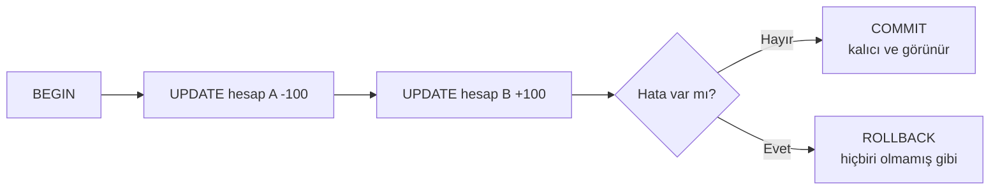

# 9.16 Transaction ve Isolation Seviyeleri

## Nedir?
**Transaction (işlem)**, veritabanında birlikte başarılı olması ya da birlikte geri alınması gereken komutlar grubudur. `BEGIN` ile başlar, `COMMIT` ile kalıcı hâle gelir, `ROLLBACK` ile geri alınır. ACID kavramı ([9.2](02-iliskisel-sql-acid.md)) transaction'ların garantilerini tanımlar.

**Isolation (yalıtım) seviyesi**, aynı anda çalışan transaction'ların birbirinin yarım kalmış veya yeni yapılmış değişikliklerini **ne kadar görebileceğini** belirler. ACID'deki "I" harfidir.

## Hangi problemi çözer?
- **Yarım iş kalmaz:** Hesaptan para düşüldü ama karşı hesaba yatmadı durumu oluşmaz.
- **ETL tutarlılığı:** "Önce eski dönemi sil, sonra yenisini yükle" işlemi yarıda kesilirse tablo boş kalmaz.
- **Eşzamanlılık hataları:** Aynı kaydı iki kullanıcı aynı anda güncellediğinde birinin değişikliğinin kaybolması (lost update) önlenir.
- **Tutarlı rapor:** Uzun süren bir rapor sorgusu, çalışırken değişen verilerden etkilenmeden tutarlı bir anlık görüntü okur.

## Nasıl çalışır?

**Transaction'ın yaşam döngüsü**


**Eşzamanlılık anomalileri**
| Anomali | Ne olur? | Örnek |
|---|---|---|
| **Dirty read** | Başkasının henüz commit etmediği veri okunur | A transaction'ı bakiyeyi değiştirdi, B okudu, A geri aldı: B olmayan bir değeri gördü |
| **Non-repeatable read** | Aynı satır iki kez okunduğunda farklı değer gelir | Rapor başında ve sonunda aynı müşterinin limiti farklı |
| **Phantom read** | Aynı koşulla iki sorgu farklı **sayıda** satır döndürür | Toplam ve detay sorgusu arasında yeni işlem eklendi; toplamlar tutmuyor |
| **Lost update** | İki transaction aynı satırı okuyup günceller, biri diğerinin değişikliğini ezer | İki kullanıcı aynı limit kaydını aynı anda düzenliyor |
| **Write skew** | İki transaction farklı satırları günceller ama birlikte bir kuralı bozar | "En az bir nöbetçi olmalı" kuralı, iki kişi aynı anda nöbetten çıkınca bozulur |

**SQL standardındaki seviyeler**
| Seviye | Dirty read | Non-repeatable read | Phantom |
|---|---|---|---|
| Read Uncommitted | Olabilir | Olabilir | Olabilir |
| **Read Committed** | Engellenir | Olabilir | Olabilir |
| Repeatable Read | Engellenir | Engellenir | Olabilir |
| Serializable | Engellenir | Engellenir | Engellenir |

**Veritabanlarındaki gerçek davranış**
| | PostgreSQL | Oracle | SQL Server |
|---|---|---|---|
| Varsayılan | Read Committed | Read Committed | Read Committed (kilit tabanlı; RCSI açılabilir) |
| Read Uncommitted | Read Committed gibi davranır | Yok | Var (`NOLOCK`) |
| Repeatable Read | Snapshot isolation (phantom da oluşmaz) | Yok | Kilit tabanlı |
| Serializable | Gerçek serializable (SSI); çakışmada hata verir | Aslında snapshot isolation | Kilit tabanlı |

**MVCC (Multi-Version Concurrency Control):** PostgreSQL ve Oracle, güncellenen satırın eski sürümünü bir süre saklar. Böylece **okuyanlar yazanları, yazanlar okuyanları beklemez**; her transaction kendi başladığı ana (veya ifadenin başladığı ana) ait tutarlı görüntüyü okur. Oracle'da eski sürümler **undo** alanında tutulur; çok uzun sorgular "ORA-01555: snapshot too old" hatası alabilir. PostgreSQL'de eski sürümler tabloda kalır ve **VACUUM** ile temizlenir.

**Önemli ayrıntılar**
- **Autocommit:** Birçok istemci her komutu ayrı transaction olarak hemen commit eder. Python `psycopg` ve `oracledb` ise varsayılan olarak transaction açar; `commit()` çağrılmazsa değişiklik kaybolur.
- **Savepoint:** Transaction içinde ara nokta; tüm işi değil sadece bir kısmını geri almak için.
- **DDL davranışı:** PostgreSQL'de `CREATE TABLE`, `ALTER TABLE` gibi komutlar transaction içinde geri alınabilir. Oracle'da her DDL **örtük commit** yapar; önceki yarım işler de commit edilir.
- **Uzun transaction'lar zararlıdır:** Kilit tutar, VACUUM'u engeller, undo/WAL alanını şişirir. Transaction'ı kısa tutun; kullanıcı girdisi beklerken açık bırakmayın.

## Mini örnek
**ETL'de güvenli yeniden yükleme**
```sql
BEGIN;
DELETE FROM dwh.bddk_kredi WHERE donem = DATE '2026-09-01';
INSERT INTO dwh.bddk_kredi (donem, kalem, tutar)
SELECT donem, kalem, tutar FROM staging.bddk_kredi WHERE donem = DATE '2026-09-01';
-- Kontrol: satır sayısı beklenen aralıkta değilse ROLLBACK
COMMIT;
```
Okuyucular COMMIT anına kadar eski veriyi, sonrasında yeni veriyi görür; arada boş tablo görmezler.

**Lost update'i önlemek**
```sql
-- 1) Kötümser (pessimistic): satırı kilitle
BEGIN;
SELECT limit_tutari FROM kredi_limit WHERE musteri_id = 123 FOR UPDATE;
UPDATE kredi_limit SET limit_tutari = 750000 WHERE musteri_id = 123;
COMMIT;

-- 2) İyimser (optimistic): sürüm sütunu ile
UPDATE kredi_limit
SET limit_tutari = 750000, surum = surum + 1
WHERE musteri_id = 123 AND surum = 7;      -- 0 satır güncellendiyse başkası değiştirmiş
```

**Seviye seçmek ve savepoint**
```sql
BEGIN ISOLATION LEVEL REPEATABLE READ;      -- PostgreSQL: rapor boyunca tutarlı görüntü
SELECT SUM(tutar) FROM islem WHERE tarih = CURRENT_DATE - 1;
SELECT segment, SUM(tutar) FROM islem WHERE tarih = CURRENT_DATE - 1 GROUP BY segment;
COMMIT;

BEGIN;
INSERT INTO log_tablo VALUES ('basladi');
SAVEPOINT once;
UPDATE hedef SET durum = 'X';               -- hata olursa:
ROLLBACK TO SAVEPOINT once;                 -- sadece bu kısmı geri al
COMMIT;
```

**Python**
```python
import psycopg

with psycopg.connect(DSN) as conn:          # blok hatasız biterse commit, hata olursa rollback
    with conn.cursor() as cur:
        cur.execute("DELETE FROM dwh.bddk_kredi WHERE donem = %s", (donem,))
        cur.executemany("INSERT INTO dwh.bddk_kredi VALUES (%s, %s, %s)", satirlar)

# SQLAlchemy
with engine.begin() as conn:                # transaction bloğu
    conn.execute(text("UPDATE ..."))
```

## Nerede kullanılır?
- Bankacılık hareketleri: havale, EFT, limit güncelleme (çok adımlı, hepsi ya da hiçbiri)
- ETL'lerde dönem bazlı silip yeniden yükleme ve MERGE işlemleri
- Tutarlı rapor anlık görüntüsü almak (Repeatable Read / snapshot)
- Uygulamalarda eşzamanlı düzenleme çakışmalarını yönetmek

## Benzerleri ve farkları
- **Dağıtık transaction (2PC, XA):** Birden çok veritabanını tek transaction'da birleştirir; karmaşık ve yavaştır. Mikroservislerde yerine **Saga** deseni (her adımın telafi işlemiyle) kullanılır.
- **NoSQL:** MongoDB çok belgeli transaction destekler ama tasarım genellikle tek belge atomikliğine dayanır ([9.6](06-mongodb.md)).
- **Lakehouse tabloları:** Delta/Iceberg, nesne depolama üzerinde dosya düzeyinde ACID ve iyimser eşzamanlılık sağlar ([9.14](14-delta-iceberg.md)).

## İlgili sayfalar
- [9.2 İlişkisel veritabanı, SQL ve ACID](02-iliskisel-sql-acid.md)
- [9.17 Lock ve deadlock](17-lock-deadlock.md)
- [9.26 Query timeout](26-query-timeout.md)
- [11.3 Yükleme türleri](../11-veri-akisi/03-yukleme-turleri.md)
- [9.25 Stored procedure, function, trigger](25-procedure-function-trigger.md)
