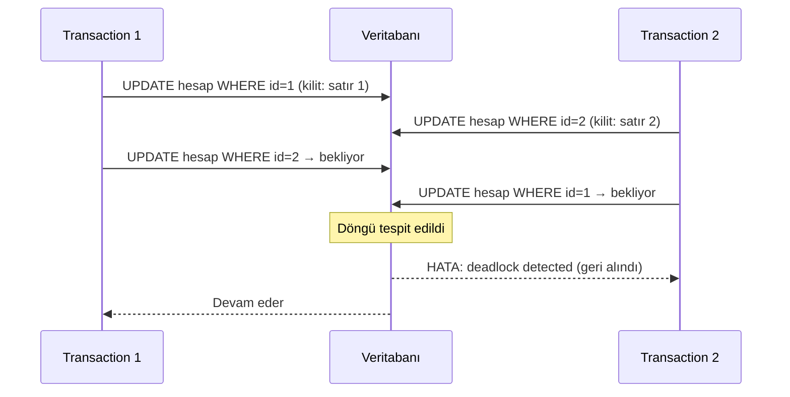

# 9.17 Lock ve Deadlock

## Nedir?
**Lock (kilit)**, veritabanının aynı veriye aynı anda yapılan ve birbiriyle çakışan erişimleri sıraya koymak için kullandığı mekanizmadır. Bir transaction bir satırı güncellerken, başka bir transaction'ın aynı satırı güncellemesi o kilit bırakılana kadar **bekletilir**.

**Deadlock (kilitlenme)**, iki veya daha fazla transaction'ın birbirinin tuttuğu kilidi beklemesi ve hiçbirinin ilerleyememesidir. Veritabanı bunu tespit eder ve transaction'lardan birini hatayla sonlandırır.

## Hangi problemi çözer?
Kilitler veri tutarlılığını korur: iki ETL'in aynı satırı aynı anda değiştirip birbirini ezmesini, tablo yapısı değişirken birinin tabloya yazmasını engeller.

Ama yanlış kullanıldığında sorun da üretir; kilitleri anlamak şu şikâyetlerin kaynağını bulmayı sağlar:
- "Sorgu hiç bitmiyor ama CPU boşta" → büyük olasılıkla bir **kilit bekliyor**.
- "ETL gece takıldı" → başka bir oturum tabloyu kilitli tutuyor.
- "ORA-00060: deadlock detected" / "deadlock detected" hataları.
- "ALTER TABLE çalıştırdım, bütün uygulama dondu."

## Nasıl çalışır?

**Kilit türleri (sadeleştirilmiş)**
| Kilit | Ne zaman alınır? | Neyi engeller? |
|---|---|---|
| **Satır kilidi (row lock)** | `UPDATE`, `DELETE`, `SELECT ... FOR UPDATE` | Aynı satırı değiştirmek isteyen diğer yazanları |
| **Paylaşımlı (shared)** | Bazı veritabanlarında okuma, yabancı anahtar kontrolü | Satırın değiştirilmesini; diğer okumalara izin verir |
| **Özel (exclusive)** | Yazma | Diğer yazanları (kilit tabanlı veritabanlarında okuyanları da) |
| **Tablo kilidi** | `LOCK TABLE`, `TRUNCATE`, çoğu `ALTER TABLE`, `DROP` | Tabloya erişimi (türüne göre okumayı da) |
| **DDL / metadata kilidi** | Yapı değişikliği | Tablo kullanılırken yapısının değişmesini |

**MVCC'nin etkisi:** PostgreSQL ve Oracle'da normal `SELECT` satır kilidi almaz; okuma yazmayı, yazma okumayı bekletmez ([9.16](16-transaction-isolation.md)). Beklemeler genellikle **yazan–yazan** çakışmalarında veya **DDL**'de olur. SQL Server'ın varsayılan kilit tabanlı modunda ise okumalar da yazanları bekleyebilir.

**Deadlock nasıl oluşur?**


**Kilit kuyruğu tuzağı (PostgreSQL):** Uzun süren bir sorgu tabloyu okurken biri `ALTER TABLE` çalıştırırsa, ALTER en güçlü kilidi beklemeye başlar. Arkasından gelen **bütün** sıradan sorgular da ALTER'ın arkasında kuyruğa girer. Sonuç: tek bir DDL tüm uygulamayı dondurur. Çözüm: DDL'den önce `SET lock_timeout = '5s'`.

**Kilitleri azaltma ilkeleri**
1. Transaction'ları **kısa** tutun; transaction içinde dış API çağrısı, dosya okuma, kullanıcı beklemesi yapmayın.
2. Satırları **her yerde aynı sırayla** güncelleyin (örneğin `id` sırasına göre); deadlock'ların çoğu böyle önlenir.
3. Büyük güncellemeleri **parçalara** bölün (her seferinde 10.000 satır).
4. DDL'leri yoğun olmayan saatlerde ve `lock_timeout` ile çalıştırın.
5. Deadlock hatası alan işlemi **yeniden deneyin** (retry); bu, veritabanının beklenen davranışıdır.

## Mini örnek
**PostgreSQL: kim kimi bekliyor?**
```sql
SELECT pid, usename, state, wait_event_type, wait_event,
       now() - xact_start AS transaction_suresi,
       pg_blocking_pids(pid) AS engelleyen,
       left(query, 80) AS sorgu
FROM pg_stat_activity
WHERE state <> 'idle'
ORDER BY xact_start;

SELECT pg_cancel_backend(12345);       -- sorguyu iptal et (oturum kalır)
SELECT pg_terminate_backend(12345);    -- oturumu sonlandır (dikkatli kullanın)
```

**Oracle**
```sql
SELECT s.sid, s.serial#, s.username, s.blocking_session, s.event, s.seconds_in_wait, s.sql_id
FROM v$session s
WHERE s.blocking_session IS NOT NULL;
-- ALTER SYSTEM KILL SESSION 'sid,serial#';   -- DBA yetkisiyle
```

**Kuyruk işleme: SKIP LOCKED**
```sql
-- Birden çok worker aynı iş tablosundan çakışmadan iş alır
BEGIN;
SELECT id, dosya_yolu FROM is_kuyrugu
WHERE durum = 'BEKLIYOR'
ORDER BY id
LIMIT 10
FOR UPDATE SKIP LOCKED;                 -- başkasının kilitlediği satırları atla
-- ... işle, durumu güncelle ...
COMMIT;

SELECT * FROM hesap WHERE id = 1 FOR UPDATE NOWAIT;   -- beklemek yerine hemen hata ver
```

**Güvenli DDL**
```sql
SET lock_timeout = '5s';                -- 5 saniyede kilit alamazsan vazgeç
ALTER TABLE musteri ADD COLUMN risk_segmenti text;
CREATE INDEX CONCURRENTLY ix_islem_tarih ON islem (tarih);   -- tabloyu yazmaya kilitlemeden index
```

**Büyük güncellemeyi parçalamak**
```sql
-- Tek seferde 50 milyon satır yerine
UPDATE islem SET kanal = 'MOBIL'
WHERE id IN (SELECT id FROM islem WHERE kanal = 'MOB' LIMIT 10000);
-- döngü içinde, her parçadan sonra COMMIT
```

## Nerede kullanılır?
- Gece ETL'lerinin takılmasını araştırmak
- Aynı tabloya yazan paralel job'ların (Airflow task'ları, Spark JDBC yazımları) tasarımı
- Kuyruk tabloları ve iş dağıtımı (`SKIP LOCKED`)
- Canlı sistemde index ekleme, sütun ekleme gibi bakım işleri

## Benzerleri ve farkları
- **Advisory lock (PostgreSQL):** Satıra değil, uygulamanın belirlediği bir numaraya alınan kilit. "Bu ETL aynı anda iki kez çalışmasın" kontrolü için: `SELECT pg_try_advisory_lock(42);`
- **Uygulama düzeyinde kilit:** Redis'te kilit anahtarı veya orkestrasyon aracının eşzamanlılık ayarı (`max_active_runs=1`, Kubernetes CronJob `concurrencyPolicy: Forbid`).
- **Lakehouse:** Delta/Iceberg kilit yerine iyimser eşzamanlılık kullanır; çakışan yazma commit anında hata alır ve yeniden denenir.

## İlgili sayfalar
- [9.16 Transaction ve isolation](16-transaction-isolation.md)
- [9.26 Query timeout](26-query-timeout.md)
- [9.24 Connection pooling](24-connection-pooling.md)
- [SQL / psql cheat sheet](../ekler/sql-psql-cheatsheet.md)
