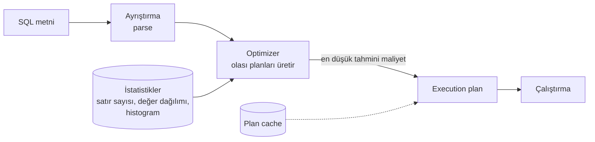

# 9.19 Execution Plan (Sorgu Planı) Okumak

## Nedir?
**Execution plan (sorgu planı)**, veritabanının bir SQL sorgusunu **adım adım nasıl çalıştıracağını** gösteren tariftir: hangi tabloyu nasıl okuyacak (tamamını mı, index ile mi), tabloları hangi sırayla ve hangi yöntemle birleştirecek, sıralama ve gruplamayı nerede yapacak.

SQL "ne istediğimi" söyleyen bildirimsel (declarative) bir dildir; "nasıl yapılacağına" veritabanının **optimizer** (sorgu iyileştirici) bileşeni karar verir. Plan, bu kararın çıktısıdır.

## Hangi problemi çözer?
Yavaş bir sorguyu tahminle değil, **kanıtla** iyileştirmeyi sağlar:
- Index kullanılıyor mu, yoksa milyonlarca satır baştan sona mı okunuyor?
- Optimizer 10 satır bekleyip 10 milyon satırla mı karşılaştı (yanlış tahmin)?
- Zaman hangi adımda harcanıyor?
- Sorgu, diske taşan bir sıralama veya hash işlemi mi yapıyor?

## Nasıl çalışır?

**Optimizer nasıl karar verir?**

- **Maliyet tabanlı optimizer (CBO):** Her olası plan için disk okuma ve CPU maliyetini tahmin eder, en ucuzunu seçer.
- Tahminler **istatistiklere** dayanır. İstatistikler eski veya eksikse, optimizer yanlış plan seçer. Kötü planların en yaygın nedeni budur.

**Planı okumak**
- Plan bir **ağaçtır**; en içteki (en çok girintili) adımlar önce çalışır, sonuç yukarı doğru akar.
- Her adımda: **tahmini maliyet**, **tahmini satır sayısı** ve (gerçekten çalıştırılınca) **gerçek süre** ve **gerçek satır sayısı**.
- **Altın kural:** Tahmini satır sayısı ile gerçek satır sayısı arasında büyük fark (100 kat ve üzeri) olan adımı arayın. Sorun genellikle oradadır.

**Sık görülen plan adımları**
| PostgreSQL | Oracle | Anlamı |
|---|---|---|
| `Seq Scan` | `TABLE ACCESS FULL` | Tablonun tamamını okuma |
| `Index Scan` | `INDEX RANGE SCAN` + `TABLE ACCESS BY INDEX ROWID` | Index ile satır bulup tablodan okuma |
| `Index Only Scan` | `INDEX FAST FULL SCAN` / sadece index | Tabloya gitmeden index'ten cevap |
| `Bitmap Heap Scan` | `BITMAP ...` | Çok sayıda satır için index'leri birleştirip toplu okuma |
| `Nested Loop` | `NESTED LOOPS` | İç içe döngü join ([9.20](20-join-stratejileri.md)) |
| `Hash Join` | `HASH JOIN` | Küçük tablodan hash tablosu kurup büyüğü tarama |
| `Merge Join` | `MERGE JOIN` | Sıralı iki girdiyi birleştirme |
| `Sort` | `SORT ORDER BY` | Sıralama; bellek yetmezse diske taşar |
| `HashAggregate` / `GroupAggregate` | `HASH GROUP BY` / `SORT GROUP BY` | Gruplama |
| `Gather` / `Parallel Seq Scan` | `PX ...` | Paralel çalışma |
| — | `PARTITION RANGE ITERATOR` | Sadece ilgili partition'ları okuma |

**EXPLAIN ve EXPLAIN ANALYZE farkı**
| Komut | Ne yapar? | Dikkat |
|---|---|---|
| `EXPLAIN` | Sadece planı ve tahminleri gösterir, sorguyu çalıştırmaz | Güvenli |
| `EXPLAIN ANALYZE` | Sorguyu **gerçekten çalıştırır**, gerçek süre ve satır sayılarını ekler | `UPDATE`/`DELETE` için transaction içinde çalıştırıp `ROLLBACK` yapın |

**Plan cache ve bind değişkenleri**
- Veritabanı aynı sorgu metni için planı önbellekte tutar ve tekrar kullanır; ayrıştırma maliyeti düşer.
- Parametreli sorgular (`WHERE musteri_id = :id`) hem plan tekrar kullanımını hem de SQL injection korumasını sağlar.
- Yan etki: İlk çalıştırmadaki parametreye göre oluşan plan, çok farklı dağılımdaki başka bir parametre için kötü olabilir (Oracle'da **bind peeking**; PostgreSQL'de generic/custom plan seçimi).

## Mini örnek
**PostgreSQL**
```sql
EXPLAIN (ANALYZE, BUFFERS)
SELECT m.segment, SUM(i.tutar)
FROM islem i
JOIN musteri m ON m.musteri_id = i.musteri_id
WHERE i.tarih >= DATE '2026-09-01' AND i.tarih < DATE '2026-10-01'
GROUP BY m.segment;
```
Örnek çıktı (sadeleştirilmiş):
```
HashAggregate  (rows=5) (actual time=4120..4120 rows=5)
  ->  Hash Join  (rows=1200) (actual rows=9800000)             ← tahmin 1.200, gerçek 9,8 milyon!
        Hash Cond: (i.musteri_id = m.musteri_id)
        ->  Seq Scan on islem i  (actual rows=9800000)
              Filter: (tarih >= '2026-09-01' AND tarih < '2026-10-01')
              Rows Removed by Filter: 410000000                 ← 410 milyon satır okunup atılmış
        ->  Hash  (actual rows=2100000)
              ->  Seq Scan on musteri m
Buffers: shared hit=120 read=5400000
Execution Time: 4125 ms
```
Okuma: `islem` tablosu baştan sona taranmış ve 410 milyon satır filtrede atılmış → tarih bazlı partition veya `tarih` index'i gerekli. Tahmin–gerçek farkı büyük → `ANALYZE islem` çalıştırılmalı.

**Oracle**
```sql
EXPLAIN PLAN FOR
SELECT m.segment, SUM(i.tutar) FROM islem i JOIN musteri m ON m.musteri_id = i.musteri_id
WHERE i.tarih >= DATE '2026-09-01' GROUP BY m.segment;

SELECT * FROM TABLE(DBMS_XPLAN.DISPLAY);

-- Gerçekten çalışmış bir sorgunun gerçek satır sayılarıyla planı
SELECT /*+ GATHER_PLAN_STATISTICS */ ... ;
SELECT * FROM TABLE(DBMS_XPLAN.DISPLAY_CURSOR(NULL, NULL, 'ALLSTATS LAST'));
```

**Yavaş sorguları bulmak**
```sql
-- PostgreSQL (pg_stat_statements eklentisi)
SELECT calls, round(mean_exec_time) AS ort_ms, round(total_exec_time) AS toplam_ms, left(query, 80)
FROM pg_stat_statements ORDER BY total_exec_time DESC LIMIT 10;

-- Oracle
SELECT sql_id, executions, ROUND(elapsed_time/1e6) AS toplam_sn, SUBSTR(sql_text, 1, 80)
FROM v$sql ORDER BY elapsed_time DESC FETCH FIRST 10 ROWS ONLY;
```

**Plan okurken kontrol listesi**
1. En pahalı / en uzun süren adım hangisi?
2. Tahmini ve gerçek satır sayıları tutarlı mı? Değilse istatistik topla.
3. Büyük tabloda beklenmedik `Seq Scan` / `TABLE ACCESS FULL` var mı? Filtre sütununda index veya partition var mı, koşul index'i kullanılabilir yazılmış mı ([9.18](18-index-derinlemesine.md))?
4. Join yöntemi veri büyüklüğüne uygun mu ([9.20](20-join-stratejileri.md))?
5. Sıralama veya hash diske taşıyor mu (`external merge`, `temp` kullanımı)? Bellek ayarı (`work_mem`) veya sorgu yapısı gözden geçirilmeli.
6. Partition pruning çalışıyor mu ([9.23](23-partitioning-derinlemesine.md))?

## Nerede kullanılır?
- Yavaş dashboard veya rapor sorgularını iyileştirmek
- ETL adımlarının süresini düşürmek
- Yeni index'in gerçekten işe yarayıp yaramadığını doğrulamak
- DBA ekibiyle konuşurken somut kanıt sunmak

## Benzerleri ve farkları
- **Spark:** `df.explain(mode="formatted")` ve Spark UI'daki DAG; aynı mantık, dağıtık ortamda ([10.3](../10-veri-isleme/03-spark.md)).
- **DuckDB:** `EXPLAIN ANALYZE` ile benzer ağaç çıktısı.
- **Görsel araçlar:** DBeaver, pgAdmin, SQL Developer planları grafik olarak gösterir; explain.depesz.com ve explain.dalibo.com PostgreSQL planlarını yorumlar (hassas sorgu ve veri adlarını paylaşmayın).

## İlgili sayfalar
- [9.4 Veritabanı performansı](04-performans.md)
- [9.18 Index derinlemesine](18-index-derinlemesine.md)
- [9.20 Join stratejileri](20-join-stratejileri.md)
- [9.21 Hint'ler](21-hint.md)
