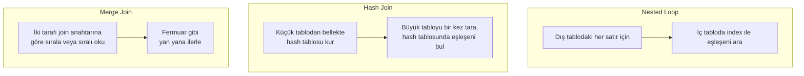

# 9.20 Join Türleri ve Join Stratejileri

## Nedir?
"Join" kelimesi iki farklı şeyi anlatır:
1. **Mantıksal join türü:** Sonuçta hangi satırların olacağı. `INNER`, `LEFT`, `RIGHT`, `FULL`, `CROSS`, semi join (`EXISTS`), anti join (`NOT EXISTS`). Bunu **sorguyu yazan** belirler.
2. **Fiziksel join stratejisi (algoritması):** Veritabanının iki tabloyu birleştirmek için kullandığı yöntem: **nested loop**, **hash join**, **merge join**. Bunu **optimizer** seçer ([9.19](19-execution-plan.md)).

## Hangi problemi çözer?
- Doğru mantıksal join'i seçmek, **yanlış sonuç** riskini önler: satırların çoğalması, kaybolması, `NULL` tuzakları.
- Fiziksel stratejiyi anlamak, aynı sorgunun neden bazen 1 saniye bazen 30 dakika sürdüğünü açıklar ve plan okumayı kolaylaştırır.

## Nasıl çalışır?

### Mantıksal join türleri
| Tür | Sonuç | Bankacılık örneği |
|---|---|---|
| `INNER JOIN` | Her iki tarafta eşleşenler | İşlemi olan müşteriler ve işlemleri |
| `LEFT JOIN` | Soldaki tüm satırlar + eşleşen sağ satırlar (yoksa `NULL`) | Tüm müşteriler ve (varsa) son ay kredileri |
| `FULL OUTER JOIN` | İki taraftaki tüm satırlar | İki sistem arasında mutabakat: hangisinde var, hangisinde yok |
| `CROSS JOIN` | Kartezyen çarpım | Her şube × her ay iskeleti (boş ayları göstermek için) |
| **Semi join** (`EXISTS`, `IN`) | Soldaki satırlardan, sağda karşılığı olanlar (çoğalmadan) | Son 3 ayda işlem yapmış müşteriler |
| **Anti join** (`NOT EXISTS`) | Soldaki satırlardan, sağda karşılığı olmayanlar | Hiç kredi kullanmamış müşteriler |

**Sık hatalar**
- **Satır çoğalması (fan-out):** Bire-çok ilişkide join'den sonra `SUM` alınırsa tutarlar katlanır. Önce gruplayıp sonra join'leyin.
- **LEFT JOIN'i WHERE ile bozmak:** `LEFT JOIN kredi k ... WHERE k.durum = 'AKTIF'` aslında INNER JOIN'e dönüşür. Koşulu `ON` içine yazın: `LEFT JOIN kredi k ON k.musteri_id = m.musteri_id AND k.durum = 'AKTIF'`.
- **`NOT IN` ve NULL:** Alt sorguda tek bir `NULL` varsa `NOT IN` **hiç satır döndürmez**. Bunun yerine `NOT EXISTS` kullanın.
- **Tip uyumsuzluğu:** `varchar` ile `number` sütunu join'lemek örtük dönüşüme ve index kaybına yol açar.

### Fiziksel join stratejileri


| Strateji | En iyi olduğu durum | Kötü olduğu durum | Bellek |
|---|---|---|---|
| **Nested loop** | Dış tarafta az satır var, iç tarafta join anahtarında index var (OLTP, "bu müşterinin işlemleri") | İki taraf da büyükse: milyon × milyon karşılaştırma | Az |
| **Hash join** | Büyük tablolar, eşitlik (`=`) koşulu, index yok veya işe yaramıyor (raporlama, ETL) | Hash tablosu belleğe sığmazsa diske taşar ve yavaşlar; `=` dışındaki koşullarda kullanılamaz | Küçük tarafın boyutu kadar |
| **Merge join** | İki taraf zaten join anahtarına göre sıralıysa (index veya önceki sıralama); Oracle'da eşitsizlik (`<`, `>`) koşulları | Sıralama sonradan yapılacaksa maliyetli | Sıralama için |

**Optimizer'ın yanlış seçimi:** En tipik sorun, optimizer'ın dış tarafta **az satır** bekleyip nested loop seçmesi, ama gerçekte milyonlarca satırla karşılaşmasıdır. Planda `Nested Loop` ve iç tarafta milyonlarca tekrar (`loops=2000000`) görürseniz sebep genellikle **yanlış satır tahmini**dir: önce istatistikleri güncelleyin, sorguyu sadeleştirin; son çare olarak hint ([9.21](21-hint.md)).

**Join sırası:** Çok tablolu sorgularda optimizer tabloları hangi sırayla birleştireceğine de karar verir. En seçici filtreye sahip tablodan başlamak ara sonuçları küçük tutar.

## Mini örnek
**Fan-out hatası ve düzeltmesi**
```sql
-- Yanlış: müşterinin her teminatı için kredi tutarı tekrar sayılıyor
SELECT k.musteri_id, SUM(k.tutar)
FROM kredi k JOIN teminat t ON t.kredi_id = k.kredi_id
GROUP BY k.musteri_id;

-- Doğru: semi join ile "teminatı olan krediler"
SELECT k.musteri_id, SUM(k.tutar)
FROM kredi k
WHERE EXISTS (SELECT 1 FROM teminat t WHERE t.kredi_id = k.kredi_id)
GROUP BY k.musteri_id;
```

**Anti join: NOT IN yerine NOT EXISTS**
```sql
-- Riskli: kredi.musteri_id içinde NULL varsa sonuç boş gelir
SELECT * FROM musteri WHERE musteri_id NOT IN (SELECT musteri_id FROM kredi);

-- Güvenli
SELECT m.* FROM musteri m
WHERE NOT EXISTS (SELECT 1 FROM kredi k WHERE k.musteri_id = m.musteri_id);
```

**Mutabakat: FULL OUTER JOIN**
```sql
SELECT COALESCE(a.hesap_no, b.hesap_no) AS hesap_no,
       a.bakiye AS core_bakiye, b.bakiye AS dwh_bakiye,
       CASE WHEN a.hesap_no IS NULL THEN 'SADECE_DWH'
            WHEN b.hesap_no IS NULL THEN 'SADECE_CORE'
            WHEN a.bakiye <> b.bakiye THEN 'FARKLI' END AS durum
FROM core_bakiye a
FULL OUTER JOIN dwh_bakiye b ON b.hesap_no = a.hesap_no
WHERE a.hesap_no IS NULL OR b.hesap_no IS NULL OR a.bakiye <> b.bakiye;
```

**Planda strateji görmek (PostgreSQL)**
```sql
EXPLAIN ANALYZE
SELECT * FROM musteri m JOIN islem i ON i.musteri_id = m.musteri_id
WHERE m.musteri_id = 123;          -- beklenen: Nested Loop + Index Scan

EXPLAIN ANALYZE
SELECT m.segment, SUM(i.tutar) FROM musteri m JOIN islem i ON i.musteri_id = m.musteri_id
GROUP BY m.segment;                -- beklenen: Hash Join
```

## Nerede kullanılır?
- Raporlama sorguları ve ETL dönüşümleri (yanlış join = yanlış rakam)
- Sistemler arası mutabakat ve veri kalitesi kontrolleri ([11.5](../11-veri-akisi/05-veri-kalitesi.md))
- Yavaş sorgu analizi: planda hangi stratejinin seçildiğini anlamak

## Benzerleri ve farkları
- **Spark:** Aynı fikirler dağıtık ortamda: **broadcast hash join** (küçük tablo her makineye kopyalanır) ve **sort-merge join** (iki taraf da anahtara göre karıştırılıp sıralanır, "shuffle"). Küçük boyut tablosunu `F.broadcast(df)` ile işaretlemek büyük hız kazandırır ([10.3](../10-veri-isleme/03-spark.md)).
- **pandas:** `df.merge(..., how="left", validate="many_to_one")`; `validate` parametresi fan-out hatasını erken yakalar ([10.2](../10-veri-isleme/02-pandas.md)).
- **Graph veritabanları:** Çok adımlı ilişki sorgularında (grup firmaları, "arkadaşın arkadaşı") join zinciri yerine kenarlar üzerinden gezinme ([9.8](08-graph-db.md)).

## İlgili sayfalar
- [10.1 SQL](../10-veri-isleme/01-sql.md)
- [9.19 Execution plan](19-execution-plan.md)
- [9.21 Hint'ler](21-hint.md)
- [9.22 CTE ve window functions](22-cte-window.md)
