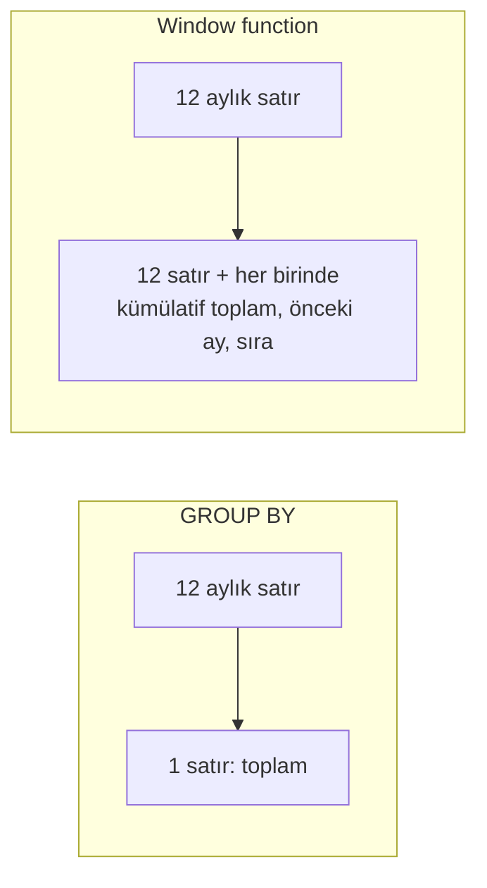

# 9.22 CTE ve Window Functions

## Nedir?
- **CTE (Common Table Expression)**, `WITH` anahtar kelimesiyle tanımlanan, sorgu içinde isim verilmiş geçici bir sonuç kümesidir. Uzun ve iç içe alt sorguları adım adım okunabilir parçalara böler.
- **Recursive (özyinelemeli) CTE**, kendisine başvuran CTE'dir; hiyerarşi ve ağaç yapılarını (organizasyon şeması, grup firmaları, hesap planı) gezmek için kullanılır.
- **Window function (pencere fonksiyonu)**, satırları gruplayıp **tek satıra indirmeden**, her satır için o satırla ilişkili bir "pencere" üzerinde hesap yapar: sıra numarası, önceki ayın değeri, kümülatif toplam, hareketli ortalama.

## Hangi problemi çözer?
- **Okunabilirlik:** 5 seviye iç içe alt sorgu yerine sırayla okunan adımlar.
- **Tekrarı önleme:** Aynı ara sonucu sorguda birden çok yerde kullanmak.
- **GROUP BY'ın yetmediği yerler:** "Her müşterinin son işlemi", "aylık değişim (MoM)", "segment içinde sıralama", "yılbaşından bugüne toplam (YTD)" gibi soruları self-join'siz, tek geçişte çözmek.
- **Hiyerarşiler:** Bir firmanın tüm alt şirketlerini bilinmeyen derinlikte bulmak.

## Nasıl çalışır?

### CTE
```sql
WITH
aylik AS (                                  -- 1. adım
    SELECT date_trunc('month', tarih) AS ay, segment, SUM(tutar) AS tutar
    FROM islem GROUP BY 1, 2
),
toplam AS (                                 -- 2. adım: önceki adımı kullanır
    SELECT ay, SUM(tutar) AS genel FROM aylik GROUP BY ay
)
SELECT a.ay, a.segment, a.tutar, ROUND(100.0 * a.tutar / t.genel, 2) AS pay_yuzde
FROM aylik a JOIN toplam t USING (ay);
```
**Performans notu:** PostgreSQL 12 öncesinde CTE'ler her zaman ayrı hesaplanıp saklanırdı (optimizasyon engeli). 12 ve sonrası tek kullanılan CTE'yi sorguya gömer; davranış `MATERIALIZED` / `NOT MATERIALIZED` ile seçilebilir. Oracle'da `MATERIALIZE` / `INLINE` hint'leri aynı işi görür ([9.21](21-hint.md)).

### Window function söz dizimi
```
fonksiyon(...) OVER (
    PARTITION BY grup_sütunları     -- pencereyi gruplara böl (isteğe bağlı)
    ORDER BY sıralama_sütunları     -- pencere içindeki sıra
    ROWS BETWEEN ... AND ...        -- çerçeve: hangi satırlar dahil (isteğe bağlı)
)
```

**GROUP BY ile farkı**


**Sık kullanılan fonksiyonlar**
| Fonksiyon | Ne yapar? | Örnek kullanım |
|---|---|---|
| `ROW_NUMBER()` | Pencere içinde 1, 2, 3... (eşitlikte de farklı) | Her müşterinin **son** kaydını seçmek, tekilleştirme |
| `RANK()` / `DENSE_RANK()` | Eşitlikte aynı sıra (RANK boşluk bırakır: 1,1,3; DENSE: 1,1,2) | Bankaların aktif büyüklük sıralaması |
| `NTILE(10)` | Satırları 10 eşit gruba (desil) böler | Skor desilleri, risk dilimleri |
| `LAG(x, n)` / `LEAD(x, n)` | n satır önceki / sonraki değer | MoM, YoY değişim |
| `SUM()`, `AVG()`, `COUNT()` `OVER` | Pencere içinde toplam/ortalama | Kümülatif (YTD) toplam, segment payı |
| `FIRST_VALUE()` / `LAST_VALUE()` | Penceredeki ilk/son değer | Dönem başı bakiyesi |
| `PERCENT_RANK()`, `CUME_DIST()` | Göreli sıra (0–1) | Yüzdelik dilim |

**Çerçeve (frame) seçimi**
| Çerçeve | Anlamı |
|---|---|
| `ROWS BETWEEN UNBOUNDED PRECEDING AND CURRENT ROW` | Baştan bu satıra kadar: kümülatif toplam |
| `ROWS BETWEEN 2 PRECEDING AND CURRENT ROW` | Son 3 satır: 3 aylık hareketli ortalama |
| `RANGE BETWEEN INTERVAL '29 days' PRECEDING AND CURRENT ROW` | Son 30 gün (değer aralığı; PostgreSQL 11+, Oracle) |

**Tuzak:** `ORDER BY` verilip çerçeve verilmezse varsayılan çerçeve `RANGE ... CURRENT ROW`'dur; aynı sıralama değerine sahip satırlar birlikte sayılır. `LAST_VALUE` bu yüzden çoğu zaman beklenmedik sonuç verir. Çerçeveyi açıkça yazın.

**Window sonucuna filtre:** Window fonksiyonları `WHERE` içinde kullanılamaz (WHERE önce çalışır). Sonucu bir CTE veya alt sorguya alıp dışarıda filtreleyin. Bazı motorlar (Snowflake, DuckDB, Databricks) bunun için `QUALIFY` sunar.

## Mini örnek
**Her müşterinin son işlemi (tekilleştirme)**
```sql
WITH sirali AS (
    SELECT i.*, ROW_NUMBER() OVER (PARTITION BY musteri_id ORDER BY islem_ts DESC) AS rn
    FROM islem i
)
SELECT * FROM sirali WHERE rn = 1;
```

**BDDK verisinde MoM, YoY ve YTD**
```sql
SELECT donem, kalem, tutar,
       tutar - LAG(tutar) OVER w                                   AS mom_fark,
       ROUND(100.0 * (tutar / NULLIF(LAG(tutar, 12) OVER w, 0) - 1), 2) AS yoy_yuzde,
       SUM(tutar) OVER (PARTITION BY kalem, EXTRACT(YEAR FROM donem)
                        ORDER BY donem
                        ROWS BETWEEN UNBOUNDED PRECEDING AND CURRENT ROW) AS ytd_toplam,
       AVG(tutar) OVER (PARTITION BY kalem ORDER BY donem
                        ROWS BETWEEN 2 PRECEDING AND CURRENT ROW)       AS ort_3ay
FROM bddk_kredi_aylik
WINDOW w AS (PARTITION BY kalem ORDER BY donem)
ORDER BY kalem, donem;
```
`LAG(tutar, 12)` sadece aylar eksiksizse doğru sonuç verir; eksik dönem olabilecekse önce dönem iskeleti (`CROSS JOIN` veya `generate_series`) ile boşlukları doldurun.

**Segment içinde ilk 10 müşteri ve pay**
```sql
SELECT * FROM (
    SELECT segment, musteri_id, bakiye,
           DENSE_RANK() OVER (PARTITION BY segment ORDER BY bakiye DESC) AS sira,
           ROUND(100.0 * bakiye / SUM(bakiye) OVER (PARTITION BY segment), 2) AS segment_payi
    FROM kredi_bakiye WHERE donem = DATE '2026-09-30'
) t
WHERE sira <= 10;
```

**Recursive CTE: grup firmalarının tüm alt şirketleri**
```sql
WITH RECURSIVE grup AS (
    SELECT firma_id, ana_firma_id, firma_adi, 1 AS seviye,
           ARRAY[firma_id] AS yol                          -- döngü koruması
    FROM firma_iliski
    WHERE firma_id = 1001                                   -- başlangıç: grup ana şirketi
    UNION ALL
    SELECT f.firma_id, f.ana_firma_id, f.firma_adi, g.seviye + 1, g.yol || f.firma_id
    FROM firma_iliski f
    JOIN grup g ON f.ana_firma_id = g.firma_id
    WHERE NOT f.firma_id = ANY(g.yol) AND g.seviye < 10     -- döngüye ve aşırı derinliğe karşı
)
SELECT * FROM grup ORDER BY seviye;
```
Oracle'da aynı iş `CONNECT BY PRIOR` veya `WITH ... (sütunlar) AS (...)` söz dizimiyle (RECURSIVE kelimesi olmadan) yapılır. İlişkiler çok yoğun ve çok yönlüyse graph veritabanı daha uygun olabilir ([9.8](08-graph-db.md)).

**pandas ve PySpark karşılıkları**
```python
df["rn"] = df.sort_values("islem_ts", ascending=False).groupby("musteri_id").cumcount() + 1
df["mom"] = df.sort_values("donem").groupby("kalem")["tutar"].diff()

from pyspark.sql import Window, functions as F
w = Window.partitionBy("kalem").orderBy("donem")
sdf = sdf.withColumn("onceki", F.lag("tutar").over(w))
```

## Nerede kullanılır?
- Finansal metrikler: MoM, YoY, YTD, hareketli ortalama (BDDK ve TÜİK serileri üzerinde metrik tabloları)
- Tekilleştirme ve "son durum" tabloları (SCD, CDC sonrası)
- Sıralama, desil, pay hesaplama
- Hiyerarşiler: grup firmaları, organizasyon, hesap planı
- dbt modellerinde adım adım dönüşümler ([11.4](../11-veri-akisi/04-dbt.md))

## Benzerleri ve farkları
- **Alt sorgu (subquery):** CTE ile aynı işi yapar ama okunabilirliği düşüktür.
- **Geçici tablo / view:** CTE sadece o sorgu süresince yaşar; view kalıcı bir sorgu tanımıdır; geçici tablo oturum boyunca veriyi saklar ve üzerinde index kurulabilir.
- **Self-join:** Window fonksiyonlarından önce "önceki ay" hesaplamanın yolu; daha yavaş ve hataya açık.

## İlgili sayfalar
- [10.1 SQL](../10-veri-isleme/01-sql.md)
- [9.20 Join stratejileri](20-join-stratejileri.md)
- [10.4 SQL, pandas, Spark karşılaştırması](../10-veri-isleme/04-karsilastirma.md)
