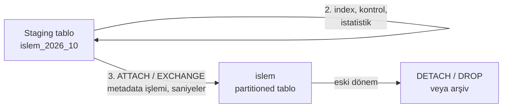

# 9.23 Partitioning Derinlemesine

## Nedir?
Partitioning'in temel fikri ve türleri (range, list, hash) [9.4](04-performans.md)'te anlatıldı: büyük bir tablo, bir anahtara göre fiziksel parçalara bölünür, ama uygulama tek bir tablo görür. Bu sayfa pratik tasarım sorularını ele alır: **Hangi anahtar, hangi parça büyüklüğü? Pruning neden çalışmıyor? Index'ler parçalara nasıl dağılır? ETL'de partition nasıl kullanılır?**

## Hangi problemi çözer?
- **Sorgu hızı:** `WHERE tarih >= ...` sorgusu 5 yıllık veri yerine sadece ilgili ayı okur (**partition pruning**).
- **Veri yaşam döngüsü:** 10 yıldan eski veriyi silmek, milyarlarca satırlık `DELETE` yerine tek bir `DROP PARTITION` olur; saniyeler sürer, log ve kilit üretmez.
- **ETL:** Yeni dönemi ayrı bir tabloya yükleyip doğrulamak, sonra **tek bir hamlede** ana tabloya bağlamak.
- **Bakım:** Index yeniden oluşturma, istatistik toplama, sıkıştırma parça parça yapılabilir; eski parçalar salt okunur veya ucuz depolamaya taşınabilir.

## Nasıl çalışır?

**Partition anahtarı seçimi**
| Kriter | Açıklama |
|---|---|
| Sorgularda filtrelenen sütun | Pruning için anahtar, `WHERE` koşulunda geçmeli. Bankacılıkta genellikle `islem_tarihi`, `donem` |
| Silme / arşivleme birimi | Veri aylık siliniyorsa aylık partition |
| Dengeli büyüklük | Parçalar çok küçük (binlerce) veya çok büyük olmamalı. Kaba kural: parça başına milyonlarca–yüz milyonlarca satır, toplam parça sayısı yüzler mertebesinde |
| Değişmeyen değer | Partition anahtarı güncellenirse satır parçalar arasında taşınır; maliyetlidir |

**Pruning ne zaman çalışır, ne zaman çalışmaz?**
| Koşul | Pruning |
|---|---|
| `WHERE islem_tarihi >= DATE '2026-09-01' AND islem_tarihi < DATE '2026-10-01'` | Evet |
| `WHERE islem_tarihi = :tarih` (parametre) | Evet (çalışma anında) |
| `WHERE TO_CHAR(islem_tarihi, 'YYYY-MM') = '2026-09'` | **Hayır**: sütun fonksiyona sokulmuş |
| `WHERE islem_tarihi::text LIKE '2026-09%'` | **Hayır** |
| Filtre partition anahtarında değil, başka sütunda | **Hayır**: tüm parçalar okunur |
| Join üzerinden gelen filtre | Veritabanına ve sürüme bağlı; planda doğrulayın |

Planda kontrol: PostgreSQL'de sadece ilgili parçaların taranması (`Subplans Removed`), Oracle'da `PARTITION RANGE SINGLE/ITERATOR` ve `Pstart/Pstop` sütunları ([9.19](19-execution-plan.md)).

**Local ve global index**
| | Local (yerel) index | Global index |
|---|---|---|
| Yapı | Her parçanın kendi index'i | Tüm tablo için tek index |
| Partition düşürme/ekleme | Kolay, diğer parçalar etkilenmez | Index yeniden düzenlenmeli (Oracle'da `UPDATE GLOBAL INDEXES`) |
| Benzersizlik | Benzersiz index partition anahtarını içermeli | Herhangi bir sütunda benzersizlik |
| PostgreSQL | Sadece local (parçalı) index | Yok |

**Partition değiştirme (exchange / attach) ile ETL**

Yeni veri ana tabloya satır satır eklenmez; hazırlanmış tablo metadata işlemiyle bağlanır. Okuyucular yarım yüklenmiş veri görmez.

**Alt bölümleme (sub-partitioning):** Önce tarihe göre range, sonra her ay içinde şubeye veya segmente göre list/hash. Sadece gerçekten iki boyutta da filtreleniyorsa faydalıdır; aksi hâlde parça sayısını gereksiz artırır.

**Sık hatalar**
- Günlük partition ile 10 yıl → 3.650+ parça; planlama süresi uzar, metadata büyür.
- Sorguların çoğu müşteri bazlıyken tarih partition'ı: Pruning çalışmaz; index ve partition birlikte tasarlanmalı.
- Gelecek dönemlerin partition'larını önceden oluşturmayı unutmak (PostgreSQL'de veri "uygun partition yok" hatası alır; `DEFAULT` partition veya otomatik oluşturma gerekir. Oracle'da **interval partitioning** bunu otomatik yapar).

## Mini örnek
**PostgreSQL: aylık range partition**
```sql
CREATE TABLE islem (
    islem_id     bigint,
    musteri_id   bigint,
    islem_tarihi date NOT NULL,
    tutar        numeric(18,2),
    PRIMARY KEY (islem_id, islem_tarihi)             -- PK partition anahtarını içermeli
) PARTITION BY RANGE (islem_tarihi);

CREATE TABLE islem_2026_09 PARTITION OF islem
    FOR VALUES FROM ('2026-09-01') TO ('2026-10-01');
CREATE TABLE islem_default PARTITION OF islem DEFAULT;   -- beklenmeyen tarihler için

CREATE INDEX ON islem (musteri_id);                  -- her parçada local index oluşur
```

**PostgreSQL: hazırlanmış tabloyu bağlamak ve eski parçayı ayırmak**
```sql
CREATE TABLE islem_2026_10 (LIKE islem INCLUDING DEFAULTS INCLUDING CONSTRAINTS);
-- ... yükle, kontrol et, index oluştur ...
ALTER TABLE islem_2026_10 ADD CONSTRAINT ck_donem
    CHECK (islem_tarihi >= DATE '2026-10-01' AND islem_tarihi < DATE '2026-11-01');  -- attach'ı hızlandırır
ALTER TABLE islem ATTACH PARTITION islem_2026_10
    FOR VALUES FROM ('2026-10-01') TO ('2026-11-01');

ALTER TABLE islem DETACH PARTITION islem_2016_10;   -- arşive taşı veya DROP
```
`pg_partman` eklentisi gelecek parçaların oluşturulmasını ve eskilerin düşürülmesini otomatikleştirir.

**Oracle: interval partitioning ve exchange**
```sql
CREATE TABLE islem (
    islem_id NUMBER, musteri_id NUMBER, islem_tarihi DATE NOT NULL, tutar NUMBER(18,2)
)
PARTITION BY RANGE (islem_tarihi)
INTERVAL (NUMTOYMINTERVAL(1, 'MONTH'))              -- yeni ay geldikçe parça otomatik açılır
(PARTITION p_ilk VALUES LESS THAN (DATE '2020-01-01'));

-- Interval tabloda hedef parça henüz yoksa önce oluşmasını sağlayın:
LOCK TABLE islem PARTITION FOR (DATE '2026-10-01') IN SHARE MODE;
ALTER TABLE islem EXCHANGE PARTITION FOR (DATE '2026-10-01')
    WITH TABLE stg_islem_2026_10 INCLUDING INDEXES WITHOUT VALIDATION;

ALTER TABLE islem DROP PARTITION FOR (DATE '2016-10-01') UPDATE GLOBAL INDEXES;
```

**Lakehouse'ta partitioning**
```python
df.write.partitionBy("donem").mode("overwrite").parquet("s3a://veri-lake/silver/islem/")
# Sadece yazılan dönemleri değiştirmek için:
spark.conf.set("spark.sql.sources.partitionOverwriteMode", "dynamic")
```
Klasör yapısı `donem=2026-10/` şeklindedir; Iceberg'de gizli bölümleme sorguyu yazanın partition'ı bilmesine gerek bırakmaz ([9.14](14-delta-iceberg.md)).

## Nerede kullanılır?
- İşlem, hareket, log ve olay tabloları (zamana göre büyüyen her şey)
- Yasal saklama süreleri ve arşivleme (eski parçaları ayırma/silme)
- Aylık rapor tabloları: dönem bazlı yeniden yükleme
- Data lake klasör yapısı (Hive tarzı `donem=...` bölümleme)

## Benzerleri ve farkları
- **Sharding:** Veriyi **farklı sunuculara** dağıtmak; partitioning ise aynı veritabanı içinde parçalamaktır.
- **Index:** Az sayıda satırı bulmak için; partitioning büyük veri bloklarını atlamak için. Birbirinin alternatifi değil, tamamlayıcısıdır ([9.18](18-index-derinlemesine.md)).
- **Clustering / Z-order:** Lakehouse ve bulut ambarlarında (Snowflake, BigQuery, Delta) verinin dosyalar içinde sıralanmasıyla benzer veri atlama etkisi.

## İlgili sayfalar
- [9.4 Veritabanı performansı](04-performans.md)
- [9.19 Execution plan](19-execution-plan.md)
- [9.14 Delta Lake ve Iceberg](14-delta-iceberg.md)
- [11.3 Yükleme türleri](../11-veri-akisi/03-yukleme-turleri.md)
