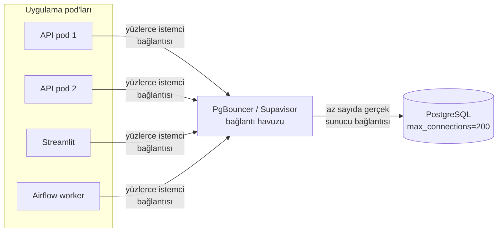

# 9.24 Connection Pooling (Bağlantı Havuzu)

## Nedir?
**Connection pooling**, veritabanı bağlantılarını her istekte açıp kapatmak yerine, önceden açılmış bir **bağlantı havuzunda** tutup tekrar tekrar kullanmaktır. Uygulama havuzdan bir bağlantı "ödünç alır", işini bitirince **geri verir**; bağlantı kapanmaz, bir sonraki istek için hazır bekler.

Havuz iki yerde olabilir:
- **Uygulama içinde:** SQLAlchemy, psycopg_pool, HikariCP (Java), Oracle python-oracledb pool
- **Ayrı bir ara katman (proxy) olarak:** PgBouncer, Pgpool-II, Supabase Supavisor, Amazon RDS Proxy, Oracle DRCP / Connection Manager

## Hangi problemi çözer?
- **Bağlantı açmak pahalıdır:** TCP bağlantısı, TLS el sıkışması, kimlik doğrulama (LDAP/Kerberos), oturum başlatma... Her sorgu için tekrarlanırsa yüzlerce milisaniye kaybolur.
- **Veritabanının bağlantı sınırı vardır:** PostgreSQL her bağlantı için ayrı bir süreç açar ve bellek harcar; `max_connections` genellikle yüzler mertebesindedir. 20 pod × 10 worker × 5 bağlantı = 1.000 bağlantı, veritabanını çökertebilir.
- **"too many connections"**, **"FATAL: sorry, too many clients already"**, **"ORA-12519: no appropriate service handler found"** gibi hatalar.
- Ani trafik artışlarında bağlantıları sıraya koyarak veritabanını korur.

## Nasıl çalışır?


**PgBouncer / Supavisor havuz modları**
| Mod | Bağlantı istemciye ne zaman geri verilir? | Avantaj | Kısıt |
|---|---|---|---|
| **Session** | İstemci bağlantıyı kapatınca | Tüm PostgreSQL özellikleri çalışır | Havuz kazancı az |
| **Transaction** | Her transaction bitince | En yüksek verim; çok sayıda istemci az sayıda bağlantıyı paylaşır | Oturum durumu korunmaz: `SET`, geçici tablo, `LISTEN`, advisory lock, bazı prepared statement kullanımları sorun çıkarır |
| **Statement** | Her ifade bitince | En agresif | Çok ifadeli transaction çalışmaz |

**Uygulama havuzunun temel ayarları (SQLAlchemy örneği)**
| Ayar | Anlamı | Tipik değer |
|---|---|---|
| `pool_size` | Havuzda sürekli açık tutulan bağlantı | 5 |
| `max_overflow` | Yoğunlukta geçici olarak açılabilecek ek bağlantı | 5–10 |
| `pool_timeout` | Boş bağlantı yoksa en fazla bekleme süresi (saniye) | 30 |
| `pool_recycle` | Bu süreden eski bağlantıyı yenile; firewall'ların boşta bağlantıyı kesmesine karşı | 1800 |
| `pool_pre_ping` | Kullanmadan önce bağlantının canlı olduğunu kontrol et | `True` |

**Bağlantı sayısı hesabı:** Toplam olası bağlantı = pod sayısı × süreç (worker) sayısı × (`pool_size` + `max_overflow`). Bu sayı veritabanının ayırdığı kotanın altında kalmalı. HPA ile pod sayısı artarken bağlantı sayısı da artar ([5.12](../05-kubernetes/12-hpa.md)).

**Havuz büyüklüğü:** "Ne kadar büyük o kadar iyi" değildir. Veritabanı CPU çekirdeği sayısının birkaç katından fazla eşzamanlı aktif sorgu genellikle hızı artırmaz, kilit ve bağlam değişimi maliyetini artırır. Fazla istekleri havuzda bekletmek daha verimlidir.

## Mini örnek
**SQLAlchemy**
```python
from sqlalchemy import create_engine, text

engine = create_engine(
    "postgresql+psycopg://svc_rapor@pg.sirket.local:5432/dwh",
    pool_size=5, max_overflow=5, pool_timeout=30,
    pool_recycle=1800, pool_pre_ping=True,
)
# engine uygulama başında BİR KEZ oluşturulur; her istekte yeniden oluşturulmaz
with engine.connect() as conn:
    sonuc = conn.execute(text("SELECT count(*) FROM islem")).scalar()
```

**Streamlit'te tek havuz**
```python
import streamlit as st
from sqlalchemy import create_engine

@st.cache_resource                      # her yeniden çalıştırmada yeni engine/havuz açılmasın
def get_engine():
    return create_engine(st.secrets["db_url"], pool_size=3, pool_pre_ping=True)
```

**Oracle (python-oracledb)**
```python
import oracledb
pool = oracledb.create_pool(user="svc_rapor", password=PAROLA, dsn="ora-scan.sirket.local/DWHPDB",
                            min=2, max=10, increment=1)
with pool.acquire() as conn:
    with conn.cursor() as cur:
        cur.execute("SELECT COUNT(*) FROM islem")
```

**PgBouncer konfigürasyonu (özet)**
```ini
[databases]
dwh = host=pg.sirket.local port=5432 dbname=dwh

[pgbouncer]
listen_port = 6432
pool_mode = transaction
max_client_conn = 1000        ; istemci tarafı sınır
default_pool_size = 20        ; veritabanı/kullanıcı başına gerçek bağlantı
auth_type = scram-sha-256
```

**Supabase örneği:** Doğrudan bağlantı (5432) uzun ömürlü uygulamalar ve migration'lar içindir. Pooler adresinde session modu 5432, transaction modu 6543 portundan sunulur; serverless fonksiyonlar ve çok sayıda kısa ömürlü istemci için transaction modu (6543) önerilir. Transaction modunda prepared statement'ları kapatmak gerekebilir (ör. `prepare_threshold=None` psycopg'de).

**Bağlantı durumunu izlemek (PostgreSQL)**
```sql
SELECT usename, application_name, state, count(*)
FROM pg_stat_activity
GROUP BY 1, 2, 3 ORDER BY 4 DESC;
-- 'idle in transaction' çoksa: uygulama transaction'ı açık bırakıyor
SHOW max_connections;
```

## Nerede kullanılır?
- API'ler ve dashboard'lar (FastAPI, Streamlit, Grafana veri kaynakları)
- Kubernetes/OpenShift üzerinde çok kopyalı (replica) uygulamalar
- Serverless fonksiyonlar (her çağrıda yeni süreç: harici havuz şart)
- Airflow gibi çok sayıda paralel task çalıştıran orkestratörler

## Benzerleri ve farkları
- **Thread pool / worker pool:** İş parçacıklarını havuzlamak; bağlantı havuzuyla birlikte boyutlandırılmalıdır (10 worker, 2 bağlantılık havuzu sürekli bekletir).
- **HTTP keep-alive / connection reuse:** Aynı fikir HTTP istemcilerinde (`requests.Session`, `httpx.Client`).
- **Cache:** Bağlantıyı değil sonucu saklar; tekrar eden sorguları hiç veritabanına göndermemek için ([9.7](07-redis-cache.md)).

## İlgili sayfalar
- [9.26 Query timeout](26-query-timeout.md)
- [9.17 Lock ve deadlock](17-lock-deadlock.md)
- [12.5 Streamlit](../12-bi/05-streamlit.md)
- [7.4 FastAPI](../07-api/04-fastapi.md)
