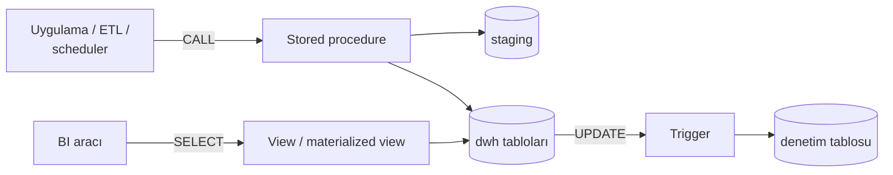

# 9.25 Stored Procedure, Function, Trigger ve View

## Nedir?
Veritabanının içinde saklanan ve orada çalışan program parçalarıdır:
| Nesne | Ne yapar? | Nasıl çağrılır? |
|---|---|---|
| **Stored procedure** | Bir dizi işlemi (yükleme, güncelleme, kontrol) çalıştırır; transaction yönetebilir | `CALL yukle_donem('2026-09');` / Oracle'da `BEGIN ... END;` |
| **Function (fonksiyon)** | Bir değer veya tablo **döndürür**; sorgu içinde kullanılabilir | `SELECT risk_skoru(musteri_id) FROM ...` |
| **Trigger (tetikleyici)** | Bir tabloda `INSERT`/`UPDATE`/`DELETE` olduğunda **otomatik** çalışır | Kendiliğinden |
| **View** | Kaydedilmiş bir sorgu; tablo gibi sorgulanır, veri saklamaz | `SELECT * FROM v_aktif_krediler` |
| **Materialized view** | Sonucu fiziksel olarak saklanan view; belirli aralıklarla yenilenir | `REFRESH MATERIALIZED VIEW ...` |
| **Package** (Oracle) | İlgili procedure, function, tip ve değişkenleri tek modülde toplar | `pkg_bddk.yukle(...)` |

Kullanılan diller: Oracle'da **PL/SQL**, PostgreSQL'de **PL/pgSQL** (ayrıca SQL, PL/Python), SQL Server'da **T-SQL**.

## Hangi problemi çözer?
- **Veriyi taşımadan işlem:** Milyonlarca satırı uygulamaya çekip işlemek yerine işi verinin olduğu yerde yapmak; ağ trafiği ve süre azalır.
- **Ortak iş kuralı:** Farklı uygulamaların aynı hesaplamayı (faiz, risk sınıfı) aynı şekilde yapması.
- **Güvenlik:** Kullanıcıya tabloya doğrudan yetki vermeden, sadece belirli bir procedure'ü çalıştırma veya bir view'u okuma yetkisi vermek.
- **Denetim izi:** Trigger ile her değişikliğin kim tarafından, ne zaman yapıldığını otomatik kaydetmek.
- **Basit erişim:** Karmaşık join'leri bir view arkasına saklayıp BI araçlarına sade bir tablo sunmak.

## Nasıl çalışır?


**Procedure ve function farkı**
| | Procedure | Function |
|---|---|---|
| Değer döndürür mü? | Zorunlu değil (OUT parametreleri olabilir) | Evet |
| `SELECT` içinde kullanılabilir mi? | Hayır | Evet |
| Transaction kontrolü (`COMMIT`) | Evet (PostgreSQL 11+ procedure'lerde) | Hayır |
| Tipik kullanım | Yükleme, toplu güncelleme, iş akışı | Hesaplama, dönüşüm, tablo döndüren sorgu |

**Ne zaman veritabanında, ne zaman uygulamada?**
| Veritabanında mantıklı | Uygulamada (Python, dbt) mantıklı |
|---|---|
| Veri yoğun, set tabanlı işlemler | Karmaşık iş mantığı, dış servis çağrıları, ML |
| Kurumda yerleşik PL/SQL yükleme altyapısı | Test edilebilirlik ve CI/CD önemli |
| Denetim trigger'ları, yetki sınırlaması | Birden çok veritabanı veya motor (taşınabilirlik) |
| Çok kısa gecikme gereken kontroller | Ekip SQL dışında bir dilde uzman |

**Dikkat edilecekler**
- **Sürüm kontrolü:** Procedure kodu veritabanında yaşar; değişiklikler kaybolmasın diye kaynak kodu **Git'te** tutulmalı ve migration aracıyla (Flyway, Liquibase) dağıtılmalıdır ([3.1](../03-git/01-git-nedir.md)).
- **Gizli mantık:** Trigger'lar "görünmez" çalışır; toplu yüklemeleri yavaşlatabilir ve hata ayıklamayı zorlaştırır. Az ve belgeli kullanın.
- **Satır satır işlem (row-by-row, "slow-by-slow"):** Cursor ile döngü kurmak yerine tek bir set tabanlı `INSERT ... SELECT` / `MERGE` çoğu zaman yüzlerce kat hızlıdır. Oracle'da döngü gerekiyorsa `BULK COLLECT` ve `FORALL`.
- **Hata yönetimi ve loglama:** Hata yakalanıp yutulmamalı; bir log tablosuna yazılmalı ve yeniden fırlatılmalı.
- **Yetki:** Oracle'da `AUTHID DEFINER` (sahibin yetkisiyle) / `CURRENT_USER`; PostgreSQL'de `SECURITY DEFINER` fonksiyonlar dikkatli yazılmalı (`search_path` sabitlenmeli).

## Mini örnek
**PostgreSQL: dönem yükleme procedure'ü**
```sql
CREATE OR REPLACE PROCEDURE dwh.yukle_bddk_kredi(p_donem date)
LANGUAGE plpgsql
AS $$
DECLARE
    v_satir bigint;
BEGIN
    DELETE FROM dwh.bddk_kredi WHERE donem = p_donem;

    INSERT INTO dwh.bddk_kredi (donem, kalem, tutar)
    SELECT donem, kalem, tutar FROM staging.bddk_kredi WHERE donem = p_donem;
    GET DIAGNOSTICS v_satir = ROW_COUNT;

    IF v_satir = 0 THEN
        RAISE EXCEPTION 'Dönem % için staging boş', p_donem;   -- tüm işlem geri alınır
    END IF;

    INSERT INTO dwh.yukleme_log (tablo, donem, satir, zaman)
    VALUES ('bddk_kredi', p_donem, v_satir, now());
END;
$$;

CALL dwh.yukle_bddk_kredi(DATE '2026-09-01');
```

**PostgreSQL: tablo döndüren fonksiyon**
```sql
CREATE OR REPLACE FUNCTION dwh.donem_ozeti(p_donem date)
RETURNS TABLE (kalem text, tutar numeric)
LANGUAGE sql STABLE
AS $$
    SELECT kalem, SUM(tutar) FROM dwh.bddk_kredi WHERE donem = p_donem GROUP BY kalem;
$$;

SELECT * FROM dwh.donem_ozeti(DATE '2026-09-01');
```

**Denetim trigger'ı**
```sql
CREATE OR REPLACE FUNCTION dwh.limit_denetim() RETURNS trigger
LANGUAGE plpgsql AS $$
BEGIN
    INSERT INTO dwh.limit_degisiklik (musteri_id, eski_limit, yeni_limit, degistiren, zaman)
    VALUES (OLD.musteri_id, OLD.limit_tutari, NEW.limit_tutari, current_user, now());
    RETURN NEW;
END;
$$;

CREATE TRIGGER trg_limit_denetim
AFTER UPDATE OF limit_tutari ON dwh.kredi_limit
FOR EACH ROW WHEN (OLD.limit_tutari IS DISTINCT FROM NEW.limit_tutari)
EXECUTE FUNCTION dwh.limit_denetim();
```

**Oracle: package ve toplu işlem**
```sql
CREATE OR REPLACE PACKAGE pkg_bddk AS
    PROCEDURE yukle(p_donem IN DATE);
END pkg_bddk;
/
CREATE OR REPLACE PACKAGE BODY pkg_bddk AS
    PROCEDURE yukle(p_donem IN DATE) IS
    BEGIN
        DELETE FROM dwh.bddk_kredi WHERE donem = p_donem;
        INSERT /*+ APPEND */ INTO dwh.bddk_kredi
        SELECT * FROM stg.bddk_kredi WHERE donem = p_donem;
        COMMIT;
    EXCEPTION
        WHEN OTHERS THEN
            ROLLBACK;
            log_hata('pkg_bddk.yukle', SQLERRM);   -- kurum içi log procedure'ü
            RAISE;
    END yukle;
END pkg_bddk;
/
```

**Materialized view**
```sql
CREATE MATERIALIZED VIEW dwh.mv_segment_ozet AS
SELECT donem, segment, SUM(bakiye) AS bakiye FROM dwh.kredi_bakiye GROUP BY donem, segment;

CREATE UNIQUE INDEX ON dwh.mv_segment_ozet (donem, segment);
REFRESH MATERIALIZED VIEW CONCURRENTLY dwh.mv_segment_ozet;   -- okuyanları engellemeden yenile
```

**Python'dan çağırmak**
```python
with engine.begin() as conn:
    conn.execute(text("CALL dwh.yukle_bddk_kredi(:d)"), {"d": "2026-09-01"})

# Oracle
cur.callproc("pkg_bddk.yukle", [datetime.date(2026, 9, 1)])
```

## Nerede kullanılır?
- Oracle tabanlı veri ambarlarında gece yükleme süreçleri (PL/SQL paketleri)
- Denetim izleri ve değişiklik geçmişi (trigger)
- BI araçlarına sade, yetki kontrollü veri sunmak (view, materialized view)
- Uygulamaların ortak kullandığı hesaplama fonksiyonları

## Benzerleri ve farkları
- **dbt:** Dönüşümleri SQL dosyaları olarak Git'te tutar, test eder ve sıralı çalıştırır; procedure tabanlı ETL'in modern alternatifidir ([11.4](../11-veri-akisi/04-dbt.md)).
- **Python ETL:** Daha esnek ve test edilebilir; büyük veriyi taşırken ağ maliyeti doğar. Çoğu zaman en iyisi: Python orkestre eder, ağır set işlemlerini veritabanına SQL olarak yaptırır.
- **Supabase / PostgREST:** PostgreSQL fonksiyonlarını doğrudan REST uç noktası (`/rpc/fonksiyon_adi`) olarak açar.

## İlgili sayfalar
- [9.16 Transaction ve isolation](16-transaction-isolation.md)
- [11.1 ETL ve ELT](../11-veri-akisi/01-etl-elt.md)
- [11.4 dbt](../11-veri-akisi/04-dbt.md)
- [15.6 RBAC ve en az yetki](../15-guvenlik/06-rbac-en-az-yetki.md)
