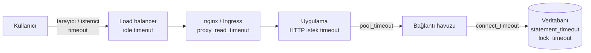

# 9.26 Query Timeout ve Kaynak Sınırları

## Nedir?
**Timeout (zaman aşımı)**, bir işlemin en fazla ne kadar sürebileceğine konan sınırdır; süre dolunca işlem iptal edilir. Veritabanı dünyasında birçok farklı timeout vardır ve her biri farklı bir aşamayı korur:

| Timeout | Neyi sınırlar? |
|---|---|
| **Connect timeout** | Veritabanına bağlantı kurma süresi |
| **Statement / query timeout** | Tek bir sorgunun çalışma süresi |
| **Lock timeout** | Bir kilidi bekleme süresi ([9.17](17-lock-deadlock.md)) |
| **Idle in transaction timeout** | Transaction açık bırakılıp hiçbir şey yapılmadan geçen süre |
| **Transaction timeout** | Bir transaction'ın toplam süresi (PostgreSQL 17+) |
| **Pool timeout** | Havuzdan boş bağlantı bekleme süresi ([9.24](24-connection-pooling.md)) |
| **Ağ / proxy timeout** | Load balancer, nginx, firewall'un boşta veya yanıtsız bağlantıyı kesme süresi |

## Hangi problemi çözer?
- **Kaçak sorgular:** Yanlışlıkla `WHERE`'siz yazılmış veya kartezyen çarpım üreten bir sorgu, veritabanını saatlerce meşgul edip herkesi yavaşlatabilir.
- **Zincirleme kilitlenme:** Kilit bekleyen bir işlem süresiz beklerse, arkasında kuyruk oluşur.
- **Takılı kaynaklar:** "idle in transaction" kalan oturumlar kilit tutar ve VACUUM'u engeller.
- **Kullanıcı deneyimi:** Dashboard 10 dakika dönmek yerine 30 saniyede anlaşılır bir hata vermeli.
- **Öngörülebilir ETL:** Takılan adım sonsuza kadar beklemek yerine hata verip yeniden denenmeli veya alarm üretmelidir.

## Nasıl çalışır?

**Bir isteğin yolundaki timeout'lar**

**Sıralama kuralı:** İçteki timeout dıştakinden **kısa** olmalıdır. Veritabanı sorgusu 60 saniyede iptal edilmeliyse, uygulama 65, nginx 70 saniye beklemelidir. Tersi olursa nginx `504 Gateway Timeout` döndürür ama sorgu veritabanında **çalışmaya devam eder** ve kaynak tüketir ([8.8](../08-nginx/08-log-hatalar.md)).

**Hangi seviyede ayarlanır?**
| Seviye | PostgreSQL örneği | Etki |
|---|---|---|
| Sunucu geneli | `postgresql.conf` | Herkes için varsayılan (genellikle kapalı bırakılır) |
| Veritabanı / kullanıcı | `ALTER ROLE svc_dashboard SET statement_timeout = '30s';` | Belirli servis hesabı için; **en kullanışlı yöntem** |
| Oturum | `SET statement_timeout = '5min';` | O bağlantı boyunca |
| Transaction | `SET LOCAL statement_timeout = '10min';` | Sadece o transaction |
| İstemci | Sürücü parametresi | Uygulama tarafında |

Kullanıcı tipine göre farklı sınırlar mantıklıdır: dashboard servis hesabı 30 saniye, analist kullanıcısı 15 dakika, gece ETL hesabı 2 saat.

**Oracle'da karşılıklar**
- Sorgu süresi için tek bir oturum parametresi yoktur; **Resource Manager** planlarıyla kullanıcı gruplarına çalışma süresi, CPU ve paralellik sınırları konur (`MAX_EST_EXEC_TIME`, `SWITCH_TIME` ile `CANCEL_SQL` grubuna geçiş).
- **Profile** ile oturum sınırları: `IDLE_TIME`, `CONNECT_TIME`, `SESSIONS_PER_USER`.
- İstemci tarafında: python-oracledb `conn.call_timeout` (milisaniye), JDBC `setQueryTimeout`.
- DDL kilidi bekleme: `ALTER SESSION SET ddl_lock_timeout = 30;`

**Timeout sonrası ne olur?**
- Sorgu iptal edilir ve transaction **hata durumuna** geçer; geri alınması gerekir (PostgreSQL'de sonraki komutlar `current transaction is aborted` hatası alır).
- Uygulama hatayı yakalayıp kullanıcıya anlamlı mesaj göstermeli, ETL ise **yeniden deneme (retry)** politikası uygulamalıdır: sınırlı sayıda, artan bekleme süresiyle (exponential backoff) ve sadece geçici hatalar için.
- Yeniden denenen işlem **idempotent** olmalı (tekrar çalışınca çift kayıt üretmemeli; silip yükleme veya MERGE).

## Mini örnek
**PostgreSQL ayarları**
```sql
-- Servis hesapları için kalıcı sınırlar
ALTER ROLE svc_dashboard SET statement_timeout = '30s';
ALTER ROLE svc_dashboard SET idle_in_transaction_session_timeout = '60s';
ALTER ROLE svc_etl       SET statement_timeout = '2h';
ALTER ROLE svc_etl       SET lock_timeout = '1min';

-- Tek bir ağır sorgu için geçici olarak artırmak
BEGIN;
SET LOCAL statement_timeout = '20min';
REFRESH MATERIALIZED VIEW dwh.mv_segment_ozet;
COMMIT;

SHOW statement_timeout;
```

**Python istemcileri**
```python
# psycopg: bağlantı ve sorgu süresi
conn = psycopg.connect(DSN, connect_timeout=10,
                       options="-c statement_timeout=30000 -c lock_timeout=5000")   # ms

# SQLAlchemy ile aynı ayar
engine = create_engine(URL, connect_args={"connect_timeout": 10,
                                          "options": "-c statement_timeout=30000"})

# python-oracledb
conn = oracledb.connect(user=..., password=..., dsn=..., tcp_connect_timeout=10)
conn.call_timeout = 30_000          # ms; aşılırsa DPY-4024 / ORA-03156 hatası

# HTTP API çağrılarında da her zaman timeout verin
requests.get(url, timeout=(5, 30))  # (bağlantı, okuma) saniye
```

**Retry ile ETL adımı**
```python
from tenacity import retry, stop_after_attempt, wait_exponential, retry_if_exception_type
from psycopg import errors

@retry(stop=stop_after_attempt(3),
       wait=wait_exponential(multiplier=30, max=300),
       retry=retry_if_exception_type((errors.QueryCanceled, errors.DeadlockDetected,
                                      errors.LockNotAvailable)))
def donem_yukle(donem):
    with psycopg.connect(DSN) as conn:
        conn.execute("CALL dwh.yukle_bddk_kredi(%s)", (donem,))
```

**Takılı sorguları bulmak ve iptal etmek**
```sql
SELECT pid, usename, state, now() - query_start AS sure, left(query, 80)
FROM pg_stat_activity
WHERE state <> 'idle' AND now() - query_start > interval '10 minutes'
ORDER BY sure DESC;

SELECT pg_cancel_backend(pid);      -- önce nazikçe iptal
```

**Orkestrasyon tarafı**
```python
# Airflow: görev süresi sınırı
PythonOperator(task_id="yukle", python_callable=donem_yukle,
               execution_timeout=timedelta(hours=1), retries=2)
```
Kubernetes Job'larında aynı işi `activeDeadlineSeconds` yapar ([5.6](../05-kubernetes/06-job-cronjob.md)).

## Nerede kullanılır?
- Dashboard ve API servis hesapları (kısa sınırlar)
- Analist ve self-servis sorgu kullanıcıları (orta sınırlar, kaynak grupları)
- Gece ETL'leri (uzun ama sonlu sınırlar, retry ve alarm)
- Canlı sistemde bakım ve DDL işlemleri (`lock_timeout`)

## Benzerleri ve farkları
- **Rate limit:** Süreyi değil, belirli sürede yapılabilecek istek sayısını sınırlar ([8.7](../08-nginx/07-cache-rate-limit.md)).
- **Resource Manager / WLM / kaynak grupları:** Oracle Resource Manager, Snowflake warehouse boyutları ve sorgu zaman aşımı, Trino resource group'ları; süreye ek olarak CPU, bellek ve eşzamanlılığı da sınırlar.
- **Circuit breaker:** Sürekli hata veren bir servise bir süre hiç istek göndermemek; timeout'larla birlikte kullanılan bir dayanıklılık deseni.

## İlgili sayfalar
- [9.17 Lock ve deadlock](17-lock-deadlock.md)
- [9.24 Connection pooling](24-connection-pooling.md)
- [8.8 Loglar ve sık hatalar](../08-nginx/08-log-hatalar.md)
- [11.8 Orkestrasyon](../11-veri-akisi/08-orkestrasyon.md)
- [14.4 Alarm](../14-gozlemlenebilirlik/04-alarm.md)
