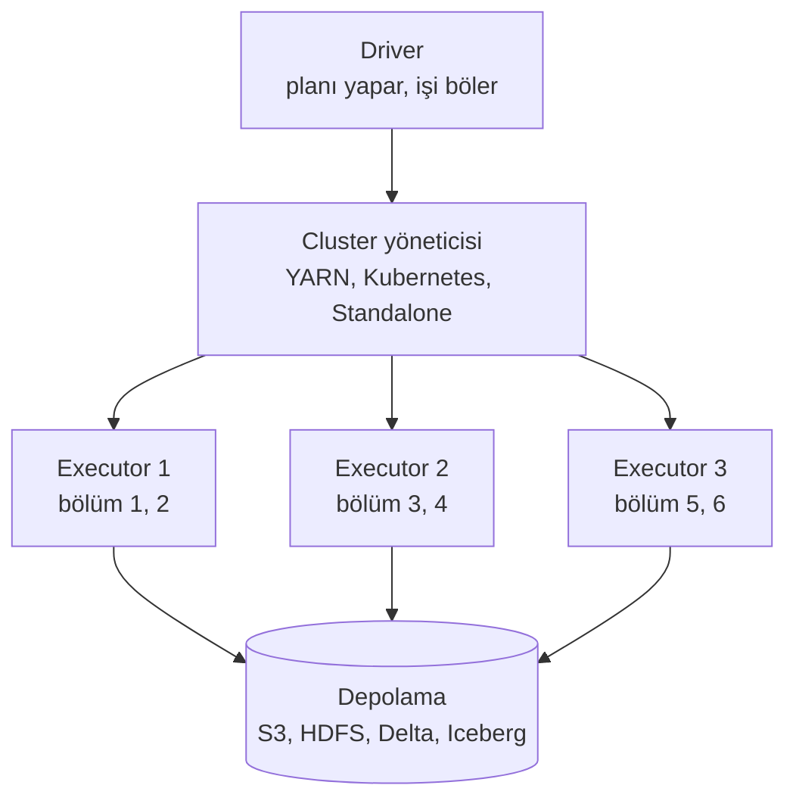
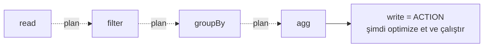

# 10.3 Spark: Dağıtık İşlem ve Lazy Evaluation

## Nedir?
**Apache Spark**, büyük veriyi **birden çok makineye (cluster) bölerek paralel** işleyen açık kaynak bir motordur. Python'dan **PySpark** ile, ayrıca SQL (Spark SQL), Scala, Java ve R ile kullanılır.

## Hangi problemi çözer?
Veri tek bir makinenin belleğine sığmadığında (yüzlerce GB – PB) veya tek makinede saatler sürdüğünde, işi onlarca makineye dağıtarak çözer. Pandas'ın "RAM'e sığmalı" sınırını ortadan kaldırır.

## Nasıl çalışır?

**Mimari**


| Kavram | Anlamı |
|---|---|
| **Driver** | Programınızın çalıştığı ana süreç; planı oluşturur, görevleri dağıtır |
| **Executor** | İşçi süreçler; verinin parçalarını işler |
| **Partition (bölüm)** | Verinin paralel işlenen parçası |
| **DataFrame** | Dağıtık tablo; pandas'a benzer API |
| **Transformation** | Yeni DataFrame tanımlayan işlem: `filter`, `select`, `groupBy`, `join` (lazy) |
| **Action** | Sonuç isteyen işlem: `count`, `show`, `collect`, `write` (çalıştırmayı tetikler) |
| **Shuffle** | Verinin executor'lar arasında yeniden dağıtılması (`groupBy`, `join`); en pahalı adım |
| **Catalyst** | Sorgu iyileştiricisi; planı optimize eder |

**Lazy evaluation (tembel değerlendirme)**
Transformation'lar **hemen çalışmaz**; Spark sadece bir plan kaydeder. Bir **action** gelince tüm planı bir arada optimize eder (gereksiz sütunları okumaz, filtreleri kaynağa iter) ve sonra çalıştırır.



Karşılaştırma: pandas her satırı anında çalıştırır (eager); Spark sonuna kadar bekler ve bütüne bakarak çalışır.

## Mini örnek
```python
from pyspark.sql import SparkSession, functions as F, Window

spark = SparkSession.builder.appName("kredi-metrik").getOrCreate()

# Okuma (lazy: henüz bir şey okunmadı)
df = spark.read.parquet("s3a://lake/silver/kredi_bakiye/")

# Dönüşümler (lazy)
aylik = (df
    .filter(F.col("donem") >= "2024-01-01")
    .groupBy("donem", "segment")
    .agg(F.sum("bakiye").alias("bakiye")))

w = Window.partitionBy("segment").orderBy("donem")
metrik = (aylik
    .withColumn("mom_yuzde", (F.col("bakiye") / F.lag("bakiye", 1).over(w) - 1) * 100)
    .withColumn("yoy_yuzde", (F.col("bakiye") / F.lag("bakiye", 12).over(w) - 1) * 100))

metrik.explain()                      # Spark'ın planı (fiziksel plan)
metrik.show(5)                        # ACTION: şimdi çalışır

# Yazma (ACTION)
metrik.write.format("delta").mode("overwrite").saveAsTable("gold.kredi_metrik")
```

Aynı iş Spark SQL ile:
```python
df.createOrReplaceTempView("kredi_bakiye")
spark.sql("""
    SELECT donem, segment, SUM(bakiye) AS bakiye
    FROM kredi_bakiye
    WHERE donem >= '2024-01-01'
    GROUP BY donem, segment
""").show()
```

Pandas ile köprü:
```python
kucuk_pdf = metrik.toPandas()              # sonucu driver'a al (sadece küçük sonuçlar için!)
sdf = spark.createDataFrame(kucuk_pdf)     # pandas -> Spark

import pyspark.pandas as ps                # pandas benzeri API, Spark üzerinde
psdf = ps.read_parquet("s3a://lake/silver/kredi_bakiye/")
```

Yerelde denemek:
```bash
pip install pyspark
pyspark                    # etkileşimli kabuk; tek makinede "local[*]" modda çalışır
```

## Nerede kullanılır?
- Lakehouse'larda bronze → silver → gold dönüşümleri ([9.13](../09-veri-depolama/13-medallion.md))
- Milyarlarca satırlık işlem, log, kart hareketi verisi
- Büyük ölçekli feature engineering ve model skorlama
- Akış işleme (Structured Streaming): Kafka'dan sürekli veri ([11.6](../11-veri-akisi/06-batch-streaming.md))

## Benzerleri ve farkları
- **pandas:** Tek makine, küçük–orta veri, en hızlı geliştirme döngüsü. Spark'ı küçük veride kullanmak, başlangıç ve dağıtım maliyeti nedeniyle genellikle **daha yavaştır**.
- **Polars / DuckDB:** Tek makinede çok hızlı; "Spark gerektiğini düşündüğüm" birçok iş (10–100 GB) aslında bunlarla yapılabilir ([10.5](05-polars-duckdb.md)).
- **Trino / Presto:** Dağıtık SQL sorgu motoru; etkileşimli BI sorgularında güçlü, Spark ise ağır dönüşüm ve ML'de.
- **Dask, Ray:** Python'a özgü dağıtık hesaplama alternatifleri.
- **Platformlar:** Databricks, AWS EMR, Google Dataproc, Azure Synapse/Fabric, Kubernetes üzerinde Spark Operator; Dataiku da Spark motorunu arka planda kullanabilir.

**Performans ipuçları:**
- `collect()` / `toPandas()` sadece küçük sonuçlarda (driver belleği dolar).
- Küçük tabloyla join'de **broadcast join**: `df.join(F.broadcast(kucuk), "id")`.
- Çok küçük dosyalar yazmaktan kaçının: yazmadan önce `coalesce` / `repartition`.
- Python UDF'leri yavaştır; önce yerleşik `functions` (F.*) kullanın, gerekiyorsa pandas UDF.
- Spark UI (genelde 4040 portu): yavaş aşamaları ve shuffle boyutlarını görmek için.

## İlgili sayfalar
- [10.4 Karşılaştırma](04-karsilastirma.md)
- [9.14 Delta Lake ve Iceberg](../09-veri-depolama/14-delta-iceberg.md)
- [10.6 Spark ve Dask](06-spark-dask.md)
- [Pandas / PySpark cheat sheet](../ekler/pandas-pyspark-cheatsheet.md)
