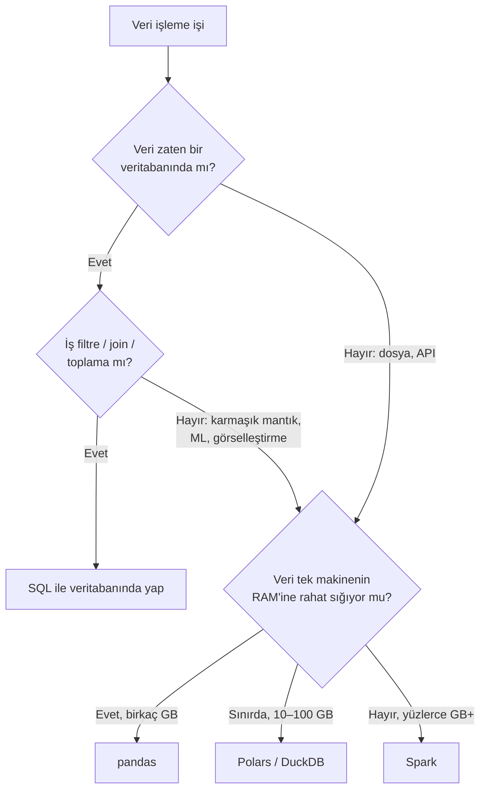

# 10.4 SQL, Pandas ve Spark Karşılaştırması

## Nedir?
Aynı veri işleme işinin üç farklı araçla yapılışını yan yana koyan ve hangi durumda hangisinin seçileceğini anlatan karşılaştırma sayfası.

## Hangi problemi çözer?
"Bu işi SQL'de mi, pandas'ta mı, Spark'ta mı yapmalıyım?" sorusu her veri projesinde çıkar. Yanlış seçim; ya gereksiz karmaşıklık (küçük veride Spark) ya da kırılgan, yavaş çözümler (büyük veride pandas) üretir.

## Nasıl çalışır?

**Temel farklar**

| Özellik | SQL (veritabanında) | pandas | Spark |
|---|---|---|---|
| Nerede çalışır? | Veritabanı sunucusu | Python sürecinin belleği (tek makine) | Cluster (çok makine) |
| Paradigma | Deklaratif | İmperatif (adım adım) | Deklaratif plan (lazy) + DataFrame API |
| Çalıştırma | Sorgu iyileştirici planlar | Eager (anında) | Lazy (action'da toplu) |
| Ölçek sınırı | Veritabanının gücü | RAM | Cluster büyüklüğü |
| Tipik veri boyutu | MB – TB | MB – birkaç GB | GB – PB |
| Başlangıç maliyeti | Yok (veritabanı hazır) | Çok düşük | Yüksek (cluster, oturum) |
| Esneklik | Orta (karmaşık mantıkta zorlanır) | Çok yüksek (her türlü Python) | Yüksek |
| ML entegrasyonu | Zayıf | Çok güçlü (scikit-learn vb.) | Orta (MLlib, pandas UDF) |
| Görselleştirme | BI araçlarıyla | Doğrudan (matplotlib, plotly) | Sonucu pandas'a alarak |
| Kim kullanır? | Herkes | Analist, veri bilimci | Veri mühendisi |

**Karar akışı**


## Mini örnek
**Görev:** `kredi_bakiye` verisinden 2023 ve sonrası için segment bazında aylık toplam bakiye ve yıllık değişim (YoY) hesapla; KOBİ segmentini göster. (2023 ayları için YoY boş gelir, çünkü 12 ay öncesi okunmadı.)

Girdi tablosu: `donem (DATE), segment (TEXT), musteri_id (INT), bakiye (NUMERIC)`

**SQL**
```sql
WITH aylik AS (
    SELECT donem, segment, SUM(bakiye) AS bakiye
    FROM kredi_bakiye
    WHERE donem >= DATE '2023-01-01'
    GROUP BY donem, segment
)
SELECT donem, segment, bakiye,
       100.0 * (bakiye / NULLIF(LAG(bakiye, 12) OVER (PARTITION BY segment ORDER BY donem), 0) - 1)
           AS yoy_yuzde
FROM aylik
WHERE segment = 'KOBİ'
ORDER BY donem;
```
*Not: Dış `WHERE segment = 'KOBİ'` pencere fonksiyonundan sonra uygulanır; pencere zaten segment bazında bölündüğü için sonuç doğrudur.*

**pandas**
```python
import pandas as pd

df = pd.read_parquet("kredi_bakiye.parquet")
aylik = (df[df["donem"] >= "2023-01-01"]
         .groupby(["donem", "segment"], as_index=False)["bakiye"].sum()
         .sort_values(["segment", "donem"]))
aylik["yoy_yuzde"] = aylik.groupby("segment")["bakiye"].pct_change(12) * 100
sonuc = aylik[aylik["segment"] == "KOBİ"]
```

**PySpark**
```python
from pyspark.sql import functions as F, Window

df = spark.read.parquet("s3a://lake/silver/kredi_bakiye/")
aylik = (df.filter(F.col("donem") >= "2023-01-01")
           .groupBy("donem", "segment")
           .agg(F.sum("bakiye").alias("bakiye")))
w = Window.partitionBy("segment").orderBy("donem")
sonuc = (aylik
         .withColumn("yoy_yuzde", (F.col("bakiye") / F.lag("bakiye", 12).over(w) - 1) * 100)
         .filter(F.col("segment") == "KOBİ")
         .orderBy("donem"))
sonuc.show()
```

**Kavram eşleştirme tablosu**

| İşlem | SQL | pandas | PySpark |
|---|---|---|---|
| Sütun seç | `SELECT a, b` | `df[["a", "b"]]` | `df.select("a", "b")` |
| Filtre | `WHERE a > 5` | `df[df["a"] > 5]` / `df.query("a > 5")` | `df.filter(F.col("a") > 5)` |
| Yeni sütun | `SELECT a*2 AS c` | `df["c"] = df["a"] * 2` | `df.withColumn("c", F.col("a") * 2)` |
| Gruplama | `GROUP BY g` + `SUM(x)` | `df.groupby("g")["x"].sum()` | `df.groupBy("g").agg(F.sum("x"))` |
| Join | `JOIN t2 ON ...` | `df.merge(t2, on=..., how=...)` | `df.join(t2, on=..., how=...)` |
| Sıralama | `ORDER BY a DESC` | `df.sort_values("a", ascending=False)` | `df.orderBy(F.desc("a"))` |
| Önceki satır | `LAG(x) OVER (...)` | `groupby(...)["x"].shift(1)` | `F.lag("x").over(w)` |
| Benzersiz | `SELECT DISTINCT` | `df.drop_duplicates()` | `df.dropDuplicates()` |
| NULL doldur | `COALESCE(x, 0)` | `df["x"].fillna(0)` | `F.coalesce("x", F.lit(0))` / `fillna` |
| Koşul | `CASE WHEN ... END` | `np.where(...)` / `.loc` | `F.when(...).otherwise(...)` |

## Nerede kullanılır?
Gerçek projelerde üçü birlikte kullanılır:
1. **SQL** ile veritabanında filtrele ve özetle,
2. **pandas** ile sonucu analiz et, modelle, görselleştir,
3. Veri büyüyünce aynı mantığı **Spark**'a (veya Spark SQL'e) taşı.

## Benzerleri ve farkları
- **Sınırlar bulanık:** DuckDB, dosyalar üzerinde tek makinede SQL çalıştırır; Polars, pandas'a benzer API ile çok çekirdekli ve lazy çalışır; Spark SQL, SQL'i dağıtık çalıştırır; `pyspark.pandas` pandas API'sini Spark'ta sunar ([10.5](05-polars-duckdb.md)).
- **Önemli olan mantık:** Filtre → join → gruplama → pencere mantığını bir araçta öğrenen, diğerlerine hızla geçer.

## İlgili sayfalar
- [10.1 SQL](01-sql.md)
- [10.2 pandas](02-pandas.md)
- [10.3 Spark](03-spark.md)
- [10.5 Polars ve DuckDB](05-polars-duckdb.md)
