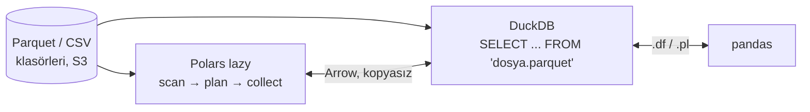

# 10.5 Ara Seçenekler: Polars ve DuckDB

## Nedir?
pandas ile Spark arasındaki boşluğu dolduran, **tek makinede çok hızlı** çalışan iki modern araç:
- **Polars:** Rust ile yazılmış, çok çekirdekli, **lazy** (tembel) çalışabilen DataFrame kütüphanesi. pandas'a benzer amaç, farklı ve tutarlı bir API.
- **DuckDB:** Kurulum gerektirmeyen, uygulamanın içinde çalışan (embedded / gömülü) **analitik SQL veritabanı**. "Analitik için SQLite" diye anılır.

İkisi de sütun bazlı çalışır, **Apache Arrow** bellek formatını kullanır ve Parquet/CSV/JSON dosyalarını doğrudan okur.

## Hangi problemi çözer?
- pandas'ın yavaş kaldığı ve bellek sınırına takıldığı 1–100 GB arası veride, Spark cluster'ı kurmadan hız sağlar.
- Laptopta veya tek bir sunucuda, dosyalar üzerinde SQL çalıştırmayı mümkün kılar.
- Spark'ın başlangıç maliyeti ve operasyon yükü olmadan hızlı ETL ve analiz.

## Nasıl çalışır?

| Özellik | pandas | Polars | DuckDB |
|---|---|---|---|
| Arayüz | Python DataFrame | Python DataFrame (ifade tabanlı) | SQL (+ Python API) |
| Çekirdek kullanımı | Çoğunlukla tek | Tüm çekirdekler | Tüm çekirdekler |
| Çalışma | Eager | Eager veya **lazy** (sorgu iyileştirme) | Sorgu iyileştirici |
| Bellekten büyük veri | Hayır (parçalama elle) | Streaming motoruyla kısmen | Evet (diske taşma / spill) |
| Dosyayı belleğe almadan sorgulama | Hayır | Evet (`scan_parquet`) | Evet |
| Kurulum | `pip install pandas` | `pip install polars` | `pip install duckdb` |



## Mini örnek
**Polars** (lazy):
```python
import polars as pl

sonuc = (
    pl.scan_parquet("kredi_bakiye/*.parquet")            # dosya okunmadı, sadece plan
      .filter(pl.col("donem") >= pl.date(2023, 1, 1))
      .group_by(["donem", "segment"])
      .agg(pl.col("bakiye").sum())
      .sort(["segment", "donem"])
      .with_columns(
          ((pl.col("bakiye") / pl.col("bakiye").shift(12).over("segment") - 1) * 100)
          .alias("yoy_yuzde")
      )
      .collect()                                          # şimdi çalış: sadece gereken sütun ve satırlar okunur
)
print(sonuc.filter(pl.col("segment") == "KOBİ"))
sonuc.to_pandas()                                         # gerekirse pandas'a
```

**DuckDB** (dosyalar üzerinde SQL):
```python
import duckdb

duckdb.sql("""
    WITH aylik AS (
        SELECT donem, segment, SUM(bakiye) AS bakiye
        FROM 'kredi_bakiye/*.parquet'
        WHERE donem >= DATE '2023-01-01'
        GROUP BY ALL
    )
    SELECT *, 100 * (bakiye / LAG(bakiye, 12) OVER (PARTITION BY segment ORDER BY donem) - 1) AS yoy_yuzde
    FROM aylik
    ORDER BY segment, donem
""").df()                                                 # sonuç pandas DataFrame
```

DuckDB'nin pratik yetenekleri:
```python
import duckdb, pandas as pd

df = pd.read_excel("bddk.xlsx")
duckdb.sql("SELECT kalem, SUM(tutar) FROM df GROUP BY kalem")    # pandas DataFrame'i doğrudan SQL ile sorgula

duckdb.sql("COPY (SELECT * FROM 'ham/*.csv') TO 'temiz.parquet' (FORMAT parquet)")   # CSV → Parquet

con = duckdb.connect()
con.sql("INSTALL postgres; LOAD postgres;")
con.sql("ATTACH 'dbname=bddk host=pg.sirket.local user=etl' AS pg (TYPE postgres, READ_ONLY)")
con.sql("SELECT * FROM pg.public.bddk_kredi LIMIT 5")                # PostgreSQL tablosunu doğrudan oku

con.sql("INSTALL httpfs; LOAD httpfs;")                              # S3 / MinIO üzerinden okuma
```

Kalıcı yerel veritabanı dosyası:
```bash
duckdb analiz.duckdb          # CLI; tablolar bu tek dosyada saklanır
```

## Nerede kullanılır?
- Laptopta veya tek sunucuda orta-büyük veri analizi (onlarca milyon – birkaç milyar satır)
- Hafif ETL: Excel/CSV'leri okuyup temizleyip Parquet'e veya veritabanına yazmak
- Streamlit dashboard'larında hızlı sorgu motoru (DuckDB dosyası + Parquet)
- CI'da veri testleri, lakehouse tablolarını (Delta/Iceberg) Spark olmadan okumak
- Notebook'larda pandas'ın yavaş kaldığı adımları hızlandırmak

## Benzerleri ve farkları
- **pandas'tan geçiş:** Polars'ta index kavramı yoktur; zincirleme ifadeler (`pl.col(...)`) kullanılır. Öğrenme eğrisi kısadır ama birebir aynı API değildir.
- **SQLite ile DuckDB:** SQLite işlem (OLTP) odaklı, satır bazlı; DuckDB analitik (OLAP) odaklı, sütun bazlı ([9.1](../09-veri-depolama/01-oltp-olap.md)).
- **Spark ne zaman gerekir?** Veri tek makinenin diskine ve kapasitesine sığmıyorsa, birden çok ekibin paylaştığı merkezi bir platform varsa veya akış (streaming) işleme gerekiyorsa ([10.3](03-spark.md)).
- **MotherDuck:** DuckDB'nin bulut hizmeti; **Polars Cloud:** Polars'ın dağıtık sürümü.

## İlgili sayfalar
- [10.4 Karşılaştırma](04-karsilastirma.md)
- [10.2 pandas](02-pandas.md)
- [9.14 Delta Lake ve Iceberg](../09-veri-depolama/14-delta-iceberg.md)
