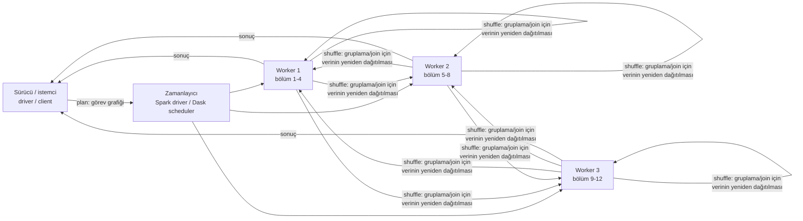

# 10.6 Dağıtık İşleme: Apache Spark ve Dask

## Nedir?
**Dağıtık işleme (distributed processing)**, tek bir makinenin belleğine veya süresine sığmayan bir işi **parçalara bölüp** birden çok çekirdek ya da makinede paralel çalıştırmak ve sonuçları birleştirmektir.

- **Apache Spark:** JVM (Scala) üzerinde çalışan, SQL, DataFrame, akış (Structured Streaming) ve ML kütüphaneleri olan genel amaçlı dağıtık motor. Python'dan **PySpark** ile kullanılır. Temel kavramları [10.3](03-spark.md)'te anlatıldı.
- **Dask:** Saf Python ile yazılmış, **pandas, NumPy ve scikit-learn API'lerini** paralel ve dağıtık hâle getiren kütüphane. Dizüstü bilgisayarda çok çekirdekli çalışmaktan, Kubernetes üzerinde yüzlerce worker'a kadar ölçeklenir.

## Hangi problemi çözer?
- pandas'ın `MemoryError` vermesi veya tek çekirdekte saatlerce sürmesi
- Yüzlerce GB–TB'lık işlem, log veya olay verisinin günlük işlenmesi
- Binlerce bağımsız işin (her şube, her müşteri segmenti, her model için ayrı hesaplama) paralel çalıştırılması
- Büyük veri üzerinde feature üretimi ve model skorlama

**Önce sorulması gereken soru:** Veri gerçekten dağıtık işleme gerektiriyor mu? On GB'lar mertebesindeki veri için tek makinede **DuckDB veya Polars** çoğu zaman daha hızlı, daha ucuz ve daha basittir ([10.5](05-polars-duckdb.md)). Dağıtık sistemler ağ, serileştirme ve koordinasyon maliyeti getirir.

## Nasıl çalışır?

**Ortak fikir: görev grafiği**

Her iki araç da **tembel (lazy)** çalışır: İşlemler önce bir plan/görev grafiği olarak kaydedilir; `collect()`, `write` (Spark) veya `compute()` (Dask) çağrılınca optimize edilip çalıştırılır.

**Spark ve Dask karşılaştırması**
| | Apache Spark | Dask |
|---|---|---|
| Dil ve çalışma ortamı | JVM; Python'dan PySpark | Saf Python |
| API | Kendi DataFrame/SQL API'si | pandas, NumPy, scikit-learn benzeri API'ler |
| SQL desteği | Güçlü (Spark SQL, Catalyst optimizer) | Sınırlı; SQL için genellikle başka araç |
| Ölçek | Çok büyük (yüzlerce TB – PB), olgun | Orta–büyük; tek makineden cluster'a |
| Optimizasyon | Catalyst (sorgu planı) + Tungsten (bellek/kod üretimi), AQE | Görev grafiği optimizasyonu; Dask DataFrame'de sorgu planı optimizasyonu (dask-expr) |
| Akış (streaming) | Structured Streaming | Yok (genel amaçlı futures/async ile kurulabilir) |
| Lakehouse entegrasyonu | Delta, Iceberg, Hudi ile birinci sınıf | Parquet; Delta/Iceberg için ek kütüphaneler |
| Esneklik | DataFrame dışı işler için daha katı | Rastgele Python fonksiyonlarını paralelleştirme (`delayed`, `futures`) çok kolay |
| Kurulum | Cluster yönetimi (YARN, Kubernetes, Databricks, EMR) | `pip install "dask[complete]"`; cluster için dask-kubernetes, Coiled vb. |
| Arayüz | Spark UI (4040) | Dask Dashboard (8787) |
| Tipik kullanıcı | Veri mühendisliği, lakehouse, büyük ETL | Python veri bilimcileri, bilimsel hesaplama, pandas kodunu ölçeklemek |

**Bölümler (partitions)**
- Spark'ta veri **partition**'lara, Dask'ta **partition** (DataFrame) veya **chunk**'lara (Array) bölünür.
- Bölüm başına makul büyüklük: yüzlerce MB. Çok küçük bölümler zamanlayıcıyı boğar; çok büyük bölümler belleği taşırır.
- **Shuffle** (gruplama, join, sıralama için verinin worker'lar arasında yeniden dağıtılması) en pahalı işlemdir; mümkünse filtreleyip sütun seçtikten sonra yapılmalıdır.

**Bellek ve hata toleransı**
- Spark, kaybedilen bölümleri soy ağacından (lineage) yeniden hesaplar; executor belleği `spark.executor.memory` ile ayarlanır.
- Dask worker'ları bellek sınırına yaklaşınca veriyi diske taşır (spill), sınırı aşarsa worker yeniden başlatılır; kaybedilen görevler tekrar çalıştırılır.

## Mini örnek
**Aynı iş: aylık segment bazında işlem toplamı**

*PySpark*
```python
from pyspark.sql import SparkSession, functions as F

spark = SparkSession.builder.appName("islem_ozet").getOrCreate()
islem = spark.read.parquet("s3a://veri-lake/silver/islem/")             # donem=.../ bölümlü

ozet = (islem
        .filter(F.col("donem") >= "2026-01")
        .groupBy("donem", "segment")
        .agg(F.sum("tutar").alias("toplam_tutar"),
             F.countDistinct("musteri_id").alias("musteri_sayisi")))

ozet.write.mode("overwrite").partitionBy("donem").parquet("s3a://veri-lake/gold/islem_segment/")
```

*Dask DataFrame*
```python
import dask
import dask.dataframe as dd
from dask.distributed import Client

client = Client()            # yerelde: tüm çekirdeklerle worker'lar; panel: http://127.0.0.1:8787
# client = Client("tcp://dask-scheduler.veri.svc:8786")   # cluster'a bağlanmak

islem = dd.read_parquet("s3://veri-lake/silver/islem/",
                        columns=["donem", "segment", "musteri_id", "tutar"],
                        filters=[("donem", ">=", "2026-01")],            # bölüm budama
                        storage_options=S3_AYAR)

grup = islem.groupby(["donem", "segment"])
ozet = grup.agg(toplam_tutar=("tutar", "sum"), islem_sayisi=("tutar", "count"))
musteri = grup["musteri_id"].nunique().rename("musteri_sayisi")

ozet, musteri = dask.compute(ozet, musteri)   # burada çalışır; tek geçişte iki sonuç (pandas olarak)
sonuc = ozet.join(musteri)
```

**Dask ile rastgele Python fonksiyonlarını paralelleştirmek**
```python
from dask import delayed, compute

@delayed
def sube_modeli_egit(sube_kodu):
    df = veri_oku(sube_kodu)                 # her şube için ayrı veri
    model = egit(df)
    return sube_kodu, skorla(model)

gorevler = [sube_modeli_egit(s) for s in sube_listesi]     # henüz çalışmadı
sonuclar = compute(*gorevler)                               # paralel çalıştır
```
Spark'ta aynı işi yapmak `applyInPandas` veya UDF gerektirir; Dask'ta düz Python fonksiyonu yeterlidir.

**Spark'ta pandas API'si (pandas-on-Spark)**
```python
import pyspark.pandas as ps
pdf = ps.read_parquet("s3a://veri-lake/silver/islem/")
pdf.groupby(["donem", "segment"])["tutar"].sum().sort_index().head()
```

**Kubernetes üzerinde Dask (kavramsal)**
```python
from dask_kubernetes.operator import KubeCluster
cluster = KubeCluster(name="analiz", image="ghcr.io/dask/dask:latest", n_workers=10,
                      resources={"requests": {"memory": "8Gi"}, "limits": {"memory": "8Gi"}})
client = Client(cluster)
```
Canlı kullanımda kurum içi registry'den, sabit sürüm etiketli image kullanın ([4.7](../04-docker/07-registry-docker-hub.md)).

## Nerede kullanılır?
- **Spark:** Lakehouse ETL'leri (bronze → silver → gold), büyük join ve agregasyonlar, CDC birleştirme (MERGE), akış işleme, büyük ölçekli feature üretimi
- **Dask:** pandas tabanlı analizlerin büyütülmesi, çok sayıda bağımsız modelin paralel eğitimi, hiperparametre aramaları, simülasyonlar (Monte Carlo, stres testi senaryoları), bilimsel diziler (NumPy/xarray)

## Benzerleri ve farkları
| Araç | Not |
|---|---|
| **Ray** | Python için genel dağıtık hesaplama; ML eğitimi, hiperparametre arama ve model serving'de (Ray Train, Tune, Serve) güçlü; Ray Data ile veri işleme |
| **Polars / DuckDB** | Tek makinede çok hızlı, çok çekirdekli işleme; dağıtık sistemden önce denenmeli ([10.5](05-polars-duckdb.md)) |
| **Trino / Presto** | Dağıtık **SQL sorgu** motoru; ETL yerine etkileşimli analitik ve federasyon |
| **Apache Flink** | Gerçek zamanlı akış işleme odaklı dağıtık motor ([11.11](../11-veri-akisi/11-kafka-redpanda.md)) |
| **Modin** | pandas API'sini Ray veya Dask üzerinde çalıştıran ince katman |
| **Veritabanı içi paralellik** | Oracle `PARALLEL`, PostgreSQL paralel sorgu; veri zaten veritabanındaysa önce bunlar ([9.21](../09-veri-depolama/21-hint.md)) |

## İlgili sayfalar
- [10.3 Spark](03-spark.md)
- [10.4 SQL, Pandas, Spark karşılaştırması](04-karsilastirma.md)
- [10.5 Polars ve DuckDB](05-polars-duckdb.md)
- [9.23 Partitioning derinlemesine](../09-veri-depolama/23-partitioning-derinlemesine.md)
