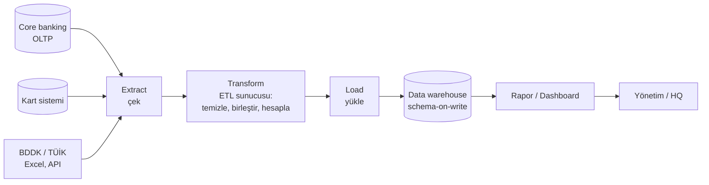
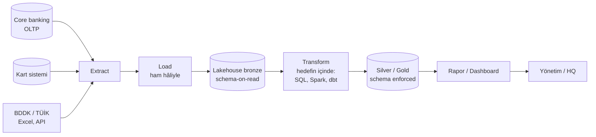

# 11.1 ETL ve ELT: Diyagramla Akış

## Nedir?
Veriyi kaynak sistemlerden alıp analiz edilecek yere taşıyan süreçlerin iki temel kalıbı:

- **ETL (Extract → Transform → Load):** Veri kaynaktan **çekilir**, ayrı bir sunucuda/araçta **dönüştürülür**, sonra hedef sisteme **yüklenir**.
- **ELT (Extract → Load → Transform):** Veri kaynaktan çekilir, **ham hâliyle** hedefe yüklenir, dönüşüm **hedef sistemin içinde** (SQL/Spark ile) yapılır.

Harflerin sırası, dönüşümün **nerede ve ne zaman** yapıldığını anlatır.

## Hangi problemi çözer?
Kaynak sistemler (core banking, kart, CRM, dış veri) analiz için uygun değildir: farklı formatlardadır, birbirinden kopuktur ve analiz sorgusu onları yavaşlatır ([9.1](../09-veri-depolama/01-oltp-olap.md)). ETL/ELT veriyi **toplar, birleştirir, temizler** ve raporlama, BI ve ML için güvenilir bir yerde hazır tutar.

## Nasıl çalışır?

### ETL


### ELT


**Adımlar**
| Adım | Ne yapılır? | Örnek |
|---|---|---|
| **Extract** | Veriyi kaynaktan almak | SQL sorgusu, dosya indirme, API çağrısı, CDC ([11.3](03-yukleme-turleri.md)) |
| **Transform** | Temizleme, tip dönüşümü, birleştirme, iş kuralları, toplama | Tarih parse, Türkçe sayı formatı, segment eşleştirme, MoM/YoY hesaplama |
| **Load** | Hedefe yazmak | `INSERT`, `MERGE`/upsert, Parquet/Delta yazma |

**ETL ile ELT karşılaştırması**
| Özellik | ETL | ELT |
|---|---|---|
| Dönüşüm nerede? | Ayrı ETL sunucusu/aracı | Hedef sistemin içinde |
| Hedefe giden veri | Temiz, dönüştürülmüş | Ham + dönüştürülmüş katmanlar |
| Ham veri saklanır mı? | Genellikle hayır | Evet (bronze) |
| Şema yaklaşımı | Schema-on-write | Önce schema-on-read, sonra katmanlarda schema-on-write ([11.2](02-akista-schema.md)) |
| Yeniden işleme | Kaynaktan tekrar çekmek gerekir | Ham veriden yeniden hesaplanır |
| Ölçeklenme | ETL sunucusunun gücüyle sınırlı | Hedefin gücüyle (lakehouse, bulut DWH) |
| Tipik araçlar | Informatica, IBM DataStage, SSIS, ODI, Talend, Python script'leri | dbt, Spark SQL, Snowflake/BigQuery SQL, Databricks |
| Ne zaman? | Hedef sistem pahalı/zayıf, hassas veri hedefe girmeden maskelenmeli, klasik DWH | Güçlü ve ucuz hedef (lakehouse/bulut), esneklik ve izlenebilirlik önemli |

**Neden ELT yaygınlaştı?** Depolama ucuzladı ve hedef sistemler (lakehouse, bulut veri ambarları) dönüşümü kendi içinde hızla yapabilecek kadar güçlendi. Ham veriyi saklamak; denetim, hata ayıklama ve yeni iş kurallarıyla geçmişi yeniden hesaplama imkânı sağlar.

## Mini örnek
Aynı iş (BDDK aylık kredi Excel'ini rapora dönüştürmek), iki kalıpla:

**ETL (Python, dönüşüm uygulamada)**
```python
import pandas as pd
from sqlalchemy import create_engine

engine = create_engine("postgresql+psycopg2://...")

# Extract
ham = pd.read_excel("bddk_kredi_2026_09.xlsx", skiprows=3)

# Transform (veritabanına girmeden önce)
df = (ham.rename(columns={"Kalem": "kalem", "Tutar": "tutar"})
         .assign(donem=pd.Timestamp("2026-09-01"),
                 kalem=lambda d: d["kalem"].str.strip().str.lower(),
                 tutar=lambda d: pd.to_numeric(d["tutar"], errors="coerce"))
         .dropna(subset=["tutar"]))

# Load (sadece temiz veri yazılır)
df.to_sql("bddk_kredi", engine, schema="dwh", if_exists="append", index=False)
```

**ELT (önce ham yükle, dönüşümü SQL ile hedefte yap)**
```python
# Extract + Load: olduğu gibi, metin olarak
ham = pd.read_excel("bddk_kredi_2026_09.xlsx", skiprows=3, dtype=str)
ham["_kaynak_dosya"] = "bddk_kredi_2026_09.xlsx"
ham["_yukleme_zamani"] = pd.Timestamp.now()
ham.to_sql("bddk_kredi_ham", engine, schema="bronze", if_exists="append", index=False)
```
```sql
-- Transform: hedefin içinde (dbt modeli de olabilir)
INSERT INTO silver.bddk_kredi (donem, kalem, tutar)
SELECT DATE '2026-09-01',
       LOWER(TRIM("Kalem")),
       CAST(REPLACE(REPLACE("Tutar", '.', ''), ',', '.') AS NUMERIC(20,2))
FROM bronze.bddk_kredi_ham
WHERE _kaynak_dosya = 'bddk_kredi_2026_09.xlsx'
  AND "Tutar" ~ '^[0-9.,]+$'
ON CONFLICT (donem, kalem) DO UPDATE SET tutar = EXCLUDED.tutar;
```

## Nerede kullanılır?
- Kurumsal veri ambarının gece yüklemeleri (klasik ETL)
- Lakehouse platformlarında bronze → silver → gold akışları (ELT) ([9.13](../09-veri-depolama/13-medallion.md))
- Dış veri kaynaklarından (BDDK, TÜİK, TCMB, HMB) düzenli veri toplama
- ML için feature tablolarının hazırlanması

## Benzerleri ve farkları
- **EtLT:** Yükleme öncesinde hafif dönüşüm (kişisel veriyi maskeleme, tip düzeltme), asıl dönüşüm yüklemeden sonra. Bankacılıkta sık görülen hibrit yaklaşımdır.
- **Reverse ETL:** Veri ambarındaki hesaplanmış veriyi (müşteri skoru, segment) operasyonel sistemlere (CRM, kampanya aracı) geri göndermek.
- **Streaming ETL:** Verinin gece toplu değil, olay olay ve sürekli işlenmesi ([11.6](06-batch-streaming.md)).
- **Data virtualization (veri sanallaştırma):** Veriyi taşımadan, kaynaklar üzerinde birleşik sorgu (Trino, Denodo); her durumda ETL'in yerini tutmaz.

## İlgili sayfalar
- [11.2 Akışta schema-on-write ve read](02-akista-schema.md)
- [11.3 Yükleme türleri](03-yukleme-turleri.md)
- [9.12 Warehouse, lake, lakehouse](../09-veri-depolama/12-warehouse-lake-lakehouse.md)
- [11.9 ETL/ELT konnektörleri](09-etl-konnektorleri.md)
- [9.25 Stored procedure ile ETL](../09-veri-depolama/25-procedure-function-trigger.md)
