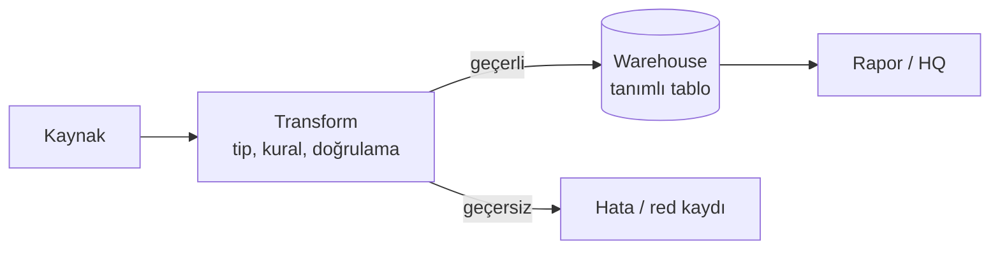
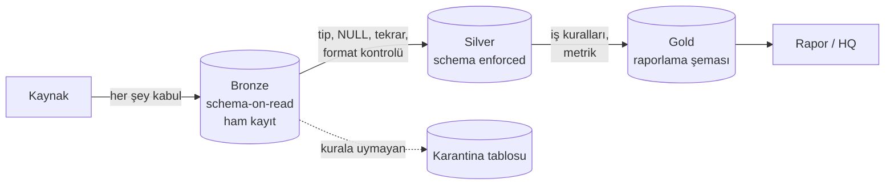

# 11.2 Schema-on-Write ve Schema-on-Read'in Akıştaki Yeri

## Nedir?
[9.11](../09-veri-depolama/11-schema-on-write-read.md)'de kavram olarak anlatılan iki yaklaşımın, **veri akışının hangi noktasında** devreye girdiğini ve kalite kontrolünün nerede yapıldığını gösteren sayfa.

Kısaca:
- **Schema-on-write:** Kural, verinin **kapıdan girişinde** uygulanır.
- **Schema-on-read:** Veri içeri **serbestçe** alınır, kural **kullanım anında** uygulanır.

## Hangi problemi çözer?
Bir veri akışında şu soruların cevabını netleştirir:
- Kaynaktan bozuk veya beklenmedik formatta veri gelirse ne olacak? Yükleme duracak mı, veri karantinaya mı alınacak?
- Kaynak yeni bir sütun eklerse veri kaybolacak mı?
- Yönetime (HQ) giden rakamın hangi kontrollerden geçtiği nasıl garanti edilecek?
- Bir iş kuralı değişince geçmiş nasıl yeniden hesaplanacak?

## Nasıl çalışır?

**ETL akışında: tek kontrol noktası, girişte**

- Şema warehouse tablosunda tanımlıdır (`NUMERIC`, `NOT NULL`, `CHECK`).
- Kaynak beklenmedik bir değişiklik yaparsa (sütun adı değişti, yeni sütun geldi) **yükleme kırılır** veya yeni alan **sessizce kaybolur**.
- Ham veri saklanmadığı için yeniden işleme, kaynaktan yeniden çekmeyi gerektirir.

**ELT / lakehouse akışında: katmanlı kontrol**


| Katman | Şema yaklaşımı | Kalite kontrolü | Sonuç |
|---|---|---|---|
| Bronze | **Schema-on-read** | Sadece "dosya geldi mi, boş mu?" | Hiçbir şey kaybolmaz; denetim kaydı |
| Silver | **Schema-on-write** (enforcement) | Tip, zorunlu alan, benzersizlik, geçerli değer aralıkları | Güvenilir ortak veri; hatalılar karantinada |
| Gold | **Schema-on-write**, iş diline göre | İş kuralı testleri, mutabakat (toplamlar kaynakla tutuyor mu?) | HQ'ya giden rakam |

**Şema değişikliği geldiğinde**
| Durum | Schema-on-write (klasik) | Katmanlı (lakehouse) |
|---|---|---|
| Kaynak yeni sütun ekledi | Yükleme kırılır veya sütun kaybolur | Bronze'a girer; silver'a eklenmesi kontrollü karar (**schema evolution**) |
| Sütun tipi değişti | Yükleme hata verir | Bronze'a girer, silver kontrolü yakalar, uyarı üretir |
| Hatalı satırlar | Tüm yükleme durabilir | Hatalılar karantinaya, geçerliler devam eder |
| İş kuralı değişti | Kaynaktan tekrar çekim | Bronze'dan yeniden hesaplama |

## Mini örnek
Silver katmana geçişte şema zorlama ve karantina (PySpark + Delta):
```python
from pyspark.sql import functions as F

ham = spark.table("bronze.bddk_kredi_ham")

donusmus = ham.select(
    F.to_date(F.concat("Donem", F.lit("-01"))).alias("donem"),
    F.lower(F.trim("Kalem")).alias("kalem"),
    F.regexp_replace(F.regexp_replace("Tutar", r"\.", ""), ",", ".").cast("decimal(20,2)").alias("tutar"),
    "_kaynak_dosya",
)

# NULL karşılaştırmaları NULL döner; coalesce ile kesin True/False yapılır
kural = F.coalesce(
    F.col("donem").isNotNull() & F.col("kalem").isNotNull() & (F.col("tutar") >= 0),
    F.lit(False),
)

donusmus.filter(kural).drop("_kaynak_dosya") \
    .write.format("delta").mode("append").saveAsTable("silver.bddk_kredi")    # şema uyuşmazlığında Delta hata verir

donusmus.filter(~kural) \
    .withColumn("_red_nedeni", F.lit("tip/değer kuralı")) \
    .write.format("delta").mode("append").saveAsTable("quarantine.bddk_kredi")
```

Delta'da bilinçli şema evrimi (yeni sütunu kabul et):
```python
yeni_df.write.format("delta").mode("append").option("mergeSchema", "true").saveAsTable("silver.bddk_kredi")
```

Gold'da mutabakat kontrolü (SQL):
```sql
-- Gold'daki toplam, silver'daki ayrıntıların toplamıyla tutuyor mu?
SELECT g.donem, g.toplam, s.toplam AS silver_toplam
FROM (SELECT donem, SUM(tutar) toplam FROM gold.bddk_kredi_ozet GROUP BY donem) g
JOIN (SELECT donem, SUM(tutar) toplam FROM silver.bddk_kredi GROUP BY donem) s USING (donem)
WHERE ABS(g.toplam - s.toplam) > 0.01;      -- sonuç boş olmalı
```

## Nerede kullanılır?
- **HQ ve düzenleyici raporlar:** Gold katmanda sıkı şema ve mutabakat; rakamın hangi kontrollerden geçtiği belgelenir.
- **Sık değişen dış kaynaklar** (web'den gelen Excel'ler, API'ler): Bronze'da esnek kabul, silver'da kontrol.
- **Denetim talepleri:** "Bu rakam hangi ham veriden üretildi?" sorusu bronze + tablo sürüm geçmişiyle cevaplanır ([9.14](../09-veri-depolama/14-delta-iceberg.md)).

## Benzerleri ve farkları
- **Veri sözleşmesi (data contract):** Kaynak ekiple şemanın ve değişiklik sürecinin önceden anlaşılması; sürprizleri kaynağında önler.
- **Veri kalitesi araçları:** Kontrollerin kodla tanımlanıp otomatik çalıştırılması ([11.5](05-veri-kalitesi.md)).
- **Klasik DWH'de karşılığı:** Staging tabloları (metin tipli, esnek) → hata tabloları (reject) → hedef tablolar; aynı fikir, farklı isimler.

## İlgili sayfalar
- [9.11 Schema-on-write ve read](../09-veri-depolama/11-schema-on-write-read.md)
- [11.1 ETL ve ELT](01-etl-elt.md)
- [11.5 Veri kalitesi](05-veri-kalitesi.md)
