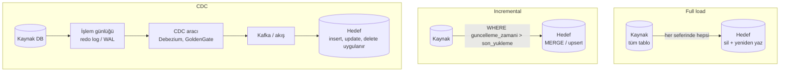

# 11.3 Yükleme Türleri: Full, Incremental ve CDC

## Nedir?
Kaynaktan hedefe verinin **ne kadarının** ve **nasıl** taşındığına göre üç yükleme yöntemi:
- **Full load (tam yükleme):** Her çalışmada tüm veri baştan alınır ve hedef yenilenir.
- **Incremental load (artımlı yükleme):** Sadece son yüklemeden bu yana **yeni veya değişen** kayıtlar alınır.
- **CDC (Change Data Capture — değişiklik verisi yakalama):** Kaynak veritabanındaki her ekleme, güncelleme ve silme **olay olarak** yakalanıp hedefe aktarılır.

## Hangi problemi çözer?
Tablolar büyüdükçe her gece tüm veriyi taşımak saatler sürer, kaynak sistemi yorar ve ağı doldurur. Doğru yükleme yöntemi:
- Yükleme süresini ve maliyetini düşürür,
- Kaynak sistem üzerindeki yükü azaltır,
- Verinin güncelliğini (günlükten dakikalara) artırır,
- Silinen kayıtların hedefe yansımasını sağlar.

## Nasıl çalışır?



| Özellik | Full load | Incremental | CDC |
|---|---|---|---|
| Ne taşınır? | Tüm veri | Yeni/değişen satırlar | Her değişiklik olayı |
| Kaynak yükü | Yüksek | Orta | Çok düşük (log okunur) |
| Silmeleri yakalar mı? | Evet (yeniden yazıldığı için) | **Hayır** (soft delete yoksa) | Evet |
| Güncellik | Batch (günlük) | Batch (saatlik/günlük) | Neredeyse gerçek zamanlı |
| Karmaşıklık | Çok basit | Orta | Yüksek |
| Gereksinim | — | Güvenilir bir değişiklik sütunu (`guncelleme_zamani`, artan ID) | Log erişimi, CDC altyapısı |
| Uygun olduğu yer | Küçük tablolar, referans/parametre tabloları, aylık dış veri | Büyük, değişiklik zamanı tutulan tablolar | Büyük ve sık değişen işlem tabloları, düşük gecikme ihtiyacı |

**Incremental yüklemenin anahtarı: "watermark" (su seviyesi işareti)**
Her başarılı yüklemede ulaşılan son değer (ör. en büyük `guncelleme_zamani`) bir kontrol tablosuna yazılır; sonraki çalışma oradan devam eder.

**Yavaş değişen boyutlar (SCD — Slowly Changing Dimensions)**
Boyut tablolarındaki değişikliklerin nasıl saklanacağı:
- **SCD Tip 1:** Eski değerin üzerine yaz (geçmiş tutulmaz).
- **SCD Tip 2:** Yeni satır ekle; `gecerlilik_baslangic`, `gecerlilik_bitis`, `guncel_mi` sütunlarıyla geçmişi koru. "Müşteri Mart'ta hangi segmentteydi?" sorusu için gereklidir.

## Mini örnek
**Full load (küçük referans tablosu)**
```sql
BEGIN;
TRUNCATE dwh.sube;
INSERT INTO dwh.sube SELECT * FROM staging.sube;
COMMIT;
```

**Incremental + watermark (Python)**
```python
import pandas as pd
from sqlalchemy import create_engine, text

kaynak = create_engine("oracle+oracledb://...")
hedef  = create_engine("postgresql+psycopg2://...")

with hedef.begin() as c:
    son = c.execute(text("SELECT son_deger FROM etl_kontrol WHERE tablo = 'kredi'")).scalar()

yeni = pd.read_sql(
    text("SELECT * FROM kredi WHERE guncelleme_zamani > :son"),
    kaynak, params={"son": son},
)

if not yeni.empty:
    with hedef.begin() as c:                                  # tek transaction
        yeni.to_sql("kredi_staging", c, if_exists="replace", index=False)
        c.execute(text("""
            INSERT INTO dwh.kredi SELECT * FROM kredi_staging
            ON CONFLICT (kredi_id) DO UPDATE SET
                tutar = EXCLUDED.tutar, durum = EXCLUDED.durum,
                guncelleme_zamani = EXCLUDED.guncelleme_zamani
        """))
        c.execute(text("UPDATE etl_kontrol SET son_deger = :v WHERE tablo = 'kredi'"),
                  {"v": yeni["guncelleme_zamani"].max()})
```

**SCD Tip 2 (Delta Lake MERGE, sadeleştirilmiş)**
```sql
-- 1) Değişen müşterilerin eski kaydını kapat
MERGE INTO dim_musteri t
USING staging_musteri s
ON t.musteri_id = s.musteri_id AND t.guncel_mi = true
WHEN MATCHED AND t.segment <> s.segment THEN
  UPDATE SET t.guncel_mi = false, t.gecerlilik_bitis = current_date();

-- 2) Yeni ve değişen müşteriler için güncel kaydı ekle
INSERT INTO dim_musteri
SELECT s.musteri_id, s.segment, current_date(), DATE '9999-12-31', true
FROM staging_musteri s
LEFT JOIN dim_musteri t ON t.musteri_id = s.musteri_id AND t.guncel_mi = true
WHERE t.musteri_id IS NULL;
```

**CDC (Debezium ile PostgreSQL → Kafka, kavramsal konfigürasyon)**
```json
{
  "name": "kredi-cdc",
  "config": {
    "connector.class": "io.debezium.connector.postgresql.PostgresConnector",
    "database.hostname": "pg.sirket.local",
    "database.dbname": "kredi",
    "table.include.list": "public.kredi,public.odeme",
    "topic.prefix": "cdc"
  }
}
```
Her değişiklik `cdc.public.kredi` topic'ine bir olay olarak düşer; hedefte bu olaylar `MERGE` ile uygulanır ([11.7](07-kafka.md)).

## Nerede kullanılır?
- **Full:** Şube, ürün, parametre tabloları; BDDK/TÜİK gibi aylık yayımlanan ve geçmiş düzeltmeleri içerebilen dış veriler (son N dönemi her seferinde yeniden yüklemek pratik bir çözümdür).
- **Incremental:** Kredi, mevduat, müşteri gibi büyük ama değişiklik zamanı tutulan tablolar.
- **CDC:** Core banking işlem tablolarının lakehouse'a dakikalar içinde yansıtılması, fraud ve gerçek zamanlı panolar.

## Benzerleri ve farkları
- **Snapshot (anlık görüntü):** Tablonun belirli bir tarihteki tam hâlini tarihle birlikte saklamak (ay sonu bakiyeleri). Bankacılıkta çok yaygındır; geçmiş raporun yeniden üretilmesini kolaylaştırır.
- **Idempotent yükleme:** Aynı yükleme iki kez çalışsa da sonuç değişmemeli (`MERGE`/upsert, dönem bazında sil-yaz). Yeniden denemelerin güvenli olması için şarttır ([5.6](../05-kubernetes/06-job-cronjob.md)).
- **CDC araçları:** Debezium (açık kaynak), Oracle GoldenGate, Qlik Replicate, AWS DMS, Fivetran.

## İlgili sayfalar
- [11.1 ETL ve ELT](01-etl-elt.md)
- [11.7 Kafka](07-kafka.md)
- [9.14 Delta Lake ve Iceberg (MERGE)](../09-veri-depolama/14-delta-iceberg.md)
