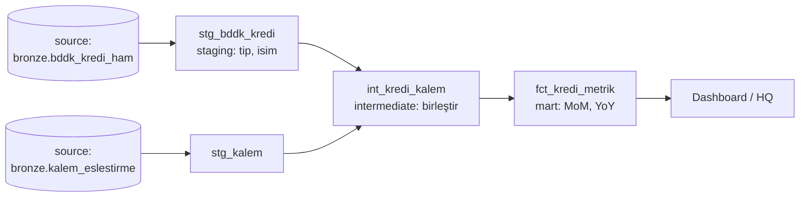

# 11.4 dbt: SQL ile Dönüşüm Katmanı

## Nedir?
**dbt (data build tool)**, ELT akışının **T (Transform)** adımını yöneten açık kaynak araçtır. Dönüşümler, her biri tek bir `SELECT` sorgusu olan **model** dosyaları olarak yazılır; dbt bu modelleri doğru sırayla çalıştırıp hedefte tablo veya view olarak oluşturur.

dbt veriyi taşımaz (E ve L yapmaz); veri zaten hedef sistemdeyken (PostgreSQL, Snowflake, BigQuery, Databricks, DuckDB, Oracle vb.) onu SQL ile dönüştürür.

## Hangi problemi çözer?
Yüzlerce SQL script'inin dağınık durduğu ortamlarda:
- **Sıra ve bağımlılık:** Hangi tablonun hangisinden önce oluşturulacağı elle takip edilir, hata yapılır.
- **Tekrar eden kod:** Aynı mantık birçok sorguya kopyalanır.
- **Test yok:** Hatalı veri raporlara kadar ulaşır.
- **Dokümantasyon yok:** "Bu sütun nereden geliyor?" sorusunun cevabı bilinmez.

dbt, SQL'e **yazılım mühendisliği pratiklerini** getirir: versiyon kontrolü (Git), modülerlik, test, dokümantasyon, CI/CD.

## Nasıl çalışır?
- Her model bir `.sql` dosyasıdır ve bir `SELECT` içerir.
- Modeller birbirine `{{ ref('model_adi') }}` ile, kaynak tablolara `{{ source('kaynak', 'tablo') }}` ile referans verir.
- dbt bu referanslardan bir **bağımlılık grafiği (DAG)** çıkarır ve modelleri doğru sırayla çalıştırır.
- **Jinja** şablon dili ile değişken, döngü ve **macro** (yeniden kullanılabilir SQL fonksiyonu) yazılabilir.
- **Materialization:** Modelin hedefte nasıl oluşturulacağı: `view`, `table`, `incremental`, `ephemeral`.



**Proje yapısı**
```
bddk_dbt/
├── dbt_project.yml
├── models/
│   ├── staging/          # silver'a karşılık: kaynakla 1'e 1, temizlik
│   │   ├── _sources.yml
│   │   ├── stg_bddk_kredi.sql
│   │   └── _stg_models.yml      # testler ve açıklamalar
│   ├── intermediate/
│   └── marts/            # gold'a karşılık: iş tabloları
│       └── fct_kredi_metrik.sql
├── macros/
├── tests/                # özel testler
└── seeds/                # küçük CSV referans tabloları
```

## Mini örnek
`models/staging/_sources.yml`
```yaml
version: 2
sources:
  - name: bronze
    schema: bronze
    tables:
      - name: bddk_kredi_ham
```

`models/staging/stg_bddk_kredi.sql`
```sql
select
    cast("Donem" || '-01' as date)                                          as donem,
    lower(trim("Kalem"))                                                    as kalem,
    cast(replace(replace("Tutar", '.', ''), ',', '.') as numeric(20,2))     as tutar
from {{ source('bronze', 'bddk_kredi_ham') }}
where "Tutar" is not null
```

`models/marts/fct_kredi_metrik.sql`
```sql
{{ config(materialized='table') }}

with aylik as (
    select donem, kalem, sum(tutar) as tutar
    from {{ ref('stg_bddk_kredi') }}
    group by donem, kalem
)
select
    donem,
    kalem,
    tutar,
    tutar / nullif(lag(tutar, 1)  over (partition by kalem order by donem), 0) - 1 as mom,
    tutar / nullif(lag(tutar, 12) over (partition by kalem order by donem), 0) - 1 as yoy
from aylik
```

`models/staging/_stg_models.yml` (testler ve dokümantasyon)
```yaml
version: 2
models:
  - name: stg_bddk_kredi
    description: "BDDK aylık kredi verisinin temizlenmiş hâli"
    columns:
      - name: donem
        tests: [not_null]
      - name: kalem
        tests:
          - not_null
          - accepted_values:
              values: ['tuketici', 'konut', 'tasit', 'kobi', 'ticari']
      - name: tutar
        description: "Bin TL"
        tests: [not_null]
```

Komutlar:
```bash
pip install dbt-postgres          # hedefe göre adapter: dbt-snowflake, dbt-databricks, dbt-duckdb, dbt-oracle...
dbt init bddk_dbt
dbt debug                         # bağlantı testi
dbt run                           # tüm modelleri sırayla oluştur
dbt run --select fct_kredi_metrik+    # bu model ve ona bağlı olanlar
dbt test                          # testleri çalıştır
dbt build                         # run + test birlikte, sırayla
dbt docs generate && dbt docs serve   # lineage grafiği ve dokümantasyon sitesi
```

Artımlı model (büyük tablolar için):
```sql
{{ config(materialized='incremental', unique_key='islem_id') }}
select * from {{ source('bronze', 'islem') }}

  where guncelleme_zamani > (select max(guncelleme_zamani) from {{ this }})

```

## Nerede kullanılır?
- Lakehouse ve veri ambarlarında silver → gold dönüşümleri
- Metrik tablolarının (MoM, YoY, YTD) standart ve test edilmiş biçimde üretilmesi
- SQL bilen analistlerin, veri mühendisliği disiplinine dahil olması ("analytics engineering")
- CI'da: her PR'da değişen modellerin test veritabanında çalıştırılıp test edilmesi ([6.2](../06-ci-cd/02-pipeline-asamalari.md))

## Benzerleri ve farkları
- **Saklı prosedürler (stored procedures):** Veritabanı içinde SQL; ama bağımlılık grafiği, test ve dokümantasyon araçları yoktur.
- **Dataiku SQL recipe'leri ve görsel akışları:** Aynı problemi görsel arayüzle çözer; dbt kod ve Git odaklıdır.
- **SQLMesh:** dbt'ye alternatif, sanal ortamlar ve değişiklik planlaması sunan yeni araç.
- **Spark ile dönüşüm:** Karmaşık, SQL ile ifadesi zor mantık veya çok büyük veri için ([10.3](../10-veri-isleme/03-spark.md)); dbt Spark/Databricks üzerinde de çalışabilir.
- **dbt Core ile dbt Cloud:** Core açık kaynak CLI aracıdır; Cloud, zamanlama, arayüz ve barındırma ekleyen ticari hizmettir.

## İlgili sayfalar
- [11.5 Veri kalitesi](05-veri-kalitesi.md)
- [9.13 Medallion](../09-veri-depolama/13-medallion.md)
- [10.1 SQL](../10-veri-isleme/01-sql.md)
