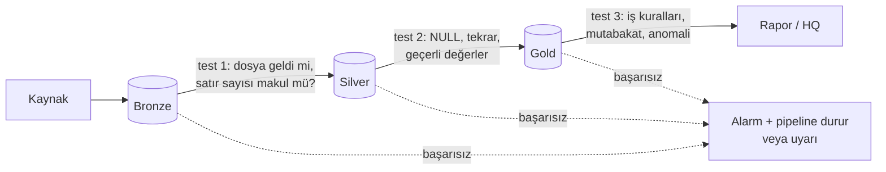

# 11.5 Veri Kalitesi ve Testleri: Great Expectations, dbt test

## Nedir?
**Veri kalitesi testleri**, kodun değil **verinin** beklentilere uyup uymadığını otomatik olarak kontrol eden kurallardır. "Tutar boş olamaz", "her müşterinin tek kaydı olmalı", "bu ayın toplamı geçen aydan %50'den fazla sapmamalı" gibi.

Yazılım testleri ([6.3](../06-ci-cd/03-otomatik-test.md)) kodun doğru çalıştığını, veri testleri ise gelen verinin doğru olduğunu kontrol eder. İkisi birbirini tamamlar: Kod doğru olsa bile kaynak bozuk veri gönderebilir.

## Hangi problemi çözer?
- Hatalı veri, yönetim raporuna veya ML modeline ulaşmadan **yakalanır**.
- "Raporu yönetim fark etti" yerine "pipeline uyardı" durumu oluşur.
- Kaynak sistemdeki sessiz değişiklikler (format değişikliği, eksik dosya, çift yükleme) erken tespit edilir.
- Düzenleyici raporlarda verinin hangi kontrollerden geçtiği belgelenir.

## Nasıl çalışır?

**Veri kalitesinin boyutları**
| Boyut | Soru | Örnek kural |
|---|---|---|
| **Tamlık (completeness)** | Eksik var mı? | `tutar` NULL olmamalı; 12 ayın hepsi gelmeli |
| **Benzersizlik (uniqueness)** | Tekrar var mı? | `(donem, kalem)` tekil olmalı |
| **Geçerlilik (validity)** | Format ve aralık doğru mu? | `segment` ∈ {Bireysel, KOBİ, Ticari}; TCKN 11 hane |
| **Doğruluk (accuracy)** | Gerçeği yansıtıyor mu? | Toplam, kaynak sistemin toplamıyla tutmalı (mutabakat) |
| **Tutarlılık (consistency)** | Tablolar birbiriyle uyumlu mu? | Her kredinin müşterisi müşteri tablosunda olmalı (referans bütünlüğü) |
| **Güncellik (timeliness)** | Veri zamanında geldi mi? | Son yükleme 24 saatten eski olmamalı (freshness) |

**Kontrol noktaları**


**Önem seviyeleri:** Her test aynı ağırlıkta değildir.
- **error:** Pipeline durur, veri yayımlanmaz (ör. birincil anahtar tekrarı).
- **warn:** Uyarı gönderilir, akış devam eder (ör. satır sayısında %20 düşüş).

## Mini örnek
**dbt test** (YAML ile, [11.4](04-dbt.md)):
```yaml
models:
  - name: fct_kredi_metrik
    tests:
      - dbt_utils.unique_combination_of_columns:     # dbt_utils paketi
          combination_of_columns: [donem, kalem]
    columns:
      - name: tutar
        tests:
          - not_null
          - dbt_utils.accepted_range:
              min_value: 0
      - name: kalem
        tests:
          - relationships:                          # referans bütünlüğü
              to: ref('dim_kalem')
              field: kalem
sources:
  - name: bronze
    tables:
      - name: bddk_kredi_ham
        loaded_at_field: _yukleme_zamani
        freshness:                                  # güncellik
          warn_after: {count: 35, period: day}
          error_after: {count: 45, period: day}
```

Özel SQL testi (`tests/kredi_aylik_sapma.sql`): sonuç döndürürse test başarısız sayılır.
```sql
-- Bir kalemin aylık değişimi %50'yi geçiyorsa şüpheli
select donem, kalem, mom
from {{ ref('fct_kredi_metrik') }}
where abs(mom) > 0.5
```

**Great Expectations** (Python):
```python
import great_expectations as gx
import pandas as pd

df = pd.read_parquet("silver/bddk_kredi.parquet")
context = gx.get_context()
batch = (context.data_sources.add_pandas("pd")
         .add_dataframe_asset("kredi")
         .add_batch_definition_whole_dataframe("tum")
         .get_batch(batch_parameters={"dataframe": df}))

suite = gx.ExpectationSuite(name="bddk_kredi")
suite.add_expectation(gx.expectations.ExpectColumnValuesToNotBeNull(column="tutar"))
suite.add_expectation(gx.expectations.ExpectColumnValuesToBeBetween(column="tutar", min_value=0))
suite.add_expectation(gx.expectations.ExpectCompoundColumnsToBeUnique(column_list=["donem", "kalem"]))
suite.add_expectation(gx.expectations.ExpectTableRowCountToBeBetween(min_value=50, max_value=500))

sonuc = batch.validate(suite)
if not sonuc.success:
    raise ValueError("Veri kalitesi kontrolü başarısız")
```
*(Great Expectations API'si sürümler arasında değişti; yukarıdaki 1.x sürümü içindir.)*

**pandera** (pandas için hafif şema doğrulama):
```python
import pandera.pandas as pa

sema = pa.DataFrameSchema({
    "donem":   pa.Column("datetime64[ns]", nullable=False),
    "kalem":   pa.Column(str, pa.Check.isin(["tuketici", "konut", "tasit", "kobi", "ticari"])),
    "tutar":   pa.Column(float, pa.Check.ge(0)),
}, unique=["donem", "kalem"])

sema.validate(df)          # kurala uymazsa ayrıntılı hata
```

## Nerede kullanılır?
- Her ETL/ELT adımının sonunda (özellikle silver ve gold'a yazmadan önce)
- Düzenleyici ve yönetim raporlarında mutabakat kontrolleri
- ML eğitim ve skorlama verisinde: beklenmeyen dağılım değişimi (drift) modelin sessizce bozulmasına yol açar (Bölüm 13)
- CI'da: dbt modelleri değiştiğinde testlerin otomatik çalışması

## Benzerleri ve farkları
| Araç | Özellik |
|---|---|
| **dbt test** | SQL tabanlı, dbt projesine gömülü; en kolay başlangıç |
| **Great Expectations** | Python, geniş kural kütüphanesi, HTML raporları (Data Docs) |
| **Soda** | YAML benzeri kontrol dili (SodaCL), çok platform |
| **pandera** | pandas/Polars için tip ve değer şemaları; kod içinde hafif kullanım |
| **Delta Live Tables / Lakeflow expectations** | Databricks'te pipeline tanımına gömülü kurallar |
| **Data observability** (Monte Carlo, Elementary) | Kural yazmadan geçmiş davranışa göre anomali tespiti, lineage ile etki analizi |

- **Veri sözleşmesi (data contract):** Kalite kurallarının kaynak ekiple yazılı olarak anlaşılması.
- **Kalite ile yönetişim:** Kalite sonuçları, veri kataloğunda tablonun "güvenilirlik" bilgisi olarak gösterilebilir (Bölüm 15).

## İlgili sayfalar
- [11.4 dbt](04-dbt.md)
- [11.2 Akışta şema](02-akista-schema.md)
- [6.3 Otomatik testler](../06-ci-cd/03-otomatik-test.md)
