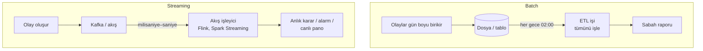

# 11.6 Batch ve Streaming Farkı

## Nedir?
Veriyi işleme zamanlamasına göre iki yaklaşım:
- **Batch (toplu) işleme:** Veri birikir, belirli aralıklarla (gece, saatlik, aylık) **toplu hâlde** işlenir.
- **Streaming (akış) işleme:** Veri **oluştuğu anda**, olay olay ve **sürekli** işlenir.

## Hangi problemi çözer?
İş ihtiyacının gerektirdiği **gecikme** (latency) farklıdır:
- Aylık BDDK raporu için verinin gece işlenmesi yeterlidir.
- Şüpheli kart işleminin, işlem onaylanmadan önceki saniyeler içinde tespit edilmesi gerekir.

Doğru yaklaşımı seçmek; gereksiz karmaşıklığı (her şeyi streaming yapmak) veya iş ihtiyacının karşılanamamasını (fraud'u ertesi gün fark etmek) önler.

## Nasıl çalışır?



| Özellik | Batch | Streaming |
|---|---|---|
| Gecikme | Dakika – gün | Milisaniye – saniye |
| Veri birimi | Sınırlı küme (dünün tüm işlemleri) | Sınırsız, sürekli akış |
| Tetikleme | Zamanlama (cron, orkestratör) | Her yeni olay |
| Karmaşıklık | Düşük | Yüksek (sıra, tekrar, geç gelen veri, durum yönetimi) |
| Hata kurtarma | İşi yeniden çalıştır | Checkpoint, offset yönetimi |
| Maliyet | Kaynaklar sadece iş sırasında kullanılır | Sürekli çalışan altyapı |
| Araçlar | SQL, pandas, Spark, dbt, Airflow | Kafka, Flink, Spark Structured Streaming, Kafka Streams |

**Streaming'e özgü kavramlar**
| Kavram | Anlamı |
|---|---|
| **Olay zamanı ile işlenme zamanı** | İşlemin gerçekleştiği an ile sisteme ulaştığı an farklı olabilir (ağ gecikmesi, mobil cihaz çevrimdışı) |
| **Pencere (window)** | Sonsuz akışı zamana göre gruplamak: "son 5 dakikadaki işlem sayısı" (tumbling, sliding, session pencereleri) |
| **Watermark** | Geç gelen veriyi ne kadar bekleyeceğimiz |
| **Durum (state)** | Olaylar arası hatırlanan bilgi: "bu kartın son 1 saatteki toplam harcaması" |
| **Teslim garantisi** | At-most-once (kayıp olabilir), at-least-once (tekrar olabilir), exactly-once (tam bir kez) |

**Ara çözümler**
- **Micro-batch:** Çok kısa aralıklarla (her 1 dakikada) küçük batch'ler. Spark Structured Streaming varsayılan olarak böyle çalışır; çoğu "gerçek zamanlıya yakın" ihtiyaç için yeterlidir.
- **Lambda mimarisi:** Aynı veri için hem batch (doğru, gecikmeli) hem streaming (hızlı, yaklaşık) katmanı. İki kod tabanı bakım yükü getirir.
- **Kappa mimarisi:** Her şey tek bir akış katmanında; geçmişi yeniden işlemek için akış baştan oynatılır.

## Mini örnek
**Batch** (her gece çalışan iş):
```python
islemler = spark.read.table("silver.kart_islem").filter("islem_tarihi = current_date() - 1")
gunluk = islemler.groupBy("kart_no").agg(F.sum("tutar").alias("gunluk_harcama"))
gunluk.write.mode("overwrite").saveAsTable("gold.kart_gunluk_ozet")
```

**Streaming** (Spark Structured Streaming ile Kafka'dan sürekli okuma):
```python
from pyspark.sql import functions as F

akis = (spark.readStream.format("kafka")
        .option("kafka.bootstrap.servers", "kafka.sirket.local:9092")
        .option("subscribe", "kart-islem")
        .load())

islem = akis.select(F.from_json(F.col("value").cast("string"),
                    "kart_no STRING, tutar DOUBLE, ts TIMESTAMP").alias("e")).select("e.*")

# Kart başına 10 dakikalık pencerede toplam; 2 dk'ya kadar geç gelen veri kabul
pencere = (islem.withWatermark("ts", "2 minutes")
           .groupBy(F.window("ts", "10 minutes"), "kart_no")
           .agg(F.sum("tutar").alias("toplam"), F.count("*").alias("adet")))

supheli = pencere.filter("adet > 20 OR toplam > 100000")

(supheli.writeStream.format("delta")
    .outputMode("append")
    .option("checkpointLocation", "s3a://lake/_checkpoints/kart_supheli")
    .toTable("gold.kart_supheli_pencere"))
```

## Nerede kullanılır?
| Batch | Streaming |
|---|---|
| Düzenleyici raporlar (BDDK, TCMB) | Kart fraud tespiti |
| Gün sonu, ay sonu raporları | Anlık bakiye/limit takibi |
| Model eğitimi | Online model skorlama için anlık feature üretimi |
| Dış verinin (TÜİK, BDDK) aylık yüklenmesi | CDC ile lakehouse'un güncel tutulması ([11.3](03-yukleme-turleri.md)) |
| Toplu kampanya listeleri | Olay bazlı bildirimler (büyük harcama SMS'i) |

## Benzerleri ve farkları
- **"Gerçek zamanlı" ihtiyacı sorgulayın:** Çoğu "anlık rapor" talebi aslında 15 dakikalık gecikmeyi kabul eder; micro-batch veya sık batch çok daha basit ve ucuzdur.
- **Event-driven (olay güdümlü) mimari:** Servislerin birbirine doğrudan istek atmak yerine olay yayınlayıp dinlemesi; streaming altyapısını uygulamalar arası iletişimde kullanır ([7.6](../07-api/06-diger-yaklasimlar.md)).

## İlgili sayfalar
- [11.7 Kafka](07-kafka.md)
- [11.3 Yükleme türleri ve CDC](03-yukleme-turleri.md)
- [10.3 Spark](../10-veri-isleme/03-spark.md)
