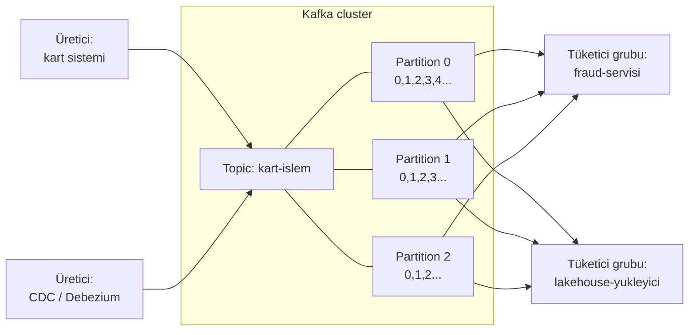

# 11.7 Mesaj Kuyrukları ve Kafka

## Nedir?
- **Mesaj kuyruğu / mesaj aracısı (message broker):** Bir sistemin ürettiği mesajları alıp, onları kullanacak sistemlere ileten aracı yazılım. Gönderen ve alan birbirini doğrudan tanımak zorunda kalmaz.
- **Apache Kafka:** Yüksek hacimli olay akışlarını **dağıtık, kalıcı ve sıralı bir günlük (log)** olarak saklayan **olay akış platformu** (event streaming platform). LinkedIn'de geliştirildi, Apache projesi oldu.

## Hangi problemi çözer?
Doğrudan bağlantılı sistemlerde (A → B'ye API çağrısı):
- B yavaşlarsa veya çökerse A da etkilenir.
- Aynı veriyi 5 sisteme göndermek için A'nın 5 entegrasyon yazması gerekir.
- Ani yük artışında (ay sonu, kampanya) alıcı sistem boğulur.

Kafka araya girince:
- **Ayrıştırma (decoupling):** Üretici olayı yazar ve işine devam eder; tüketiciler kendi hızlarında okur.
- **Çoklu tüketici:** Aynı olayı fraud sistemi, lakehouse ve bildirim servisi ayrı ayrı okur.
- **Tampon:** Ani yükü emer.
- **Kalıcılık ve yeniden oynatma:** Mesajlar okununca silinmez; belirlenen süre boyunca saklanır, gerekirse baştan okunur.

## Nasıl çalışır?



| Kavram | Anlamı |
|---|---|
| **Broker** | Kafka sunucusu; cluster birden çok broker'dan oluşur |
| **Topic** | Mesajların konu bazında toplandığı kanal (`kart-islem`, `cdc.public.kredi`) |
| **Partition** | Topic'in paralel işlenebilen parçası; sıra **sadece partition içinde** garanti edilir |
| **Offset** | Mesajın partition içindeki sıra numarası |
| **Key** | Mesajın hangi partition'a gideceğini belirler; aynı key (ör. `kart_no`) hep aynı partition'a → o kartın olayları sıralı |
| **Producer** | Mesaj yazan uygulama |
| **Consumer / consumer group** | Mesaj okuyan uygulama; bir gruptaki tüketiciler partition'ları paylaşır (ölçekleme), farklı gruplar aynı veriyi bağımsız okur |
| **Retention** | Mesajların saklanma süresi (ör. 7 gün) veya boyutu |
| **Replication** | Her partition birden çok broker'da kopyalanır; broker çökse veri kaybolmaz |
| **Schema Registry** | Mesaj şemalarının (Avro, Protobuf, JSON Schema) merkezi kaydı ve uyumluluk kontrolü |

**Kafka ekosistemi**
- **Kafka Connect:** Veritabanı, dosya, S3 gibi sistemlere hazır bağlayıcılar (source / sink connector). Debezium CDC bağlayıcıları burada çalışır.
- **Kafka Streams / ksqlDB:** Kafka üzerinde akış işleme.
- **Apache Flink, Spark Structured Streaming:** Kafka'dan okuyan güçlü akış işleme motorları.

## Mini örnek
Komut satırı (Kafka'nın kendi araçları):
```bash
kafka-topics.sh --bootstrap-server kafka:9092 --create --topic kart-islem --partitions 6 --replication-factor 3
kafka-topics.sh --bootstrap-server kafka:9092 --list
kafka-console-producer.sh --bootstrap-server kafka:9092 --topic kart-islem
kafka-console-consumer.sh --bootstrap-server kafka:9092 --topic kart-islem --from-beginning
kafka-consumer-groups.sh --bootstrap-server kafka:9092 --describe --group fraud-servisi   # LAG: geride kalan mesaj sayısı
```

Python (confluent-kafka):
```python
import json
from confluent_kafka import Producer, Consumer

# Üretici
p = Producer({"bootstrap.servers": "kafka.sirket.local:9092"})
olay = {"kart_no": "4543...1234", "tutar": 2500.0, "ts": "2026-10-13T14:05:00+03:00"}
p.produce("kart-islem", key=olay["kart_no"], value=json.dumps(olay))
p.flush()

# Tüketici
c = Consumer({
    "bootstrap.servers": "kafka.sirket.local:9092",
    "group.id": "fraud-servisi",
    "auto.offset.reset": "earliest",
    "enable.auto.commit": False,
})
c.subscribe(["kart-islem"])
while True:
    msg = c.poll(1.0)
    if msg is None or msg.error():
        continue
    islem = json.loads(msg.value())
    # ... kural / model skoru ...
    c.commit(msg)          # işlendikten sonra offset'i kaydet (at-least-once)
```

## Nerede kullanılır?
- Kart işlemlerinin fraud, bildirim ve analitik sistemlerine eşzamanlı dağıtılması
- CDC: Core banking değişikliklerinin lakehouse'a akışı ([11.3](03-yukleme-turleri.md))
- Mikroservisler arası olay güdümlü iletişim
- Log ve metrik toplama hattı
- Online feature store'ların beslenmesi (Bölüm 13)

## Benzerleri ve farkları
| Araç | Model | Güçlü yanı |
|---|---|---|
| **Kafka** | Kalıcı, dağıtık log | Çok yüksek hacim, yeniden oynatma, çoklu tüketici |
| **RabbitMQ** | Klasik mesaj kuyruğu (AMQP) | Esnek yönlendirme, görev kuyrukları; mesaj okununca silinir |
| **IBM MQ** | Kurumsal mesaj kuyruğu | Bankacılıkta yerleşik, işlem garantileri güçlü |
| **Redis Streams** | Hafif akış | Basit kurulum ([9.7](../09-veri-depolama/07-redis-cache.md)) |
| **Apache Pulsar** | Kafka benzeri, katmanlı depolama | Çoklu kiracılık |
| **Bulut** | AWS Kinesis, Azure Event Hubs, Google Pub/Sub | Yönetilen hizmet |

- **Kafka bir veritabanı değildir:** Sorgu yapılmaz, sıralı okunur. Olaylar analiz için lakehouse'a veya veritabanına aktarılır.
- **Kubernetes/OpenShift'te:** **Strimzi** operator'ü (Red Hat'in ürünleşmiş hâli: Streams for Apache Kafka) ile kurulur ([5.5](../05-kubernetes/05-statefulset-daemonset.md)).
- **ZooKeeper:** Eski Kafka sürümleri cluster yönetimi için ZooKeeper'a ihtiyaç duyuyordu; yeni sürümler **KRaft** moduyla buna gerek duymaz.

## İlgili sayfalar
- [11.6 Batch ve streaming](06-batch-streaming.md)
- [11.3 CDC](03-yukleme-turleri.md)
- [7.6 Webhook ve olay odaklı iletişim](../07-api/06-diger-yaklasimlar.md)
- [17.9 Avro](../17-formatlar/09-digerleri.md)
- [11.11 Kafka ve Redpanda](11-kafka-redpanda.md)
