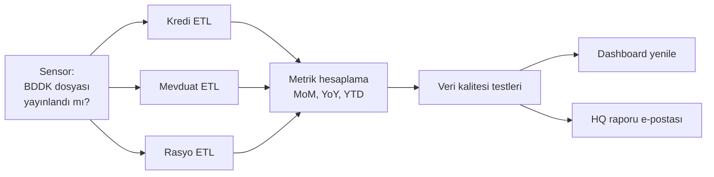

# 11.8 Zamanlama ve Orkestrasyon: cron, Airflow, n8n

## Nedir?
- **Zamanlama (scheduling):** Bir işi belirli bir zamanda veya aralıkla başlatmak ("her sabah 07:00").
- **Orkestrasyon (orchestration):** Birbirine bağımlı birçok işi doğru sırayla çalıştırmak, başarısız olanı yeniden denemek, durumu izlemek ve sorunda haber vermek ("önce kredi ve mevduat ETL'leri, ikisi bitince metrikler, sonra dashboard yenilemesi, hata olursa e-posta").

Orkestrasyon araçları iş akışlarını genellikle bir **DAG (Directed Acyclic Graph — yönlü döngüsüz çizge)** olarak tanımlar: adımlar ve aralarındaki bağımlılıklar, döngü olmadan.

## Hangi problemi çözer?
Birkaç cron satırıyla başlayan ETL'ler zamanla şu sorunları üretir:
- İş B, iş A'nın bitmesini bekleyemez; "A genelde 06:40'ta biter, B'yi 07:00'ye koyalım" gibi kırılgan tahminler.
- Bir adım başarısız olunca sonrakiler hatalı veriyle çalışır.
- Hangi işin ne zaman, ne kadar sürede çalıştığı ve neden düştüğü görülemez.
- Geçmiş tarihler için yeniden çalıştırmak (backfill) elle ve zahmetlidir.

## Nasıl çalışır?



**Orkestratörün sağladıkları**
| Yetenek | Açıklama |
|---|---|
| Bağımlılık yönetimi | Bir adım, öncekiler başarılı bitince başlar |
| Zamanlama | Cron ifadesi, takvim, olay tetiklemesi (dosya geldi, başka DAG bitti) |
| Yeniden deneme | Geçici hatalarda otomatik tekrar (ör. 3 kez, 5 dk arayla) |
| Backfill | Geçmiş dönemler için işi tarih parametresiyle yeniden çalıştırmak |
| İzleme | Arayüzde çalışma geçmişi, süreler, loglar |
| Alarm | Başarısızlıkta e-posta / Teams / Slack bildirimi |
| Paralellik | Bağımsız adımları aynı anda çalıştırmak |
| Parametre | Çalışma tarihi gibi değerlerin adımlara aktarılması |

**Araçlar**
| Araç | Yaklaşım | Güçlü yanı | Ne zaman? |
|---|---|---|---|
| **cron** ([1.8](../01-linux/08-cron.md)) | Tek satır, tek sunucu | Basitlik | Bağımsız, tek adımlı işler |
| **Kubernetes CronJob** ([5.6](../05-kubernetes/06-job-cronjob.md)) | Container olarak zamanlanmış iş | İzolasyon, yeniden deneme | Container'laşmış bağımsız işler |
| **Apache Airflow** | DAG'lar Python kodu | Olgun, çok geniş entegrasyon, backfill | Veri mühendisliği iş akışları; sektör standardı |
| **Dagster** | "Varlık (asset)" odaklı, Python | Veri varlıkları ve lineage, test edilebilirlik | Modern veri platformları |
| **Prefect** | Python fonksiyonlarını akışa çevirme | Kolay başlangıç | Python ağırlıklı ekipler |
| **Argo Workflows** | Kubernetes YAML; her adım bir pod | Kubernetes-native | Kubernetes merkezli ortamlar |
| **n8n** | Görsel, düğüm tabanlı iş akışı | API entegrasyonları, webhook, AI adımları, az kod | Otomasyon, raporlama, bildirim akışları |
| **Dataiku scenario'ları** | Platform içi zamanlama ve tetikleme | Dataiku akışlarıyla doğal entegrasyon | Dataiku projeleri |
| **Kurumsal zamanlayıcılar** | Control-M, IBM Workload Scheduler | Bankalarda merkezi iş zamanlama | Kurum çapında batch işler |

## Mini örnek
**Airflow DAG** (`dags/bddk_aylik.py`):
```python
from datetime import datetime, timedelta
from airflow.decorators import dag, task

varsayilan = {"retries": 3, "retry_delay": timedelta(minutes=10)}

@dag(
    schedule="0 7 * * 1-5",
    start_date=datetime(2026, 1, 1),
    catchup=False,
    default_args=varsayilan,
    tags=["bddk"],
)
def bddk_aylik():

    @task
    def kredi_etl(ds=None):           # ds: mantıksal çalışma tarihi (Airflow verir)
        from etl.kredi import calistir
        return calistir(tarih=ds)

    @task
    def mevduat_etl(ds=None):
        from etl.mevduat import calistir
        return calistir(tarih=ds)

    @task
    def metrikler(kredi_satir: int, mevduat_satir: int):
        from metrics.hesapla import calistir
        calistir()

    @task
    def kalite_kontrol():
        from quality.kontroller import calistir
        calistir()                    # hata fırlatırsa DAG burada durur

    metrikler(kredi_etl(), mevduat_etl()) >> kalite_kontrol()

bddk_aylik()
```

```bash
airflow dags list
airflow dags test bddk_aylik 2026-10-13          # yerelde dene
airflow dags backfill bddk_aylik -s 2026-01-01 -e 2026-03-31   # geçmişi doldur (Airflow 2.x; 3.x'te arayüzden/komutla backfill)
```

**n8n** ile aynı fikrin görsel karşılığı (kavramsal):
```text
[Cron: hafta içi 07:00] → [HTTP Request: BDDK sayfası] → [IF: yeni dönem var mı?]
      → [Execute Command / HTTP: ETL servisini tetikle] → [Postgres: metrik sorgusu]
      → [AI: özet metin üret] → [Grafik oluştur] → [E-posta / Teams: rapor gönder]
      ↳ hata dalı → [Teams: "ETL başarısız" bildirimi]
```

## Nerede kullanılır?
- Çok adımlı ETL/ELT akışları ve dbt çalıştırmaları
- Model eğitimi → doğrulama → kayıt → skorlama zincirleri (MLOps, Bölüm 13)
- Dış kaynakların yayımlanmasını bekleyip (sensor) otomatik yükleme
- Rapor üretimi ve dağıtımı (n8n, Airflow)

## Benzerleri ve farkları
- **Orkestratör işi yapmaz, yönetir:** Ağır veri işleme Airflow worker'ında değil, tetiklediği sistemde (Spark, veritabanı, Kubernetes pod'u) yapılmalıdır. Orkestratör "ne zaman ve hangi sırayla"yı yönetir.
- **Idempotent görevler:** Yeniden deneme ve backfill'in güvenli olması için her görev aynı tarihle iki kez çalıştığında aynı sonucu üretmelidir ([11.3](03-yukleme-turleri.md)).
- **CI/CD ile ilişkisi:** DAG ve workflow tanımları da koddur; Git'te tutulur ve pipeline ile dağıtılır ([6.1](../06-ci-cd/01-ci-cd-nedir.md)).

## İlgili sayfalar
- [1.8 cron](../01-linux/08-cron.md)
- [5.6 Kubernetes CronJob](../05-kubernetes/06-job-cronjob.md)
- [11.4 dbt](04-dbt.md)
