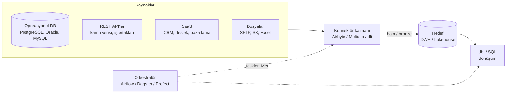

# 11.9 ETL/ELT Konnektörleri: Airbyte, Meltano ve dlt

## Nedir?
**Konnektör (connector)**, bir kaynaktan (veritabanı, SaaS uygulaması, REST API, dosya) veriyi okuyup bir hedefe (veri ambarı, lakehouse, veritabanı) yazan hazır bileşendir. ELT'nin **E (extract)** ve **L (load)** adımlarını standartlaştırır; dönüşüm (T) genellikle hedefte dbt veya SQL ile yapılır ([11.1](01-etl-elt.md)).

| Araç | Ne? | Nasıl kullanılır? |
|---|---|---|
| **Airbyte** | Hazır konnektör kataloğu olan, arayüzlü veri entegrasyon platformu | Web arayüzü, API, Terraform; Python'dan PyAirbyte |
| **Meltano** | **Singer** standardındaki tap (kaynak) ve target (hedef) eklentilerini yöneten, kod/CLI odaklı ELT çatısı | `meltano.yml` + CLI, Git'te yönetim |
| **dlt (data load tool)** | Python kodunun içinden veri yükleme kütüphanesi; şemayı otomatik çıkarır ve evrimini yönetir | `pip install dlt`, Python fonksiyonları |

## Hangi problemi çözer?
- Her kaynak için sıfırdan yazılan, bakımı zor çekme script'leri (sayfalama, kimlik doğrulama, hata ve tekrar deneme, oran sınırı)
- Artımlı (incremental) yükleme ve "en son nereye kadar okudum?" durumunun (state) yönetimi
- Kaynakta yeni sütun çıktığında akışın kırılması (şema evrimi)
- İç içe JSON'ların tablolara açılması
- Aynı işi yapan onlarca farklı script yerine ortak, izlenebilir bir yükleme katmanı

## Nasıl çalışır?

**Konnektör katmanının yeri**


**Ortak kavramlar**
| Kavram | Anlamı |
|---|---|
| **Source / tap** | Kaynak konnektörü |
| **Destination / target** | Hedef konnektörü |
| **Stream** | Kaynaktaki bir tablo veya API uç noktası |
| **Sync modu / write disposition** | Tam yenileme (replace), ekleme (append), birincil anahtara göre birleştirme (merge / dedup) |
| **Cursor / incremental** | Artımlı yükleme için kullanılan alan (`guncelleme_zamani`, artan ID) |
| **State** | Son okunan cursor değeri; bir sonraki çalışmada kaldığı yerden devam etmek için |
| **CDC** | Veritabanı değişiklik günlüğünden (WAL, redo log) ekleme/güncelleme/silme olaylarını okumak ([11.3](03-yukleme-turleri.md)) |
| **Normalizasyon** | İç içe JSON'un ana ve çocuk tablolara açılması |

**Araç karşılaştırması**
| | Airbyte | Meltano | dlt |
|---|---|---|---|
| Yaklaşım | Platform (arayüz + API + zamanlayıcı) | CLI + YAML proje; Singer eklentileri | Python kütüphanesi |
| Konnektörler | Geniş hazır katalog; düşük kodlu Connector Builder | MeltanoHub'daki Singer tap/target'ları | Doğrulanmış kaynaklar + REST API ve SQL veritabanı için genel kaynaklar; kendi kaynağınızı Python ile yazmak kolay |
| Altyapı | Kubernetes/Docker üzerinde birden çok servis | Tek Python ortamı | Tek Python ortamı; altyapı gerekmez |
| Kimin için? | Konnektör çeşitliliği isteyen, arayüz tercih eden ekipler | Her şeyi kod ve Git'te tutmak isteyen ekipler | Python geliştiricileri, API ağırlıklı kaynaklar, hafif kurulum |
| Orkestrasyon | Kendi zamanlayıcısı + Airflow/Dagster entegrasyonları | Orkestratörle veya `meltano schedule` ile | Herhangi bir orkestratörde Python adımı olarak |
| Lisans | Platform kaynak kodu açık (Elastic License v2); konnektörlerin çoğu MIT | MIT | Apache 2.0 |

**Bankacılık bağlamında dikkat**
- Çekirdek bankacılık veritabanlarından CDC ile çekim, DBA ve güvenlik ekibi onayı, ayrı okuma yetkili servis hesabı ve kaynak sisteme yük testi gerektirir.
- Konnektörlerin kimlik bilgileri secret yöneticisinde tutulmalı ([15.7](../15-guvenlik/07-secret-yonetimi.md)).
- Dışarıya (SaaS) veri gönderen konnektörler veri sınıflandırma politikasına tabidir ([16.6](../16-veri-yonetisimi/06-siniflandirma.md)).
- Kurum içi kullanım için açık kaynak aracın kurum içinde (self-hosted) çalıştırılması ve konnektör image'larının kurum registry'sinden çekilmesi gerekebilir.

## Mini örnek
**dlt: REST API'den artımlı yükleme**
```python
import dlt
from dlt.sources.helpers import requests      # otomatik tekrar denemeli requests

@dlt.resource(name="doviz_kurlari", write_disposition="merge", primary_key=["tarih", "kod"])
def doviz_kurlari(tarih=dlt.sources.incremental("tarih", initial_value="2026-01-01")):
    sayfa = 1
    while True:
        yanit = requests.get("https://api.ornek-veri.local/v1/kurlar",
                             params={"baslangic": tarih.last_value, "sayfa": sayfa}, timeout=30)
        yanit.raise_for_status()
        kayitlar = yanit.json()["kayitlar"]
        if not kayitlar:
            break
        yield kayitlar                            # iç içe alanlar otomatik çocuk tablolara açılır
        sayfa += 1

pipeline = dlt.pipeline(pipeline_name="kurlar", destination="postgres", dataset_name="bronze_kurlar")
bilgi = pipeline.run(doviz_kurlari())
print(bilgi)                                      # yüklenen tablolar, satır sayıları
```
Bağlantı bilgileri koda değil `.dlt/secrets.toml` dosyasına veya ortam değişkenlerine yazılır:
```toml
[destination.postgres.credentials]
host = "pg.sirket.local"
port = 5432
database = "dwh"
username = "svc_dlt"
# password: DESTINATION__POSTGRES__CREDENTIALS__PASSWORD ortam değişkeninden
```

**dlt: veritabanından tablo kopyalamak**
```python
from dlt.sources.sql_database import sql_database

kaynak = sql_database(credentials=KAYNAK_DB_URL, schema="kredi",
                      table_names=["kredi_hesap", "teminat"])
kaynak.kredi_hesap.apply_hints(incremental=dlt.sources.incremental("guncelleme_zamani"),
                               write_disposition="merge", primary_key="kredi_id")
dlt.pipeline(pipeline_name="kredi_kopya", destination="postgres",
             dataset_name="bronze_kredi").run(kaynak)
```

**Meltano: Singer tap'leri ile proje**
```bash
pip install meltano
meltano init kredi-elt && cd kredi-elt
meltano add extractor tap-postgres
meltano add loader target-postgres
meltano config tap-postgres set host pg-kaynak.sirket.local
meltano config tap-postgres set user svc_meltano
meltano config tap-postgres set password "$KAYNAK_PAROLA"     # .env dosyasına yazılır, Git'e girmez
meltano run tap-postgres target-postgres                        # state otomatik saklanır
```
`meltano.yml` (sadeleştirilmiş)
```yaml
version: 1
project_id: kredi-elt
plugins:
  extractors:
    - name: tap-postgres
      variant: meltanolabs
      config:
        host: pg-kaynak.sirket.local
        database: core
      select:
        - kredi-kredi_hesap.*
        - kredi-teminat.*
      metadata:
        kredi-kredi_hesap:
          replication-method: INCREMENTAL
          replication-key: guncelleme_zamani
  loaders:
    - name: target-postgres
      variant: meltanolabs
      config:
        host: pg.sirket.local
        database: dwh
        default_target_schema: bronze_kredi
```

**Airbyte: yerel deneme ve PyAirbyte**
```bash
curl -LsfS https://get.airbyte.com | bash -    # abctl kurulumu
abctl local install                            # yerel Kubernetes (kind) üzerinde; arayüz: http://localhost:8000
```
```python
import airbyte as ab                          # pip install airbyte (PyAirbyte)

kaynak = ab.get_source("source-faker", config={"count": 1000}, install_if_missing=True)
kaynak.check()
kaynak.select_all_streams()
sonuc = kaynak.read()                         # varsayılan olarak yerel DuckDB önbelleğine
df = sonuc["users"].to_pandas()
```
Kurumsal kullanımda Airbyte bağlantıları (source → destination, akış seçimi, sync modu, zamanlama) arayüzden veya Terraform sağlayıcısıyla kod olarak tanımlanır.

## Nerede kullanılır?
- Kamu kurumlarının ve iş ortaklarının API'lerinden düzenli veri çekme (döviz kurları, istatistikler, piyasa verisi)
- Operasyonel veritabanlarından analitik ortama kopyalama ve CDC
- SaaS uygulamalarından (CRM, çağrı merkezi, pazarlama) veri toplama
- Lakehouse'un bronze katmanını besleme ([9.13](../09-veri-depolama/13-medallion.md))

## Benzerleri ve farkları
| Araç | Not |
|---|---|
| **Fivetran, Stitch, Hevo** | Tam yönetilen (SaaS) ticari ELT servisleri |
| **Debezium + Kafka Connect** | Veritabanı CDC'sini olay akışına çeviren açık kaynak çözüm; gerçek zamanlıya yakın ([11.11](11-kafka-redpanda.md)) |
| **Apache NiFi** | Görsel akış tasarımı, dosya ve mesaj yönlendirme; kurumlarda yaygın |
| **Informatica, ODI, SSIS, Talend, DataStage** | Bankalarda yaygın geleneksel kurumsal ETL araçları |
| **Spark JDBC / pandas + SQLAlchemy** | Elle yazılan çekim; tam kontrol, ama sayfalama, state, şema evrimi sizin sorumluluğunuzda |
| **n8n** | Genel amaçlı iş akışı otomasyonu; küçük entegrasyonlar için ([11.8](08-orkestrasyon.md)) |

## İlgili sayfalar
- [11.1 ETL ve ELT](01-etl-elt.md)
- [11.3 Yükleme türleri: full, incremental, CDC](03-yukleme-turleri.md)
- [11.10 Orkestratörler](10-orkestrator-karsilastirma.md)
- [11.4 dbt](04-dbt.md)
