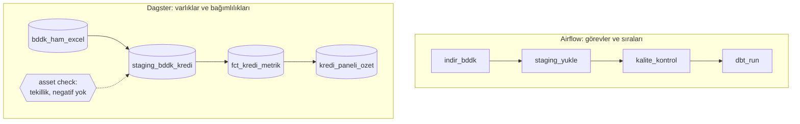

# 11.10 Workflow Orkestrasyonu: Airflow, Dagster ve Prefect

## Nedir?
Orkestrasyonun temel kavramları (zamanlama, bağımlılık, tekrar deneme, izleme) [11.8](08-orkestrasyon.md)'de anlatıldı. Bu sayfa Python dünyasının üç yaygın orkestratörünü **aynı iş üzerinden** karşılaştırır:

| Araç | Temel düşünce | Kısaca |
|---|---|---|
| **Apache Airflow** | **Görev (task) odaklı:** DAG içinde sıralı/paralel görevler | En yaygın, en geniş entegrasyon ekosistemi; kurumsal standart |
| **Dagster** | **Veri varlığı (asset) odaklı:** "Hangi tablolar/dosyalar üretilmeli ve neye bağlılar?" | Lineage, bölümler (partition) ve kalite kontrolleri yerleşik |
| **Prefect** | **Python fonksiyonu odaklı:** Mevcut Python kodunu az değişiklikle akışa çevirmek | Hızlı başlangıç, dinamik akışlar, sade API |

## Hangi problemi çözer?
- Cron ile zamanlanmış onlarca script'in birbirine bağımlılığının, tekrar denemelerinin ve hatalarının yönetilememesi
- "Dün gece hangi adım başarısız oldu, hangi raporlar etkilendi?" sorusunun cevaplanamaması
- Geçmiş dönemlerin yeniden işlenmesi (backfill) ihtiyacı
- Farklı araçların (SQL, Python, dbt, Spark, API çağrısı, kalite kontrolü) tek bir akışta birleştirilmesi

## Nasıl çalışır?

**Görev odaklı ve varlık odaklı düşünce farkı**

Airflow'da "ne çalışacak" sorusu merkezdedir; Dagster'da "hangi veri varlığı güncel olmalı" sorusu. Dagster'ın varlık grafiği aynı zamanda bir lineage grafiğidir ([16.3](../16-veri-yonetisimi/03-lineage.md)). Airflow 3'teki **Asset** kavramı ve Prefect'in varlık takibi de bu yöne yaklaşır.

**Karşılaştırma**
| | Airflow | Dagster | Prefect |
|---|---|---|---|
| Temel birim | DAG + task | Asset (+ op/job) | Flow + task |
| Zamanlama | Cron, zaman tablosu, **Asset** olaylarına göre (veri güncellenince tetikleme) | Schedule, sensor, **otomatik materialization** (bağımlılık güncellenince) | Deployment üzerinde cron/interval, olay tetikleyicileri |
| Bölümler / backfill | Veri aralığı (`data_interval`), backfill | Partition tanımları (günlük, aylık, statik liste) yerleşik; arayüzden seçili bölümleri doldurma | Parametreli çalıştırmalarla |
| Dinamik akış | Dynamic task mapping | Dynamic partitions, dinamik çıktılar | Çok kolay: düz Python döngüleri ve koşullar |
| Veri kalitesi | Ayrı görev olarak (SQL check operatörleri, GX, Soda) | **Asset check** yerleşik | Görev olarak |
| Yerel geliştirme ve test | `airflow dags test`; ortam kurulumu daha ağır | `dagster dev`; varlıklar düz Python fonksiyonu olarak test edilir | Akışlar düz Python gibi çalıştırılır |
| Ekosistem | En geniş provider/operatör seti (veritabanları, bulut, Kubernetes, SFTP...) | Entegrasyon kütüphaneleri (dbt, Airbyte, dlt, Spark, Snowflake...) | Entegrasyon koleksiyonları |
| Arayüz | Web UI (Airflow 3 ile yenilendi), DAG sürümleri | Varlık grafiği, katalog, partition durumu | Akış çalışmaları, olaylar, otomasyonlar |
| Ticari/yönetilen | Astronomer, AWS MWAA, Google Cloud Composer | Dagster+ | Prefect Cloud |
| Kurumda tercih nedeni | Standart, bilinen, büyük topluluk; birçok bankada mevcut | Veri platformu ve lineage odaklı yeni projeler | Python ekiplerinin hızla otomasyon yapması |

**Airflow 3 ile gelen önemli değişiklikler (2025):** Yeni arayüz, DAG sürümleme, `Dataset` kavramının **Asset** olarak yeniden adlandırılması, görev kodunun `airflow.sdk` paketiyle yazılması (Task SDK), zamanlayıcı tarafından yönetilen backfill. Airflow 2 örneklerindeki `airflow.decorators` importları geçiş döneminde çalışsa da yeni kodda `airflow.sdk` tercih edilir.

## Mini örnek
Aynı iş üç araçta: BDDK verisini indir → staging'e yükle → kalite kontrolü → dbt ile metrik tablolarını üret. Her ayın 5'inde 09:00'da çalışsın.

**Airflow 3**
```python
# dags/bddk_aylik.py
import pendulum
from airflow.sdk import dag, task, Asset

FCT = Asset("postgres://pg.sirket.local/dwh/gold/fct_kredi_metrik")

@dag(schedule="0 9 5 * *",
     start_date=pendulum.datetime(2026, 1, 1, tz="Europe/Istanbul"),
     catchup=False, max_active_runs=1,
     default_args={"retries": 2, "retry_delay": pendulum.duration(minutes=10)},
     tags=["bddk", "kredi"])
def bddk_aylik():

    @task
    def indir(**context) -> str:
        donem = context["data_interval_start"].strftime("%Y-%m")
        return bddk_excel_indir(donem)                # dosya yolunu döndürür (XCom)

    @task
    def staging_yukle(dosya: str) -> int:
        return excel_to_staging(dosya)                # yüklenen satır sayısı

    @task
    def kalite(satir: int):
        if satir == 0:
            raise ValueError("Staging boş")
        soda_scan("checks/staging_bddk.yml")

    @task.bash(outlets=[FCT])                          # bu görev bitince Asset güncellendi sayılır
    def dbt_run():
        return "cd /opt/dbt && dbt build --select +fct_kredi_metrik"

    kalite(staging_yukle(indir())) >> dbt_run()

bddk_aylik()

# Başka bir DAG, fct_kredi_metrik güncellenince çalışabilir:
# @dag(schedule=[FCT], ...)
```

**Dagster**
```python
# definitions.py
import dagster as dg

aylik = dg.MonthlyPartitionsDefinition(start_date="2025-01-01", timezone="Europe/Istanbul")

@dg.asset(partitions_def=aylik, group_name="bddk")
def bddk_ham_excel(context: dg.AssetExecutionContext) -> str:
    return bddk_excel_indir(context.partition_key[:7])           # '2026-09'

@dg.asset(partitions_def=aylik, group_name="bddk")
def staging_bddk_kredi(context: dg.AssetExecutionContext, bddk_ham_excel: str) -> dg.MaterializeResult:
    satir = excel_to_staging(bddk_ham_excel)
    return dg.MaterializeResult(metadata={"satir_sayisi": satir})  # arayüzde görünür

@dg.asset_check(asset=staging_bddk_kredi, blocking=True)          # başarısızsa aşağı akış çalışmaz
def staging_tekil_ve_pozitif() -> dg.AssetCheckResult:
    hatali = sql_scalar("SELECT count(*) FROM staging.bddk_kredi WHERE tutar < 0")
    return dg.AssetCheckResult(passed=hatali == 0, metadata={"hatali": hatali})

@dg.asset(partitions_def=aylik, deps=[staging_bddk_kredi], group_name="bddk")
def fct_kredi_metrik(context: dg.AssetExecutionContext) -> None:
    dbt_calistir("+fct_kredi_metrik", donem=context.partition_key)

bddk_job = dg.define_asset_job("bddk_aylik", selection=dg.AssetSelection.groups("bddk"),
                               partitions_def=aylik)

defs = dg.Definitions(
    assets=[bddk_ham_excel, staging_bddk_kredi, fct_kredi_metrik],
    asset_checks=[staging_tekil_ve_pozitif],
    jobs=[bddk_job],
    schedules=[dg.build_schedule_from_partitioned_job(bddk_job, day_of_month=5, hour_of_day=9)],
)
```
```bash
dagster dev -f definitions.py      # arayüz: http://127.0.0.1:3000 — varlık grafiği, bölüm durumu, backfill
```
dbt projeleri `dagster-dbt` ile her dbt modeli ayrı bir asset olacak şekilde içe aktarılabilir.

**Prefect 3**
```python
# akislar/bddk.py
from datetime import date
from prefect import flow, task, get_run_logger

@task(retries=2, retry_delay_seconds=600)
def indir(donem: str) -> str:
    return bddk_excel_indir(donem)

@task
def staging_yukle(dosya: str) -> int:
    return excel_to_staging(dosya)

@task
def kalite(satir: int):
    if satir == 0:
        raise ValueError("Staging boş")
    soda_scan("checks/staging_bddk.yml")

@task
def dbt_build():
    dbt_calistir("+fct_kredi_metrik")

@flow(name="bddk-aylik", log_prints=True)
def bddk_aylik(donem: str | None = None):
    donem = donem or onceki_ay(date.today())
    get_run_logger().info(f"Dönem: {donem}")
    satir = staging_yukle(indir(donem))
    kalite(satir)
    dbt_build()

if __name__ == "__main__":
    bddk_aylik.serve(name="aylik", cron="0 9 5 * *")   # basit zamanlanmış çalıştırma
    # Kurumsal kurulum: work pool + `prefect deploy` ile Kubernetes üzerinde çalıştırma
```
```bash
prefect server start               # arayüz: http://127.0.0.1:4200
python akislar/bddk.py             # deployment'ı başlatır ve zamanlamayı dinler
```
Yardımcı fonksiyonlar (`bddk_excel_indir`, `excel_to_staging`, `soda_scan`, `dbt_calistir`) her üç örnekte de aynı Python modülünden gelir: İş mantığını orkestratörden bağımsız tutmak, araç değiştirmeyi ve test etmeyi kolaylaştırır.

**Hangisini seçmeli?**
| Durum | Öneri |
|---|---|
| Kurumda Airflow zaten var, platform ekibi destekliyor | Airflow; yeni DAG'leri Airflow 3 söz dizimiyle yazın |
| Yeni bir lakehouse/dbt platformu, lineage ve partition takibi önemli | Dagster |
| Küçük Python ekibi, hızlı otomasyon, dinamik akışlar | Prefect |
| Basit, tek adımlı periyodik iş | Kubernetes CronJob veya cron yeterli olabilir ([5.6](../05-kubernetes/06-job-cronjob.md)) |
| İş birimi otomasyonları, API'ler arası basit akışlar | n8n benzeri görsel araçlar ([11.8](08-orkestrasyon.md)) |

## Nerede kullanılır?
- Aylık/günlük düzenleyici veri yüklemeleri ve rapor üretimi
- ELT akışları: konnektör → dbt → kalite → yayın ([11.9](09-etl-konnektorleri.md))
- ML: eğitim, değerlendirme, model kaydı ve batch skorlama ([13.1](../13-mlops/01-ml-yasam-dongusu.md))
- Geçmiş dönemlerin yeniden işlenmesi (backfill) ve düzeltme yüklemeleri

## Benzerleri ve farkları
- **Argo Workflows:** Kubernetes yerel, her adımı ayrı container olarak çalıştıran iş akışı motoru; ML ve CI işlerinde yaygın.
- **Kestra, Mage, Luigi, Flyte:** Diğer orkestratörler; Flyte ML iş akışları için güçlüdür.
- **Kurumsal iş zamanlayıcıları (Control-M, Automic, IBM Workload Scheduler):** Bankalarda ana bilgisayar ve dağıtık sistem işlerini birlikte yöneten geleneksel çözümler; Airflow/Dagster ile birlikte veya onların üstünde çalışabilir.
- **Event-driven mimari:** Zaman yerine olaya (dosya geldi, mesaj yayımlandı) göre tetikleme; Kafka ile birlikte ([11.11](11-kafka-redpanda.md)).

## İlgili sayfalar
- [11.8 Zamanlama ve orkestrasyon](08-orkestrasyon.md)
- [11.9 ETL/ELT konnektörleri](09-etl-konnektorleri.md)
- [16.9 Veri kalitesi araçları](../16-veri-yonetisimi/09-kalite-araclari.md)
- [16.4 OpenLineage ve DataHub](../16-veri-yonetisimi/04-openlineage-datahub.md)
