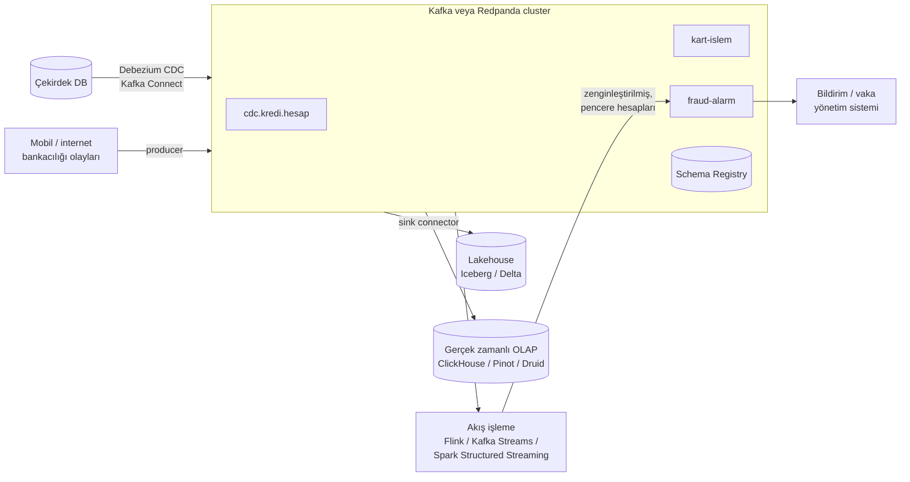

# 11.11 Streaming Platformları: Kafka ve Redpanda, Teslim Garantileri ve Akış İşleme

## Nedir?
Kafka'nın temel kavramları (topic, partition, offset, consumer group) [11.7](07-kafka.md)'de anlatıldı. Bu sayfa bir streaming platformunu **işletirken ve üzerine sistem kurarken** karşılaşılan konuları ele alır:

- **Apache Kafka:** JVM üzerinde çalışan, dağıtık ve kalıcı olay günlüğü (log). Kafka 4.0 (2025) ile ZooKeeper tamamen kaldırıldı; cluster yönetimi yerleşik **KRaft** protokolüyle yapılır.
- **Redpanda:** **Kafka API'siyle uyumlu**, C++ ile yazılmış, tek bir çalıştırılabilir dosya olarak gelen streaming platformu. Kafka istemcileri, Kafka Connect ve araçları değişiklik yapmadan Redpanda'ya bağlanabilir. Yerleşik Schema Registry ve HTTP proxy içerir.

## Hangi problemi çözer?
- Kart işlemleri, uygulama olayları, CDC değişiklikleri gibi sürekli akan verinin saniyeler içinde birden çok sisteme iletilmesi
- Üretici ve tüketicilerin birbirinden bağımsız ölçeklenmesi ve birbirini beklememesi
- Olayların yeniden oynatılabilmesi (yeni bir tüketici geçmiş olayları baştan okuyabilir)
- Gerçek zamanlı fraud tespiti, anlık bildirim, canlı dashboard ve lakehouse'a sürekli yükleme

Bu sayfadaki sorular: Kafka mı Redpanda mı? Mesaj kaybolur veya iki kez işlenir mi? Şema nasıl yönetilir? Akış nasıl işlenir?

## Nasıl çalışır?

**Uçtan uca akış mimarisi**


**Kafka ve Redpanda karşılaştırması**
| | Apache Kafka | Redpanda |
|---|---|---|
| Dil / çalışma ortamı | Java/Scala (JVM) | C++; JVM yok |
| Bileşenler | Broker'lar (KRaft ile kontrolcüler); Schema Registry, Connect, REST proxy ayrı projeler | Tek binary içinde broker, Raft tabanlı yönetim, Schema Registry ve HTTP proxy |
| Protokol | Kafka protokolü (referans uygulama) | Kafka protokolüyle uyumlu |
| Performans profili | Çok yüksek hacimde kanıtlanmış; ayar gerektirir | Düşük gecikme ve daha az donanımla yüksek verim hedefler |
| İşletim | Olgun araçlar, geniş uzmanlık havuzu; Kubernetes'te Strimzi | Daha az bileşen, `rpk` CLI; Kubernetes operatörü |
| Ekosistem | En geniş (Connect konnektörleri, Streams, sayısız entegrasyon) | Kafka ekosistemini kullanır; ek olarak Redpanda Connect, Console |
| Lisans | Apache 2.0 | Topluluk sürümü kaynak kodu erişilebilir (BSL), kurumsal özellikler ticari |
| Yönetilen hizmet | Confluent Cloud, AWS MSK, Aiven, Azure Event Hubs (Kafka uyumlu uç nokta) | Redpanda Cloud / BYOC |

Seçimde belirleyici olan genellikle teknik farktan çok **kurumun işletim kapasitesi, destek modeli ve lisans politikasıdır**. Bankalarda Kafka (çoğu zaman ticari destekli dağıtımlarla, ör. Confluent Platform veya Red Hat Streams for Apache Kafka) yaygındır.

**Teslim garantileri (delivery semantics)**
| Garanti | Anlamı | Nasıl sağlanır? |
|---|---|---|
| **At-most-once** (en fazla bir kez) | Mesaj kaybolabilir, tekrar etmez | Tüketici işlemeden önce offset'i işler |
| **At-least-once** (en az bir kez) | Kaybolmaz ama **tekrar edebilir** | İşledikten sonra offset işlenir; varsayılan ve en yaygın |
| **Exactly-once** (tam bir kez) | Ne kaybolur ne tekrar eder (Kafka içinde) | İdempotent producer + transaction'lar + `read_committed` tüketici; ya da at-least-once + **idempotent tüketici** |

Pratik kural: Dış sistemlere (veritabanı, API) yazan tüketicilerde uçtan uca exactly-once zordur. Bunun yerine her olaya benzersiz bir kimlik (`islem_id`) verip hedefte **upsert/MERGE** veya "daha önce işlendi mi?" kontrolü yapılır.

**Güvenilir üretici ayarları**
| Ayar | Önerilen | Neden? |
|---|---|---|
| `acks` | `all` | Mesaj tüm senkron kopyalara yazılmadan başarılı sayılmaz |
| `enable.idempotence` | `true` | Ağ hatasında yeniden gönderimler kopya üretmez |
| `min.insync.replicas` (topic) | `2` (replication factor 3 iken) | Bir broker kaybında veri kaybını önler |
| Key seçimi | İş anahtarı (`kart_no`, `hesap_no`) | Aynı varlığın olayları aynı partition'da ve sıralı |

**Şema yönetimi (Schema Registry)**
- Mesajlar Avro, Protobuf veya JSON Schema ile tanımlanır; şema registry'de sürümlenir, mesajda sadece şema kimliği taşınır.
- **Uyumluluk kuralı** (ör. `BACKWARD`): Yeni şemanın eski tüketicileri bozup bozmadığı yayından önce kontrol edilir. Bu, akış dünyasındaki **data contract** uygulamasıdır ([16.5](../16-veri-yonetisimi/05-sahiplik-data-contract.md)).
- Topic adlandırma standardı: `<alan>.<kaynak>.<varlık>.<sürüm>` (ör. `kredi.core.hesap.v1`).

**Akış işleme seçenekleri**
| Araç | Not |
|---|---|
| **Kafka Streams** | Java kütüphanesi; uygulamanın içinde çalışır, ayrı cluster gerekmez |
| **Apache Flink** | Durumlu (stateful) akış işlemede en güçlü motor; olay zamanı, pencereler, exactly-once; Flink SQL |
| **Spark Structured Streaming** | Spark ekosistemiyle birlikte; mikro-batch; lakehouse'a yazma kolay ([10.6](../10-veri-isleme/06-spark-dask.md)) |
| **ksqlDB / Redpanda Connect / Benthos tarzı araçlar** | SQL veya YAML ile basit dönüşüm ve yönlendirme |
| **Python: Faust, Bytewax, Quix Streams** | Python ekipleri için hafif akış işleme |

**Akış işlemede temel kavramlar:** Olay zamanı (event time) ile işlenme zamanı (processing time) farkı, **pencereler** (tumbling: 5 dakikalık bloklar; sliding/hopping: kayan pencereler; session: aktivite oturumları), geç gelen olaylar ve **watermark**, durum (state) ve checkpoint.

**İzlenmesi gereken metrikler:** Tüketici **gecikmesi (consumer lag)**, under-replicated partition sayısı, broker disk kullanımı, üretici hata oranı, istek gecikmesi ([14.2](../14-gozlemlenebilirlik/02-prometheus-grafana.md)).

## Mini örnek
**Redpanda'yı yerelde çalıştırmak**
```bash
docker run -d --name redpanda -p 9092:9092 -p 8081:8081 \
  redpandadata/redpanda:latest redpanda start --mode dev-container --smp 1 \
  --kafka-addr 0.0.0.0:9092 --advertise-kafka-addr localhost:9092
# 8081: yerleşik Schema Registry

docker exec -it redpanda rpk topic create kart-islem -p 6
docker exec -it redpanda rpk topic list
docker exec -it redpanda rpk topic produce kart-islem --key 5400123412341234
docker exec -it redpanda rpk topic consume kart-islem --offset start
docker exec -it redpanda rpk group describe fraud-servisi      # tüketici gecikmesi
```
Aynı Python/Java Kafka istemcileri `localhost:9092` adresiyle değişiklik yapmadan çalışır. Canlı ortamda `latest` yerine sabit sürüm etiketi kullanın.

**Güvenilir üretici (confluent-kafka, Python)**
```python
import json
from confluent_kafka import Producer

producer = Producer({
    "bootstrap.servers": "kafka-1.sirket.local:9093,kafka-2.sirket.local:9093",
    "security.protocol": "SASL_SSL", "sasl.mechanisms": "SCRAM-SHA-512",
    "sasl.username": "svc_kart", "sasl.password": PAROLA,
    "acks": "all", "enable.idempotence": True,
    "compression.type": "zstd", "linger.ms": 20,
})

def teslim_raporu(hata, mesaj):
    if hata:
        print(f"Gönderilemedi: {hata}")      # alarm / ölü mektup kuyruğu

olay = {"islem_id": "TX-20261024-000981", "kart_no_hash": "a91f...", "tutar": 1250.0,
        "ts": "2026-10-24T19:41:03+03:00"}
producer.produce("kart-islem", key=olay["kart_no_hash"], value=json.dumps(olay),
                 on_delivery=teslim_raporu)
producer.flush()
```

**At-least-once + idempotent tüketici**
```python
import json
from confluent_kafka import Consumer

consumer = Consumer({
    "bootstrap.servers": "kafka-1.sirket.local:9093", "group.id": "lakehouse-yukleyici",
    "enable.auto.commit": False,              # offset'i işledikten sonra biz işleyeceğiz
    "auto.offset.reset": "earliest", "isolation.level": "read_committed",
})
consumer.subscribe(["kart-islem"])

while True:
    mesajlar = consumer.consume(num_messages=500, timeout=1.0)
    if not mesajlar:
        continue
    kayitlar = [json.loads(m.value()) for m in mesajlar if m.error() is None]
    hedefe_upsert(kayitlar, anahtar="islem_id")   # tekrar gelirse aynı satırın üzerine yazar
    consumer.commit(asynchronous=False)            # sonra offset'i işle
```

**Spark Structured Streaming ile lakehouse'a sürekli yükleme**
```python
from pyspark.sql import functions as F

akis = (spark.readStream.format("kafka")
        .option("kafka.bootstrap.servers", "kafka-1.sirket.local:9093")
        .option("subscribe", "kart-islem")
        .option("startingOffsets", "latest")
        .load())

islemler = (akis.selectExpr("CAST(value AS STRING) AS json")
            .select(F.from_json("json", "islem_id STRING, tutar DOUBLE, ts TIMESTAMP").alias("e"))
            .select("e.*"))

(islemler.withWatermark("ts", "10 minutes")
    .groupBy(F.window("ts", "5 minutes"))
    .agg(F.sum("tutar").alias("tutar_5dk"), F.count("*").alias("adet"))
    .writeStream.format("delta").outputMode("append")
    .option("checkpointLocation", "s3a://veri-lake/_checkpoints/kart_5dk")
    .start("s3a://veri-lake/silver/kart_islem_5dk"))
```

**Debezium ile CDC (Kafka Connect konnektör tanımı)**
```json
{
  "name": "core-kredi-cdc",
  "config": {
    "connector.class": "io.debezium.connector.postgresql.PostgresConnector",
    "database.hostname": "pg-core.sirket.local",
    "database.port": "5432",
    "database.user": "svc_debezium",
    "database.password": "${file:/opt/secrets/cdc.properties:parola}",
    "database.dbname": "core",
    "topic.prefix": "cdc",
    "table.include.list": "kredi.hesap,kredi.teminat",
    "plugin.name": "pgoutput",
    "snapshot.mode": "initial"
  }
}
```
Debezium, Kafka Connect ve Redpanda üzerinde aynı şekilde çalışır; kaynak veritabanında mantıksal replikasyon (PostgreSQL) veya LogMiner/XStream (Oracle) yetkisi gerektirir ([11.3](03-yukleme-turleri.md)).

## Nerede kullanılır?
- Kart işlemlerinde gerçek zamanlı fraud skorlaması ve alarm üretimi
- Çekirdek sistemlerden CDC ile analitik ortama gecikmesiz aktarım
- Mikroservisler arası olay tabanlı iletişim (hesap açıldı, limit değişti)
- Mobil ve internet bankacılığı kullanıcı olaylarının toplanması
- Gerçek zamanlı dashboard'lar ve operasyonel izleme

## Benzerleri ve farkları
- **Klasik mesaj kuyrukları (IBM MQ, RabbitMQ):** Mesaj okununca silinir; görev dağıtımı ve işlem garantili mesajlaşma için. Kafka/Redpanda ise kalıcı log; yeniden okuma ve çoklu bağımsız tüketici ([11.7](07-kafka.md)).
- **Apache Pulsar:** Depolama ile hesaplamayı ayıran, çoklu kiracılık ve coğrafi replikasyonu güçlü alternatif.
- **WarpStream, AutoMQ ve benzerleri:** Kafka protokolünü nesne depolama (S3) üzerinde çalıştıran yeni nesil, disk yönetimi gerektirmeyen yaklaşımlar ([9.15](../09-veri-depolama/15-nesne-depolama.md)).
- **Batch ile karşılaştırma:** Her iş gerçek zamanlı olmak zorunda değildir; günlük raporlar için batch daha basit ve ucuzdur ([11.6](06-batch-streaming.md)).

## İlgili sayfalar
- [11.7 Mesaj kuyrukları ve Kafka](07-kafka.md)
- [11.6 Batch ve streaming](06-batch-streaming.md)
- [11.3 Yükleme türleri ve CDC](03-yukleme-turleri.md)
- [17.9 Avro ve diğer formatlar](../17-formatlar/09-digerleri.md)
