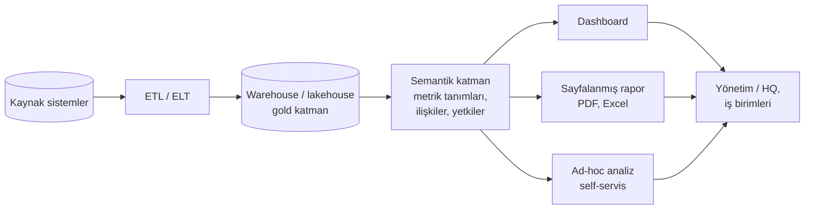

# 12.1 BI Nedir

## Nedir?
**BI (Business Intelligence — İş Zekâsı)**, kurumun verisini toplayıp anlamlı **raporlar, göstergeler (KPI) ve dashboard'lar** hâline getirerek karar alıcıların kullanımına sunan süreçlerin, araçların ve yöntemlerin bütünüdür.

Kısaca: "Veride ne oldu ve neden oldu?" sorusunu cevaplayıp karar alıcıya ulaştırmak.

## Hangi problemi çözer?
- Yönetim, aynı soruyu (şube performansı, kredi büyümesi, NPL oranı) her ay farklı kişilerden, farklı Excel'lerle, farklı rakamlarla alır.
- Rapor hazırlamak günler sürer ve elle yapıldığı için hata içerir.
- İş birimleri veriye ulaşmak için hep veri ekibine bağımlıdır.

BI ile:
- **Tek doğru kaynak (single source of truth):** Herkes aynı tanımla hesaplanmış aynı rakamı görür.
- **Self-servis:** İş birimleri hazır veri modelleri üzerinde kendi sorularını sorabilir.
- **Güncellik:** Raporlar otomatik yenilenir.

## Nasıl çalışır?

**Analitik olgunluk seviyeleri**
| Seviye | Soru | Örnek | Araç |
|---|---|---|---|
| **Betimleyici (descriptive)** | Ne oldu? | Eylülde KOBİ kredileri %3 arttı | BI, dashboard |
| **Teşhis edici (diagnostic)** | Neden oldu? | Artışın %70'i İç Anadolu bölgesinden | BI, detaya inme (drill-down) |
| **Tahmin edici (predictive)** | Ne olacak? | Önümüzdeki 3 ayda büyüme yavaşlayacak | ML, istatistik |
| **Yönlendirici (prescriptive)** | Ne yapmalıyız? | Bu segmentte fiyatlama şu şekilde ayarlanmalı | Optimizasyon, karar modelleri |

BI genellikle ilk iki seviyeyi kapsar; ML ve ileri analitik diğer ikisini.

**Temel kavramlar**
| Kavram | Anlamı |
|---|---|
| **KPI** | Hedefe göre izlenen ana gösterge (kredi büyümesi, NPL oranı, mevduat payı) |
| **Ölçü (measure)** | Toplanan sayısal değer (bakiye, adet) |
| **Boyut (dimension)** | Ölçünün kırıldığı nitelik (dönem, segment, şube, ürün) |
| **Semantik katman** | "Net kredi büyümesi"nin tek bir yerde, tek bir formülle tanımlanması; tüm raporlar bu tanımı kullanır |
| **Drill-down / drill-through** | Özetten ayrıntıya inmek (bölge → şube → müşteri) |
| **Satır seviyesinde güvenlik (RLS)** | Kullanıcının sadece yetkili olduğu satırları görmesi (bölge müdürü kendi bölgesini) |
| **Dashboard ile rapor** | Dashboard: etkileşimli, bir bakışta durum. Sayfalanmış rapor (paginated): sabit formatlı, basılabilir, düzenleyici raporlar için |

## Mini örnek
Bir BI çözümünün tasarım adımları (aylık kredi dashboard'u):
1. **Soru:** Yönetim hangi kararı verecek? → "Hangi segment ve bölgelerde kredi büyümesi hedefin altında?"
2. **KPI tanımı:** `Kredi büyümesi (YoY) = (Bu ay bakiye / Geçen yıl aynı ay bakiye) − 1`, kaynak tablo: `gold.kredi_metrik`
3. **Boyutlar:** Dönem, segment, bölge, ürün
4. **Veri modeli:** Yıldız şeması — `fact_kredi_bakiye` + `dim_tarih`, `dim_sube`, `dim_urun` ([9.1](../09-veri-depolama/01-oltp-olap.md))
5. **Görselleştirme:** Üstte KPI kartları, ortada zaman serisi, altta segment × bölge tablosu ([12.4](04-dashboard-tasarimi.md))
6. **Yetki:** Bölge müdürleri için satır seviyesinde güvenlik
7. **Yenileme:** Her iş günü 08:00, ETL tamamlanınca

## Nerede kullanılır?
- Yönetim ve HQ dashboard'ları, KPI takibi
- Şube ve portföy performans raporları
- Risk raporları (NPL, konsantrasyon, limit kullanımı)
- Düzenleyici raporların görselleştirilmiş kontrol ekranları

## Benzerleri ve farkları
- **BI ile veri bilimi:** BI geçmişi ve bugünü anlatır, standart ve tekrarlanan sorulara cevap verir. Veri bilimi tahmin ve keşif yapar; sonuçları çoğu zaman yine BI ekranlarında sunulur.
- **BI ile Excel:** Excel esnek ve yaygındır ama tek doğru kaynak, otomatik yenileme ve yetki yönetimi zayıftır. BI araçları Excel'e dışa aktarımı destekler.
- **Gömülü analitik (embedded analytics):** Dashboard'ların bir uygulamanın içine yerleştirilmesi.
- **Doğal dil ile BI:** Yeni nesil araçlar, "Geçen ay en çok büyüyen segment hangisi?" gibi soruları semantik katman üzerinden SQL'e çevirebiliyor; doğruluk için iyi tanımlanmış metrikler şarttır.

## İlgili sayfalar
- [12.2 BI araçları](02-bi-araclari.md)
- [12.4 Dashboard tasarımı](04-dashboard-tasarimi.md)
- [0.2 Veriden rapora](../00-buyuk-resim/02-veriden-rapora.md)
