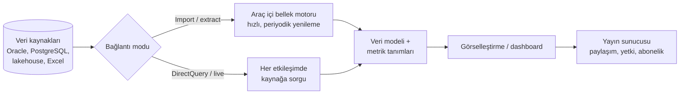

# 12.2 BI Araçları: Power BI, Tableau, Qlik, Superset

## Nedir?
Veri kaynaklarına bağlanıp, veri modeli kurmayı, metrik tanımlamayı, görselleştirmeyi ve raporları kullanıcılarla güvenli biçimde paylaşmayı sağlayan yazılımlardır.

## Hangi problemi çözer?
Kod yazmadan (veya az kodla) etkileşimli dashboard üretmeyi, raporların otomatik yenilenmesini, yetkilendirmeyi ve kurum içinde paylaşımı tek platformda toplar. Doğru araç seçimi; lisans maliyeti, mevcut altyapı (Microsoft, Oracle vb.), kullanıcı profili ve kurum içi kurulum gereksinimine bağlıdır.

## Nasıl çalışır?
Çoğu BI aracı benzer bileşenlerden oluşur:



| Bileşen | Açıklama |
|---|---|
| **Masaüstü / web tasarım aracı** | Rapor geliştirme (Power BI Desktop, Tableau Desktop) |
| **Bağlantı modu** | **Import:** Veri aracın belleğine alınır, çok hızlı ama periyodik yenilenir. **DirectQuery / live:** Her tıklamada kaynağa sorgu gider, güncel ama kaynağın hızına bağlı |
| **Veri modeli ve hesaplama dili** | Tablolar arası ilişkiler ve metrik formülleri (Power BI: DAX, Tableau: calculated fields/LOD, Qlik: set analysis) |
| **Yayın sunucusu** | Paylaşım, yetki, zamanlanmış yenileme, e-posta abonelikleri (Power BI Service / Report Server, Tableau Server/Cloud, Qlik Sense Enterprise) |

**Araç karşılaştırması**
| Özellik | Power BI | Tableau | Qlik Sense | Apache Superset | Metabase |
|---|---|---|---|---|---|
| Lisans | Ticari (Microsoft) | Ticari (Salesforce) | Ticari | Açık kaynak | Açık kaynak + ticari |
| Güçlü yanı | Microsoft ekosistemi, maliyet, DAX ile güçlü modelleme | Görselleştirme esnekliği ve keşif | İlişkisel (associative) bellek motoru, keşif | SQL odaklı, kurum içi kurulum, ölçeklenebilir | Çok kolay kullanım |
| Hesaplama dili | DAX, Power Query (M) | Calculated fields, LOD | Qlik script, set analysis | SQL, Jinja | SQL, görsel sorgu |
| Kurum içi kurulum | Power BI Report Server (sınırlı) | Tableau Server | Evet | Evet (Docker/Kubernetes) | Evet |
| Kullanıcı profili | İş analisti, geniş kitle | Analist, veri görselleştirme uzmanı | İş analisti | Veri ekibi, SQL bilen analist | İş birimleri |

Diğerleri: **Oracle Analytics**, **SAP Analytics Cloud**, **Looker** (Google; güçlü semantik katman LookML), **Microsoft Fabric** (Power BI'ı lakehouse ile birleştiren platform).

## Mini örnek
Aynı metrik ("Yıllık kredi büyümesi") farklı araçlarda:

**Power BI (DAX)**
```dax
Toplam Bakiye = SUM ( fact_kredi[bakiye] )

Bakiye Geçen Yıl =
    CALCULATE ( [Toplam Bakiye], SAMEPERIODLASTYEAR ( dim_tarih[tarih] ) )

YoY Büyüme % =
    DIVIDE ( [Toplam Bakiye] - [Bakiye Geçen Yıl], [Bakiye Geçen Yıl] )
```

**Tableau (calculated field)**
```text
// Table calculation: aynı segmentte 12 ay önceye göre
(SUM([Bakiye]) - LOOKUP(SUM([Bakiye]), -12)) / ABS(LOOKUP(SUM([Bakiye]), -12))
```

**Superset (SQL dataset + metrik)**
```sql
-- Dataset olarak kaydedilen sorgu
SELECT donem, segment, bakiye, yoy_yuzde
FROM gold.kredi_metrik
```
Metrik hesabı veri ambarında (dbt modeli) yapılmışsa, BI aracı sadece gösterir. Bu yaklaşım **metriklerin tek yerde tanımlanmasını** sağlar ve farklı araçlar arasında tutarlılığı korur.

Superset'i denemek:
```bash
docker run -d -p 8088:8088 -e SUPERSET_SECRET_KEY=degistir --name superset apache/superset
# yönetici oluşturma ve başlatma adımları için resmi dokümana bakın
```

## Nerede kullanılır?
- **Power BI:** Microsoft 365 kullanan kurumlarda yaygın; Türkiye'deki bankalarda sık görülür.
- **Tableau / Qlik:** Uzun süredir kurulu, görselleştirme odaklı BI ortamları.
- **Superset / Metabase:** Açık kaynak tercih eden, kurum içi ve Kubernetes'te çalışan veri ekipleri; iç araçlar.
- **Oracle Analytics:** Oracle veri ambarı ağırlıklı kurumlar.

## Benzerleri ve farkları
- **BI aracı ile Grafana:** Grafana operasyonel/zaman serisi izleme içindir; iş raporlaması için BI aracı daha uygundur ([12.3](03-grafana.md)).
- **BI aracı ile Streamlit/Dash:** Kod tabanlı uygulamalar; özel etkileşim, model sonuçları ve "what-if" senaryoları için esnek, standart raporlamada daha fazla geliştirme ister ([12.5](05-streamlit.md)).
- **Metrik nerede hesaplanmalı?** Mümkün olduğunca veri katmanında (SQL/dbt, gold tablolar). BI aracına özel formüllere gömülen iş kuralları, araç değişince kaybolur ve farklı raporlarda farklı sonuç verebilir.

## İlgili sayfalar
- [12.1 BI nedir](01-bi-nedir.md)
- [12.3 Grafana](03-grafana.md)
- [12.5 Streamlit](05-streamlit.md)
